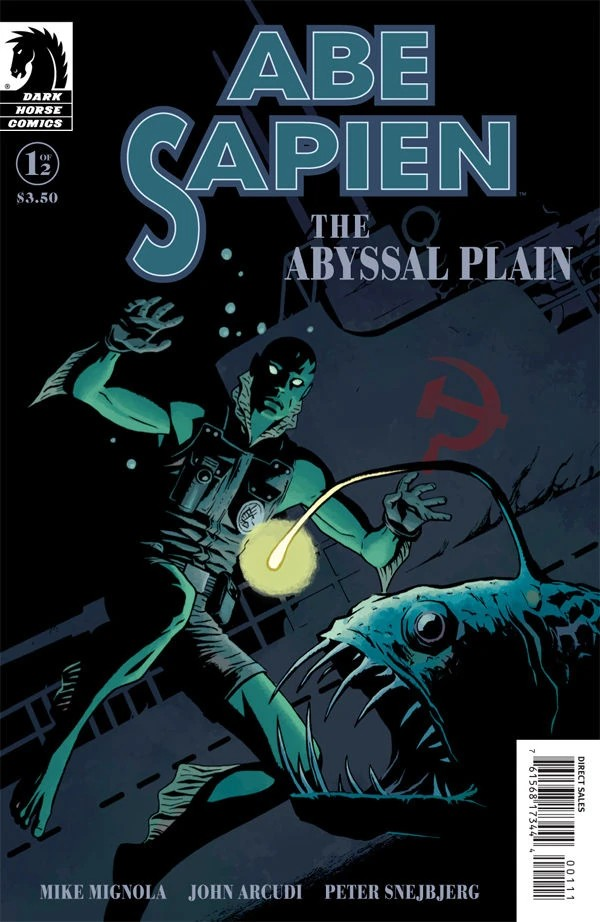

**Peter Snejbjerg Nielsen** is a Danish comic book artist. Some of his major works include the epic science-fiction/fantasy series *Hypernauten*, the adventure story *The Hidden Protocol* (Den Skjulte Protokol), the DC Comics title *Starman*, and various Vertigo titles.

### Interior Artist

- [*B.P.R.D.: War on Frogs* \#4](/entry/War_on_Frogs)
- [Abe Sapien: The Abyssal Plain](/entry/The_Abyssal_Plain)
- [*B.P.R.D.: Hell on Earth—A Cold Day in Hell*](/entry/A_Cold_Day_in_Hell)
- [*B.P.R.D.: Hell on Earth—Nowhere, Nothing, Never*](/entry/Nowhere%2C_Nothing%2C_Never)
- [*Lobster Johnson: The Forgotten Man*](/entry/The_Forgotten_Man)

### Cover Artist

## External Links

- [**Wikipedia:** Peter Snejbjerg](https://en.wikipedia.org/wiki/Peter_Snejbjerg)
- [**Comic Book DB:** Peter Snejbjerg](http://comicbookdb.com/creator.php?ID=283)
- [Peter Snejbjerg's official blog](http://www.snejbjerg.com/)

## Gallery

|Abe Sapien: The Abyssal Plain #1 variant
