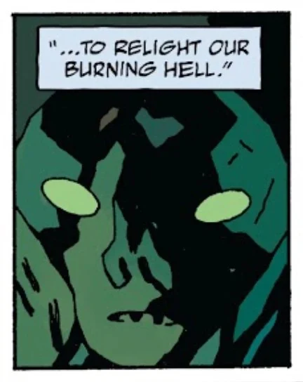

**Pluto** is the former ruler of [Hell](/entry/Hell) before the rise of [Satan](/entry/Satan) and his demons. In Roman culture he was known as the Lord of the Underworld. He first appeared in [For Whom the Bell Tolls.](/entry/For_Whom_the_Bell_Tolls)

Within the story of Hellboy he has largely been an unseen figure, though it's implied that he will be serving as a major antagonist in the post [Ogdru Jahad](/entry/Ogdru_Jahad)-world.

## History

### Origin

Pluto was originally one of the [Watchers](/entry/Watchers) that was cast from Earth for creating the [Ogdru Jahad](/entry/Ogdru_Jahad). He was made leader of the Watchers sentenced to Hell.

After the Second Fall of the Angels, Satan and his band of followers were cast into the Pit, where they waged a thousand-year war with Pluto's followers. Satan was eventually victorious and declared Hell his kingdom. The remaining Watchers from the First Fall of the Angels were enslaved and made to build [Pandemonium](/entry/Pandemonium). Pluto was the only Watcher to escape into the [Abyss](/entry/Abyss).

### [For Whom the Bell Tolls](/entry/For_Whom_the_Bell_Tolls)

After [Hellboy](/entry/Hellboy) murdered Satan in his sleep, the death of the King of Hell precipitated a slave rebellion that nearly killed a majority of the demonic hierarchy. The surviving demon lords rallied to Beelzebub's castle at the edge of Hell. Worried for their safety and the diminished fire in Hell, Beelzebub proposed to call forth Pluto so he may take Satan's place to re-establish order. The plan to locate the former king of Hell was never carried out as the demon lords were all massacre by a combined onslaught from Hellboy and a mob of vengeful slaves.[1]

### [Koshchei the Deathless](/entry/Koshchei_the_Deathless)

When Hellboy met [Koshchei](/entry/Koshchei_%28character%29) in Hell, who was searching for his lost soul, the former warned him that Pluto was still on the loose.[2]

### [Acheron](/entry/Acheron_%28story%29)

Pluto, still imprisoned in [Tartarus](/entry/Tartarus), reached out to [Eligos](/entry/Eligos) offering him power in exchange for the demon knight in freeing him. Eligos accepted to pave way for his return, setting his sights on using his newfound power to kill [Edward Grey](/entry/Edward_Grey). His champion though was defeated after Grey embraced his demonic nature becoming the embodiment of [Acheron](/entry/Acheron_%28river%29).[3]

### [Koshchei in Hell](/entry/Koshchei_in_Hell)

Sir Edward Grey is worried that Pluto is on his way back to destroy all living things and pleads [Koshchei](/entry/Koshchei_%28character%29) to stop him. The Slavic warriors eventually agrees and hears from Hellboy's vampire bride that [Gamori](/entry/Gamori)'s scream over Satan's corpse has awakened Pluto, who is on his way back.

## Powers & Abilities

According to [Beelzebub](/entry/Beelzebub), Pluto had power to reignite Hell's power with his cold heart. He had at his command the [Erinyes](/entry/Erinyes) who sought and punished men and gods that escaped justice.[4] It is likely that he was the third most powerful of all Watchers and Demons, after Satan and Anum.

## Gallery

PlutoCloseupByMikeMignola.jpg

|
## References

<references />

[1] *[Hellboy in Hell](/entry/Hellboy_in_Hell)* \#10

[2] *[Koshchei the Deathless](/entry/Koshchei_the_Deathless)* \#6

[3] *[Acheron](/entry/Acheron_%28story%29)*

[4] *[Hellboy in Hell](/entry/The_Hounds_of_Pluto)* \#8
