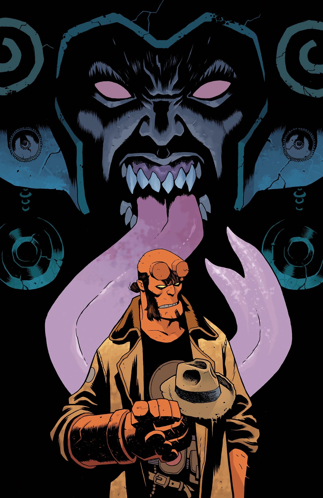

***Professor Harvey Is Gone*** is a *[Hellboy and the B.P.R.D.](/entry/Hellboy_and_the_B.P.R.D.)* one-shot written by [Mike Mignola](/entry/Mike_Mignola) and [Christopher Golden](/entry/Christopher_Golden) and illustrated by [Giuseppe Manunta](/entry/Giuseppe_Manunta) in his Hellboy Universe debut. The story is a loose adaptation of the prose short story *[The City in the Sea](/entry/The_City_in_the_Sea)* by Mike Mignola and [Christopher Golden](/entry/Christopher_Golden).

## Synopsis

When a paranoid antiquities professor goes missing, Hellboy and the Bureau of Paranormal Research and Defense leap into action, but their search takes a dangerous turn as whoever was after the professor sets their sights on Hellboy.

## Gallery

*Hellboy and the B.P.R.D.: Professor Harvey Is Gone*  
cover by Giuseppe Manunta

*Hellboy and the B.P.R.D.: Professor Harvey Is Gone*  
variant cover by Mike Mignola  
with colors by Dave Stewart

*Hellboy and the B.P.R.D.: Professor Harvey Is Gone*  
Nirvana Comics exclusive variant cover by Ben Stenbeck

|Hellboy and the B.P.R.D.: Professor Harvey Is Gone Nirvana Comics exclusive variant cover by Ben Stenbeck
