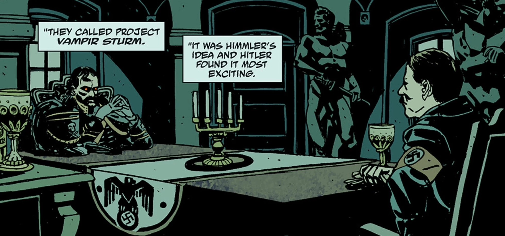

**Project Vampir Sturm** was a Nazi doomsday experiment created by [Heinrich Himmler](/entry/Heinrich_Himmler) to create an army of vampires.

## History

Vampir Sturm was proposed by Himmler and approved by [Adolf Hitler](/entry/Adolf_Hitler) in October 1944. Himmler dispatched a Nazi delegation led by [Ilsa Haupstein](/entry/Ilsa_Haupstein) to Castle Giurescu in Romania to recruit [Vladimir Giurescu](/entry/Vladimir_Giurescu) into the German war effort. Giurescu personally met with Hitler in December 1944, but the meeting caused Hitler to realize that an army of such creatures would be absolutely uncontrollable. Giurescu and his accompanying brides were arrested and executed. Haupstein, who had fallen as deeply in love with Giurescu as his brides, was devastated; though her devotion to the Nazis' ideals remained strong, she dismissed Hitler as a pathetic weakling who was afraid of being overshadowed by Giurescu's greatness.

However, Project Vampir Sturm was not abandoned, but rather refined. One of Giurescu's brides, Anna, was completely drained of her blood, which was taken to a laboratory in Berlin, concealed beneath the Ritter Institute for the Mentally Unstable. With the blood, the Nazis attempted to create vampire hybrids which could be controlled, unlike vampires created by Giurescu. The initial test subjects were nine handpicked members of the *Schutzstaffel* attached to the *Werwolf* insurgency division. Unfortunately, five instantly died and the remaining four mutated into rabid, deformed beasts.

Accepting that it was hopeless to create vampire soldiers who could turn the tide of the war, the Nazis changed Vampir Sturm for the last time, to create a swarm of these beasts which could be unleashed to wreak havoc upon the world if Germany were to fall to the Allies. In January 1945, 120 of the strongest patients from the Ritter Institute were injected with the vampire blood and frozen mid-transformation in liquid nitrogen.

On April 30th, 1945, as Soviet forces reached Berlin, Hitler ordered General [Frederich Manstein](/entry/Frederich_Manstein) to unfreeze the subjects of Project Vampir Sturm. However, Manstein, who has seen the errors of the Nazis, disobeyed the order and instead sealed the room containing the vampires, before leaving a letter explaining his decisions in the asylum's files.

In 1946, the frozen vampires were recovered by Doctor [Herman von Klempt](/entry/Herman_von_Klempt), who loaded them onto a rocket ship and fired towards the United States. The plot was foiled by [Trevor Bruttenholm](/entry/Trevor_Bruttenholm) and a small company of American and Soviet troops under the demon [Varvara](/entry/Varvara), and the vampires were destroyed in the ensuing explosion of von Klempt's rocket.

## Gallery

|Hitler meets Giurescu.
## See also

- [Project Ragna Rok](/entry/Project_Ragna_Rok)
