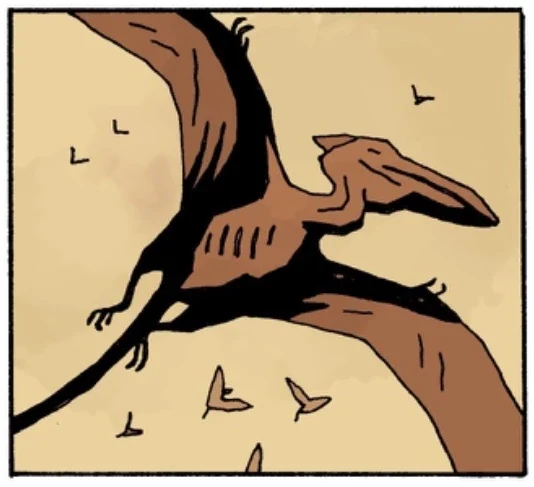

**Pterosaurs** are flying reptiles from Earth's ancient past, which were long thought to be extinct. Unknowingly to humanity, at least one species still lived in the Sancti Hyperberum, deep underground.

## Appearances

- [*Frankenstein Underground*](/entry/Frankenstein_Underground)

<!-- -->

- [*Ragna Rok*](/entry/Ragna_Rok_(story_arc))
