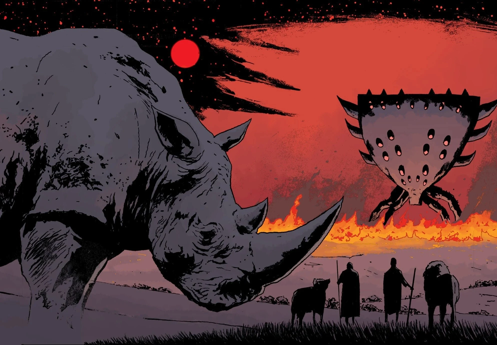
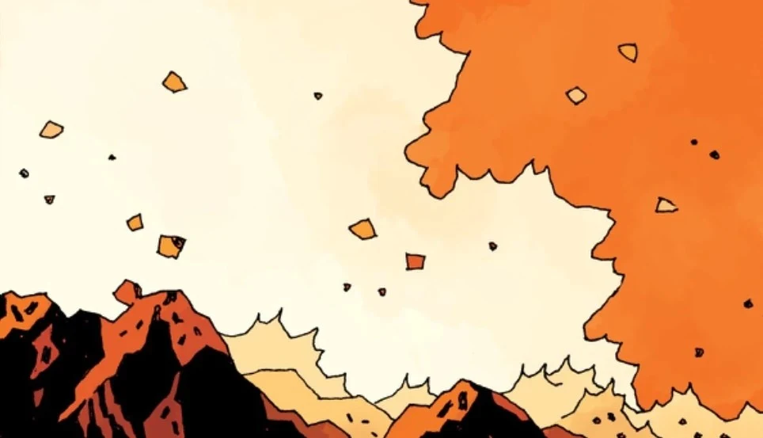
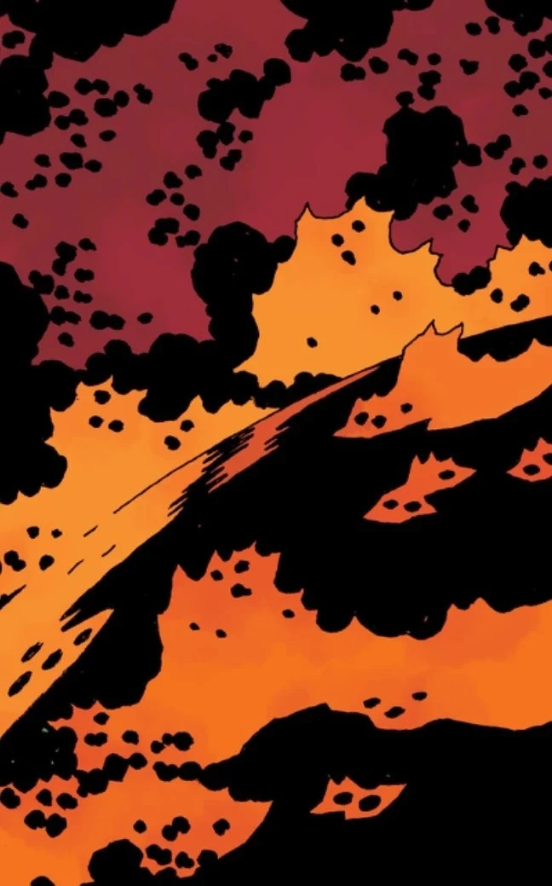
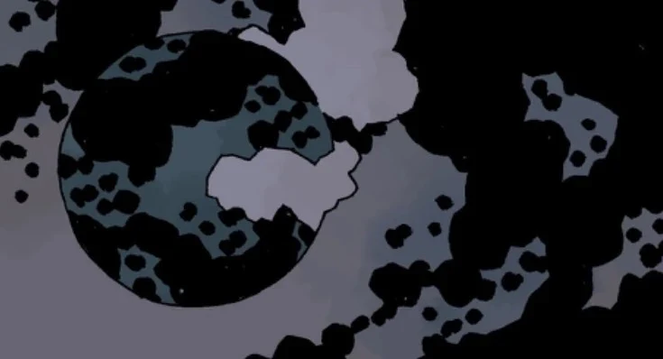

**Ragna Rok** was the destined end of the world, which was tied to [Hellboy](/entry/Hellboy_(character)), the [Right Hand of Doom](/entry/Right_Hand_of_Doom) and the [Ogdru Jahad](/entry/Ogdru_Jahad).

## Prophecies

Although many characters in the series knew of the prophecies of the end of the world, they also held a variety of interpretations at exactly how it would play out, with several common elements. The most common was that the release of the Ogdru Jahad would see the world incinerated by fire and reduced to cinder. Some believed that their release would be triggered by the extinction of humanity (either at the hands of the Ogdru Hem or otherwise) while others thought that the Dragon will be released first and it will destroy mankind itself. Thus, many of the series' villains attempted to act upon these interpretations to see the Apocalypse through or prevent it. Others foresaw that the Ogdru Hem would rule the world before it would be consumed by fire. Only a certain few, such as Rasputin, Hecate and the fae, saw the new world that was to rise in the aftermath, and with it the Third and Final Race of Man. Hecate could not see beyond the point where she and Hellboy would stand together at the end of the world, and was uncertain if they would play a part in the world to come or simply die together.

## The End and The Beginning

The eventual actualization of the Apocalypse revealed the true outcome. Rasputin returns from the dead as the host of the Ogdru Jahad, incarnating and reawakening the Ogdru Hem around the world to their full power. Hellboy and Abe Sapien perish at Rasputin's hands, with Hellboy losing the Right Hand of Doom, but not before Hellboy kills Rasputin permanently. The Ogdru Hem do have their time reigning on Earth, terrorizing the last remnants of humanity as the rest have fled to the Hollow Earth. The Osiris Club then takes the Right Hand of Doom and uses it to hurl the crystal prison of the Ogdru Jahad upon the planet, wiping them and their children out. The life force of the Dragons is funneled into the Hand, intended by the Osiris Club to bring them godhood over the new world. However the spirit of Hellboy reclaimed the Hand before they could complete their goals.

The revived Hellboy stands atop a mountain, reunited with Hecate as she had promised. Down below, they see Liz Sherman in the distance, wandering the ruined Earth in a trance. At Hellboy's urging, Liz releases all her fire, fulfilling the prophecy of the Earth burned to a cinder. Hecate opens up her iron maiden form and swallows Hellboy. She spills his blood down the mountain, bringing back water and life to the world. The eggs released from Abe Sapien's broken body hatch, bringing forth the final race of Man to inherit the flourishing new world.

## Gallery

The [Daoine Sidhe](/entry/Daoine_Sidhe) witness Ragna Rok from the vanished Isle of Britain

|The Great Spirit of Africa at Ragna Rok

|Liz Sherman igintes, beginning the end.

|The flames engulf the Earth.

|Earth after Ragna Rok.
## Appearance

- [Ragna Rok](/entry/Ragna_Rok_(story_arc))
