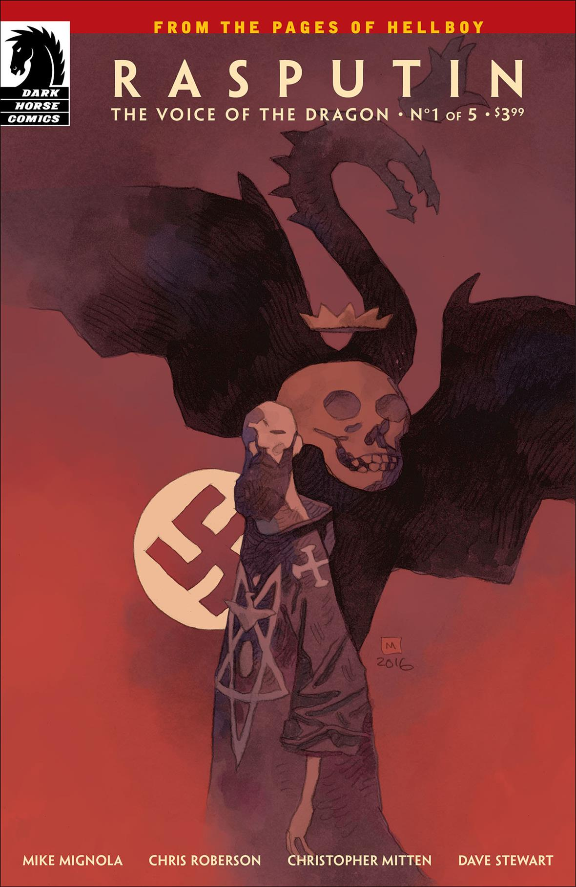
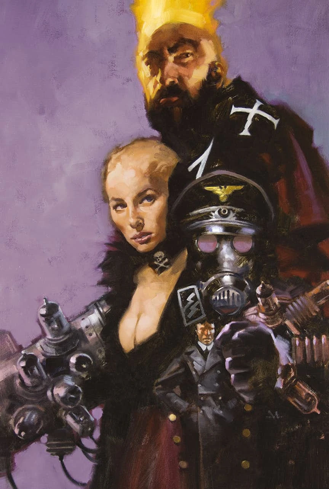
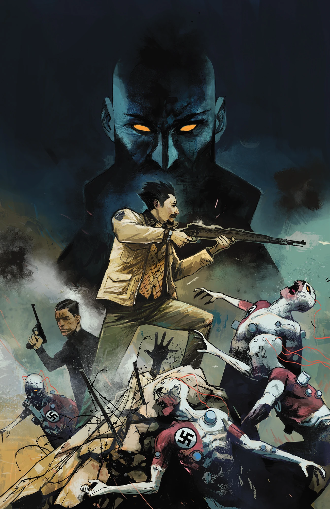
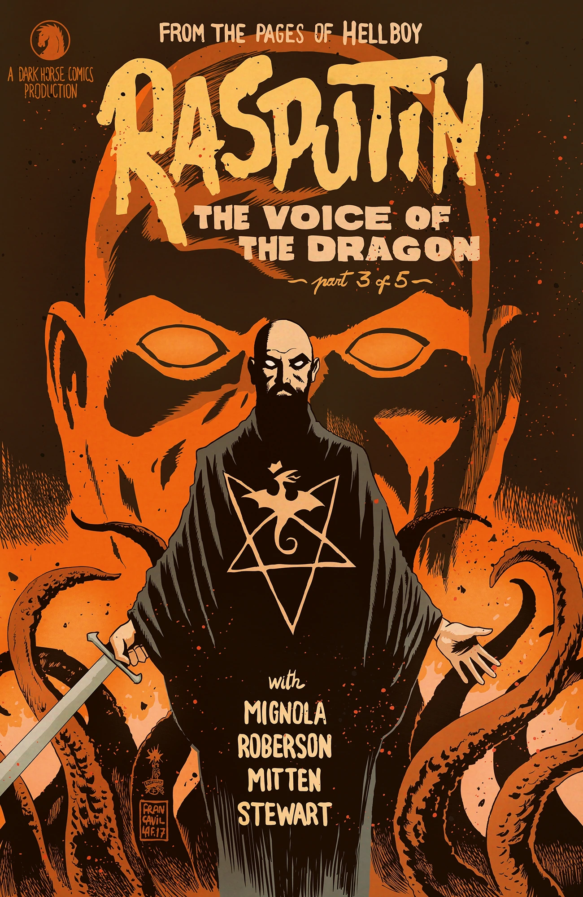
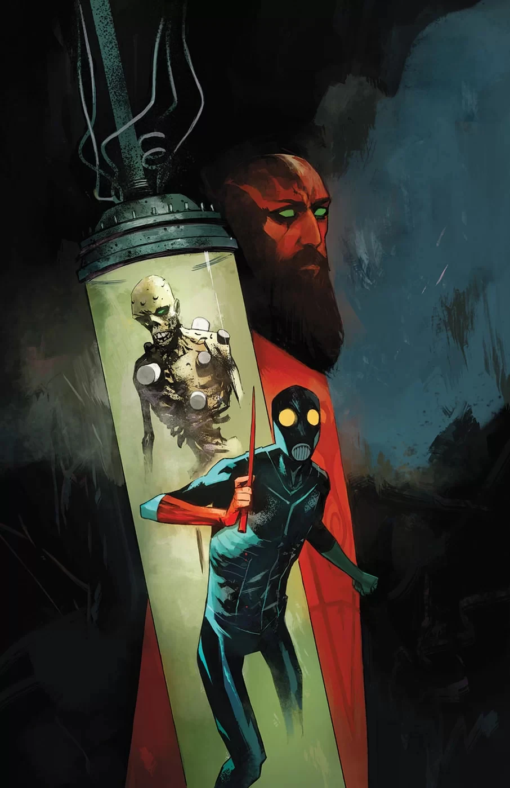
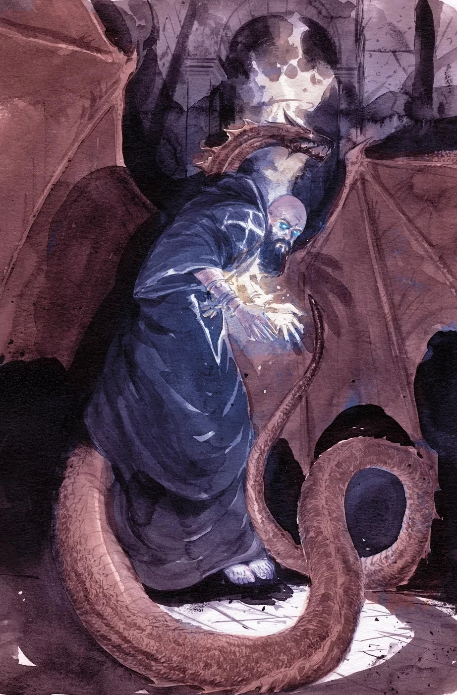
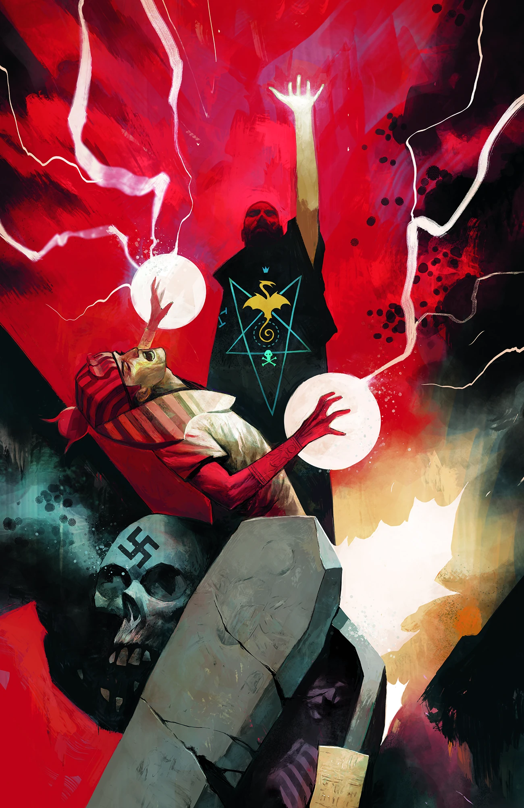

***Rasputin: The Voice of the Dragon*** is a five-issue miniseries written by Mike Mignola and Chris Roberson with art by Christopher Mitten.

## Synopsis

### Part One

A conspiracy involving the Third Reich and a dead member of a sinister secret society sets [Professor Bruttenholm](/entry/Trevor_Bruttenholm) on his first mission—to find the man who’d soon bring [Hellboy](/entry/Hellboy_%28character%29) to earth. The mad Russian sorcerer [Rasputin](/entry/Grigori_Rasputin) had been thought dead since 1916, when a group of noblemen sought to end his influence over the Tsar. Now Rasputin works with the most twisted members of [Hitler’s](/entry/Adolf_Hitler) inner circle, and he’s about to cross paths with the man who’ll go on to found the [Bureau for Paranormal Research and Defense.](/entry/Bureau_for_Paranormal_Research_and_Defense)

### Part Two

A séance reveals that Bruttenholm’s mission may be more than he bargained for when the stakes become more dangerous but the enemy only more mysterious.

### Part Three

Rasputin’s allies pursue their own goals as Professor Bruttenholm parachutes into Nazi territory in search of “The Master.”

### Part Four

Bruttenholm and [Sandhu’s](/entry/A.N._Sandhu) mission to uncover the evasive “Master” behind the Nazis occult experiments is derailed when they fall into the clutches of their enemy.

### Part Five

Bruttenholm and Sandhu reach the site of the Nazis' occult activity, where the shadowy Master himself is about to complete his occult experiment. Sandhu is casually slapped aside by Rasputin while Bruttenholm is knocked out by [Ilsa Haupstein](/entry/Ilsa_Haupstein). Rasputin is betrayed by Albert Mayhew, who attempts to absorb the energy from the wards around Eugene Remy's Tomb. Remy's ghost reanimates his body and emerges holding a large gold tablet. He reprimands Mayhew and incinerates his body and spirit, saving Rasputin the trouble of dealing with him. Rasputin leaves with Remy's tablet, which confirms that the ancients heard the voice of the [Ogdru Jahad](/entry/Ogdru_Jahad). Sandhu dies in Bruttenholm's arms.

## Gallery

All covers by [Mike Huddleston](/entry/Mike_Huddleston) unless otherwise credited.

 \#1

 \#1
(Mike Mignola variant)

 \#2

 \#2
([Gregory Manchess](/entry/Gregory_Manchess) variant)

 \#3

 \#3
([Francesco Francavilla](/entry/Francesco_Francavilla) variant)

 \#4

 \#4
(Vanesa R. Del Rey variant)

 \#5

 \#5
([Michael W. Kaluta](/entry/Michael_W._Kaluta) variant)
