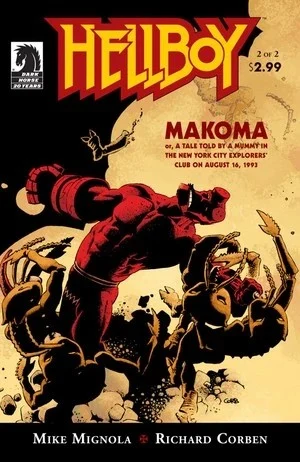
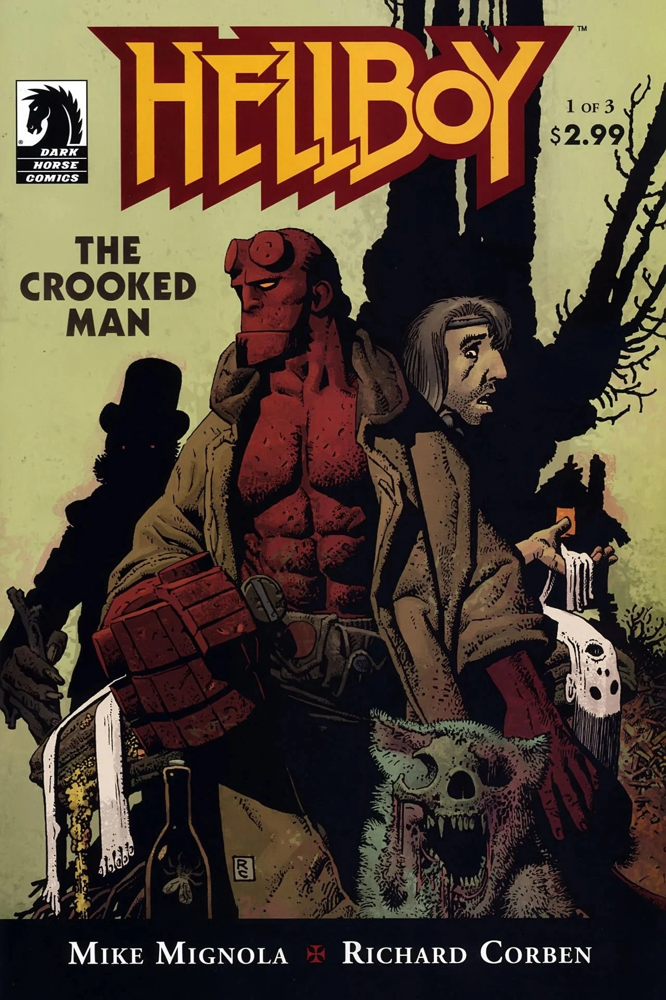
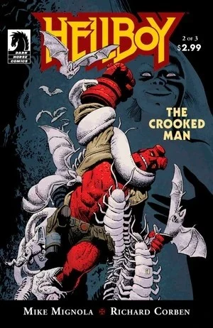
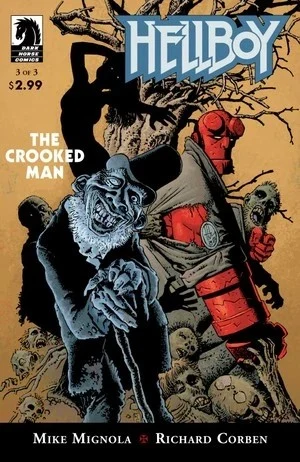
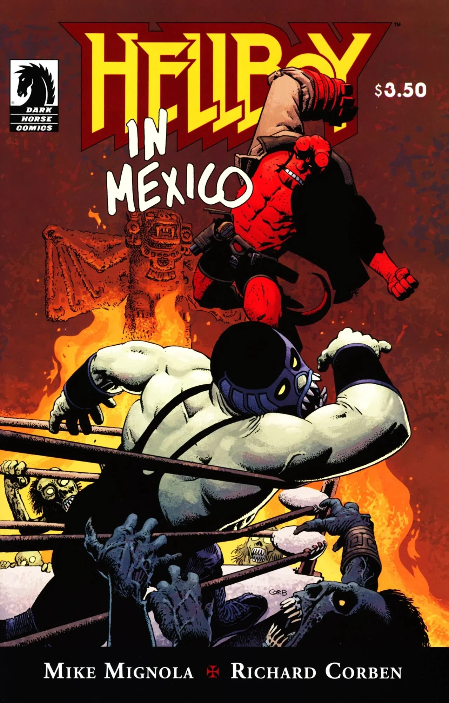
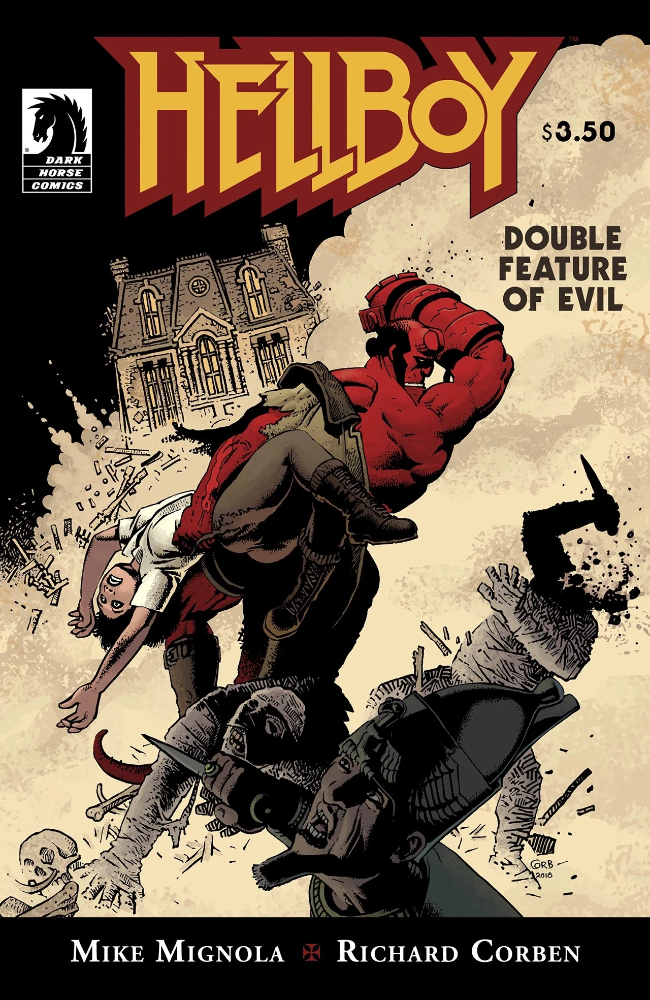
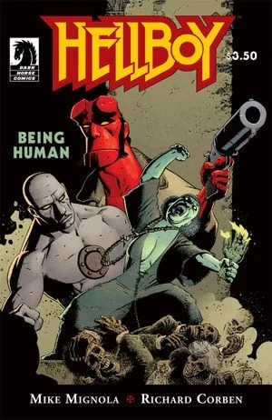

**Richard Corben** was an American comic book artist best known for his illustrated fantasy stories in *Heavy Metal* magazine.

## Interior Artist

- [*Hellboy: Makoma*](/entry/Makoma_%28story%29)
- [*Hellboy: The Crooked Man*](/entry/The_Crooked_Man_%28comic_story%29)
- [*Hellboy: The Bride of Hell*](/entry/The_Bride_of_Hell)
- [*Hellboy in Mexico* or *A Drunken Blur*](/entry/Hellboy_in_Mexico_%28story%29)
- [*Hellboy: Double Feature of Evil*](/entry/Double_Feature_of_Evil)
- [*Hellboy: Being Human*](/entry/Being_Human)
- [*Hellboy: House of the Living Dead*](/entry/House_of_the_Living_Dead)
- [*Hellboy: The Mirror*](/entry/The_Mirror)

## Cover Artist

## External links

- [**Wikipedia:** Richard Corben](https://en.wikipedia.org/wiki/Richard_Corben)
- [**Comic Book DB:** Richard Corben](http://comicbookdb.com/creator.php?ID=684)
- [Official Website](http://www.corbenstudios.com)
- [The Most Complete Comicography of Richard Corben](http://www.muuta.net)

## Gallery

|Hellboy: Makoma #2

|Hellboy: The Crooked Man #1

|Hellboy: The Crooked Man #2

|Hellboy: The Crooked Man #3

|Hellboy in Mexico

|Hellboy: Double Feature of Evil

|Hellboy: Being Human
