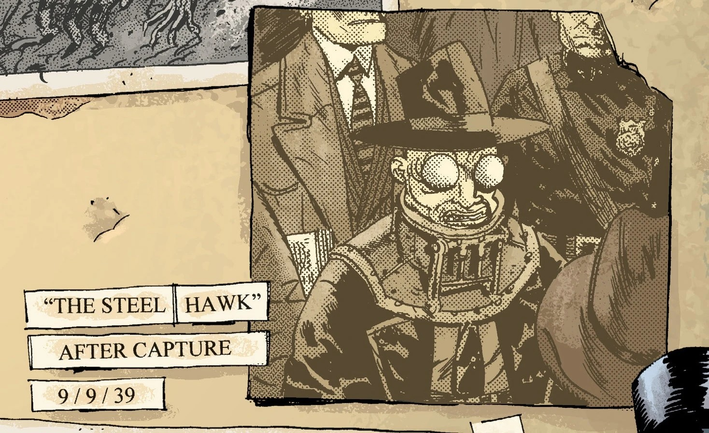
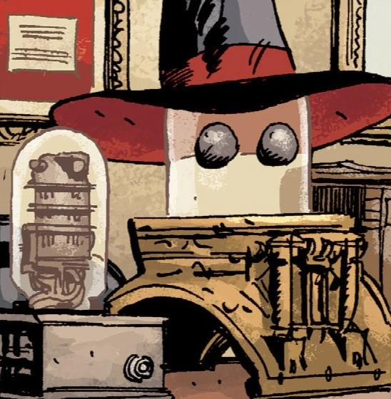
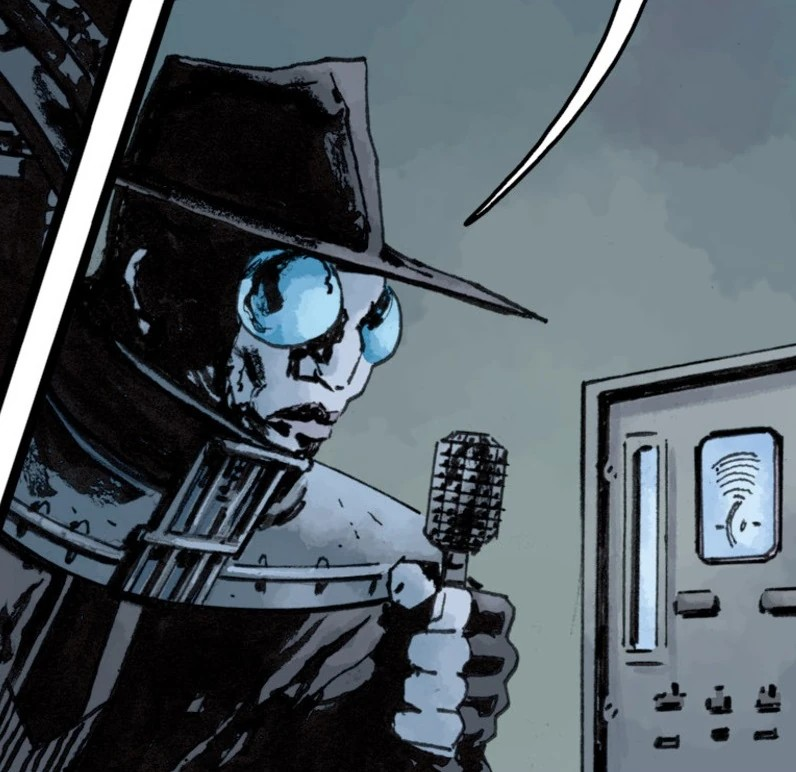
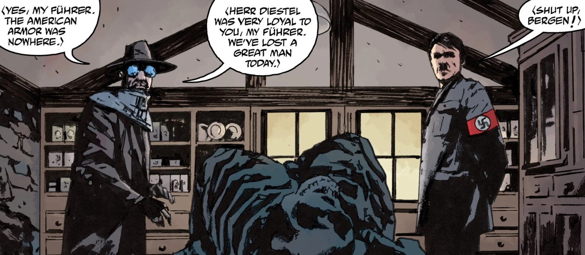
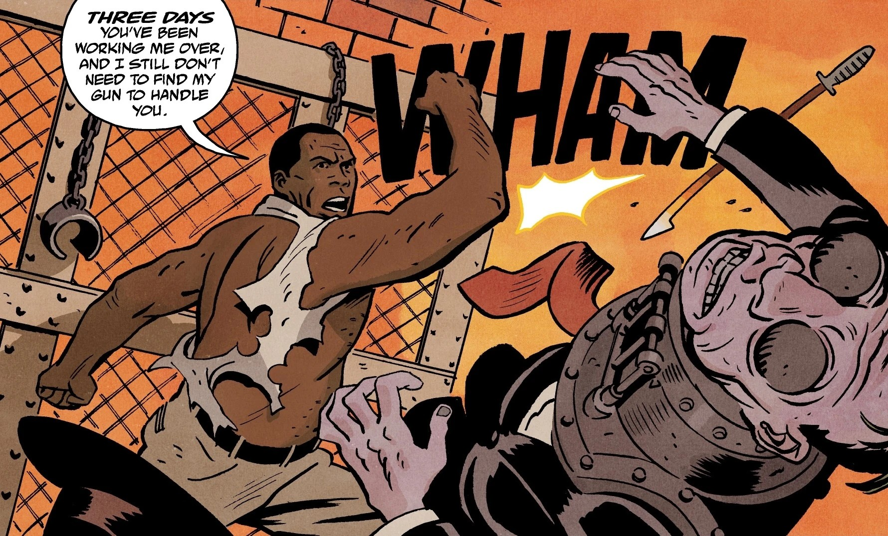

**Rudolf Bergen**, better known as **The Steel Hawk**, was a Nazi Special Agent. Little is known about him other than that he was a Nazi. He had an encounter with [The Lobster](/entry/The_Lobster) and his partner [Harry](/entry/Harold_McTell) in 1936, he was captured in 1939 by the Allies but is later seen working with [Raimund Diestel](/entry/Raimund_Diestel) (The first [Black Flame](/entry/The_Black_Flame_(character))) in 1944, eventually showing his corpse to [Hitler](/entry/Adolf_Hitler). His belongings eventually end up in [Landis Pope's](/entry/Landis_Pope) office.

## Gallery

|

|

|

|

|
