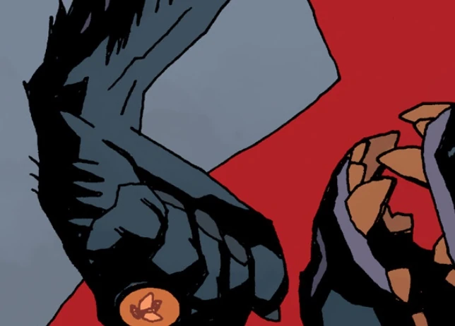

**Rumael** was a [demon](/entry/Demon) lord (possibly a Marquis or Earl) of Hell, who ruled over 32 legions of demons. He was one of the many who died during the demon riots, alongside alongside [Astaroth](/entry/Astaroth), [Orobas](/entry/Orobas), Suriel, [Beleth](/entry/Beleth), [Shax](/entry/Shax), Usiel, Raum, Semyaza, [Moloch](/entry/Moloch), Belial, Dagon and [Beelzebub](/entry/Beelzebub).

One of his serving knights became depressed following his death, seeing no purpose in existing and cut his throat.

## Apperance

- [The Spanish Bride](/entry/The_Spanish_Bride) (corpse)
