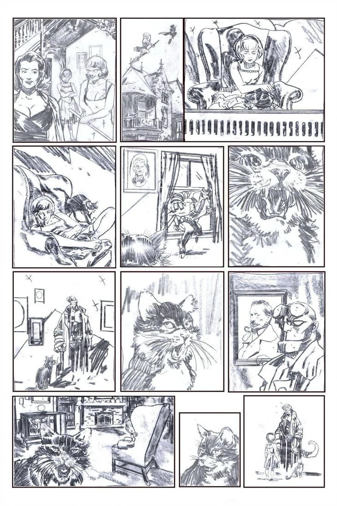
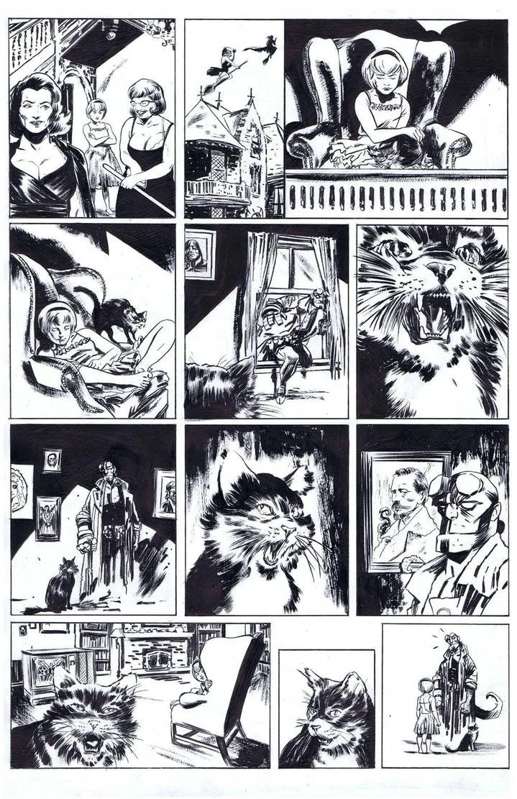
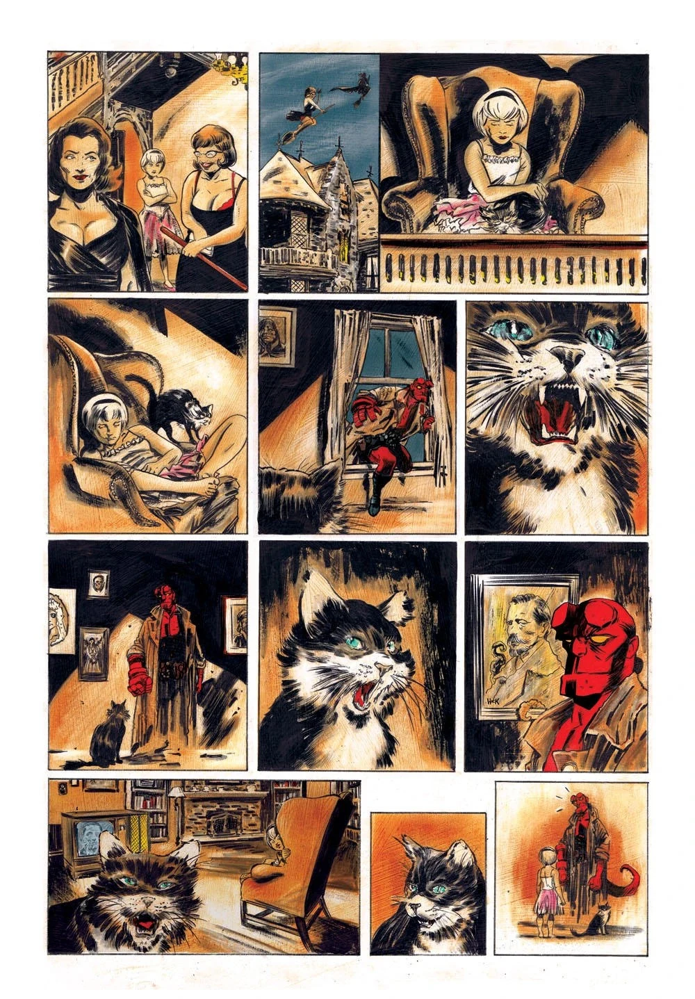

***Sabrina Meets Hellboy*** is a single-page, non-canonical story that crosses over with Chilling Adventures of Sabrina. It was published as a backup story in *Archie vs. Predator* \#1. It was written by Alex de Campi with art provided by Robert Hack and published by [Dark Horse Comics](/entry/Dark_Horse_Comics).

## Plot Synopsis

Eight year old Sabrina Spellman is left under the care of her familiar, Salem. She falls asleep watching television. While she is asleep, [Hellboy](/entry/Hellboy_(character)), on assignment for the [B.P.R.D.](/entry/B.P.R.D.), breaks into the Spellman house to interrogate Salem. The conversation between the two wakes Sabrina. Salem then introduces the "future queen of witches" to the "future king of [Hell](/entry/Hell)". Sabrina greets Hellboy by asking if he would like to "build some Lego" with her.

## Interior Art

Robert Hack has shared his pencils, inks and colors for the story to his DeviantArt page.

|Pencils

|Inks

|Colors

## External Links

- Archie vs. Predator #1 product page on DarkHorse.com
- Archie vs. Predator Hardcover Collection product page on DarkHorse.com
- Pencils on Robert Hack's DeviantArt Page
- Inks on Robert Hack's DeviantArt Page
- Colors on Robert Hack's DeviantArt Page
- Archie vs. Predator #1 entry at the Dark Horse Database
