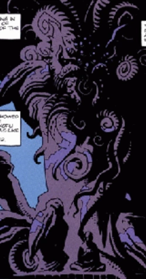
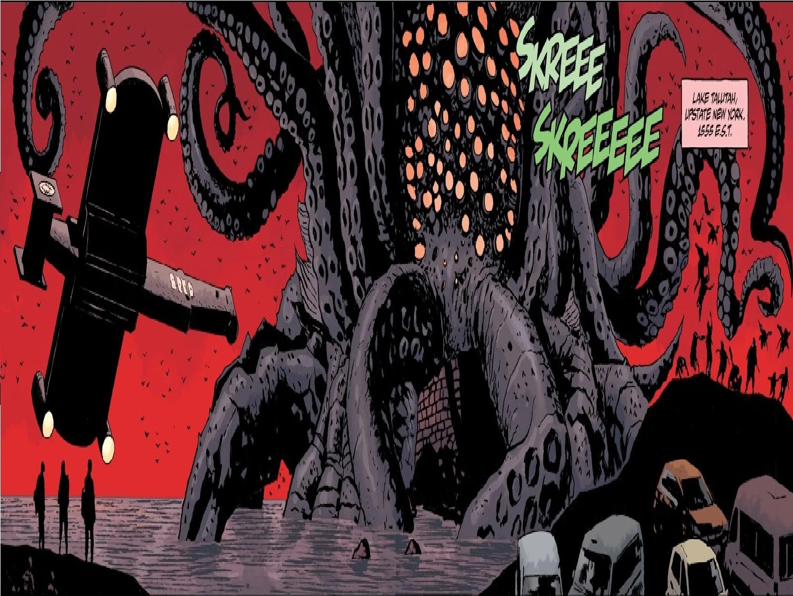

*Sadu-Hem is much improved from his former condition. He has dined well on the flesh of men from here to the arctic circle. He has sucked life from the waters of this lake.*

\- Rasputin describing Sadu-Hem.

The **Sadu-Hem** was one of the 369 [Ogdru Hem](/entry/Ogdru_Hem), the children of the [Ogdru Jahad](/entry/Ogdru_Jahad).

## History

### Origin

Sadu-Hem was destroyed by the [Watcher Angels](/entry/Watchers), and then reborn during the Fall of [Hyperborea](/entry/Hyperboreans) at [Gorinium](/entry/Gorinium).

He was put into the Gorinium, a temple dedicated to the Ogdru Jahad at the top of the Arctic circle, in order to guarantee that the Seven Gods of Chaos have always a foothold on the Earth.

### Seed of Destruction

After the 2nd World War Sadu-Hem was Imprisoned on Earth so that the Ogdru Jahad would "*always have a foothold in the world from which they were banished*", Sadu-Hem was discovered by [Grigori Rasputin](/entry/Grigori_Rasputin) in the [Gorinium](/entry/Gorinium) temple at the top of the Arctic circle. Rasputin remained in a trance near the statue until the arrival of Professor [Trevor Bruttenholm](/entry/Trevor_Bruttenholm) and the Cavendish exploration party. The newly awakened Rasputin and Sadu-Hem devoured most of Bruttenholm's exploration party. Bruttenholm was allowed, under heavy psychological compulsion, to return to America, where Rasputin and Sadu-Hem installed themselves below [Cavendish Hall](/entry/Cavendish_Hall). Physically, Sadu-Hem appeared as a gruesome mass of tentacles and snapping claws, with a cluster of eyes and feelers serving as its head. Sadu-Hem was to act as the conduit between Rasputin and the Ogdru Jahad, but was destroyed after [Abe Sapien](/entry/Abe_Sapien) speared Rasputin to death and [Liz Sherman](/entry/Liz_Sherman) set the entire place on fire.

### Plague of Frogs

Although Sadu-Hem was apparently destroyed, a small piece of him was discovered in the Cavendish Hall ruins over a decade later by the [B.P.R.D.](/entry/B.P.R.D.) Director [Thomas Manning](/entry/Thomas_Manning) had the specimen of fungus preserved in a New Jersey lab, until Sadu-Hem grew strong enough to absorb a human form and escape. Fleeing to Crab Point, Michigan,

Sadu-Hem converted an entire town into vicious [frog monsters](/entry/frog_monster) and had allied with an acolyte of Ogdru Jahad whom they chose as their new herald upon Rasputin's original defeat. When bureau forces arrived they were too late to save the towns people and a viscous battle ensued before he was again immolated by Liz Sherman. However not before the majority of his new Frog creations escaped into the American country side leading to the Plague of Frogs crisis.

### The Devil You Know

Main article: [Ragna Rok](/entry/Ragna_Rok_%28story_arc%29)

After Grigori Rasputin was brought back to life thanks to [Varvara](/entry/Varvara) he revived all the Ogdru Hem that were destroyed on earth, including Sadu-Hem. Rasputin beseeched Sadu-Hem and all his siblings that they had only to revel in their victory for he was the dragon returned to earth and their victory was ashured. Sadu-Hem returned in a colossal form far more powerful than he had ever been began rampaging across former New York state. Sadu-Hem and an army of frog monsters and other horrors began chasing after the remaining BPRD and human survivors attempting to escape into the underground caverns. Following the defeat of Rasputin and the death of Hellboy Sadu-Hem and his siblings stood triumphant upon the earth as its new rulers. However he was subseuently killed when the Osiris Club hurled the Ogdru Jahads prison into the earth with Hellboys stolen hand. The explosion destroyed several Ogdru Hem and the remainder of the Earth was shortly after cleansed by Elizabeth Sherman releasing all her power and brining Ragno Rok. Sadu-hem was presumably engulfed in this inferno along with any remaining Ogdru hem though his ultimate fate (and that of his siblings) is unknown.

## Appeared

As a gruesome mass of tentacles and snapping claws, with a cluster of eyes and feelers serving as its head.

in his human form he appeared as a massively engorged human with a fungus engorged head ringed with eyes similar to his original form.

## Powers and Abilities

- **Biological Manipulation**: The Ogdru Hem can warp flesh on a cellular and genetic level, transforming others into monstrous creatures. Sadu-Hem, in particular, uses spores to infect and convert humans into frog monsters.
- **Possession and Absorption**: It can absorb a host to gain a new physical form, as it did with the B.P.R.D. scientist Edwin Derby.
- **Psychic Compulsion**: Sadu-Hem can exert powerful psychological control over others, as seen with Professor Bruttenholm.
- **Regeneration**: It can survive a seemingly fatal blow by leaving behind a small piece of itself, allowing for a later revival.
- **Superhuman Physical Characteristics**: It possesses immense size, strength, and durability, especially when fully regenerated.
- **Technological Manipulation**: It can interfere with and disrupt machinery and electronics.

## Weapons

As a monstrous entity Its own body and abilities, particularly its biological manipulation and sheer destructive power, are its weapons. Sadu-Hem has claws and tentacles.

## Gallery

|Sadu-Hem was being Imprisoned while Rasputin remained in a trance near the statue until the arrival of Professor Trevor Bruttenholm and the Cavendish exploration party.

|Sadu-Hem in a colossal form and an army of frog-monsters to get vengeance on humanity in The Devil You Know:Ragna Rok
## Trivia

Inspired by H.P. Lovecraft's [Cthulhu](https://lovecraft.fandom.com/wiki/Cthulhu), notably by the creature's cephalopod-like appearance.

Served as an inspiration for the Behemoth in the 2004 *Hellboy* film.

## Links

- [Sadu-Hem](https://villains.fandom.com/wiki/Sadu-Hem) in [Villains Wiki.](https://villains.fandom.com/)
- [Sadu-Hem](https://darkhorse.fandom.com/wiki/Sadu-Hem) in [Dark Horse Database.](https://darkhorse.fandom.com/)
- [Sadu-Hem](https://lovecraft.fandom.com/wiki/Sadu-Hem) in [The H.P. Lovecraft Wiki.](https://lovecraft.fandom.com/)
