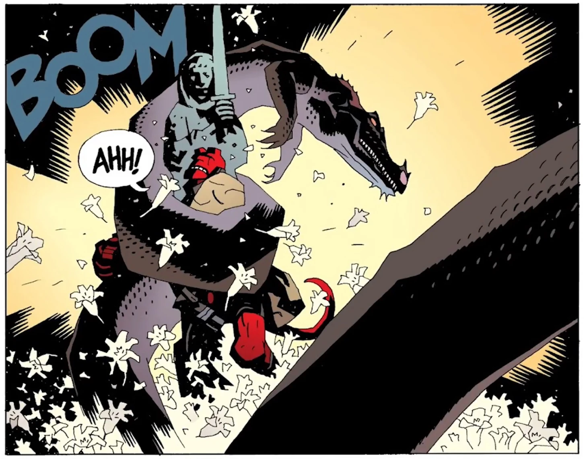

The **Saint Leonard Wyrm** was a [dragon](/entry/Dragons) that resided in England.

## Overview

The wyrm was originally killed by a monk in the 14th Century, but by 1956 the creatures had returned, which led to the [Osiris Club](/entry/Osiris_Club) asking help from Hellboy.

Hellboy agrees to enter Leonard's wood, and approaches a clearing with a statue of the monk. The dragon attacks Hellboy, and constricts him up against the statue. The dragon crushes Hellboy and the statue. The top of the statue breaks off, and the stone sword falls, killing the dragon.

## Trivia

- Possibly inspired by the legend of the Tatzelwurm.

## Appearance

- *[The Nature of the Beast](/entry/The_Nature_of_the_Beast)*
