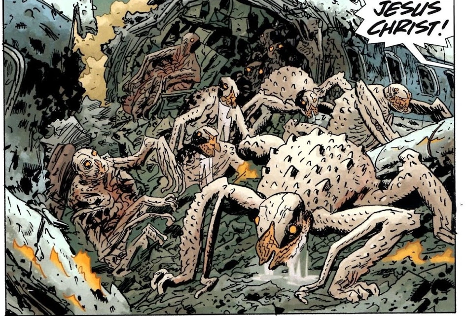

**The Salton Sea Monster** was one of the [Ogdru Hem](/entry/Ogdru_Hem), the children of the [Ogdru Jahad](/entry/Ogdru_Jahad).

## Overview

This creature crawled out of the ocean during [King of Fear](/entry/King_of_Fear_(story)), after [Elizabeth Sherman](/entry/Elizabeth_Sherman) destroyed the [Black Flame's](/entry/The_Black_Flame_(character)) forces.

Originally this being was seen as an herald of the end times, but it was quickly worshipped as a god by many humans. One of these key worshippers was [Paul Nedin](/entry/Paul_Nedin), a former Christian pastor from Atlanta, who formed the Church of the Living Earth.

The creature, like most Ogdru Hem, also releases a gas which transforms humans into monsters.

Recently it has begun moving and laying eggs.

## Gallery

## Appearances

- [*B.P.R.D.: King of Fear*](/entry/King_of_Fear_(story))
- [*B.P.R.D.: Hell on Earth—New World*](/entry/New_World_(B.P.R.D._story_arc))
