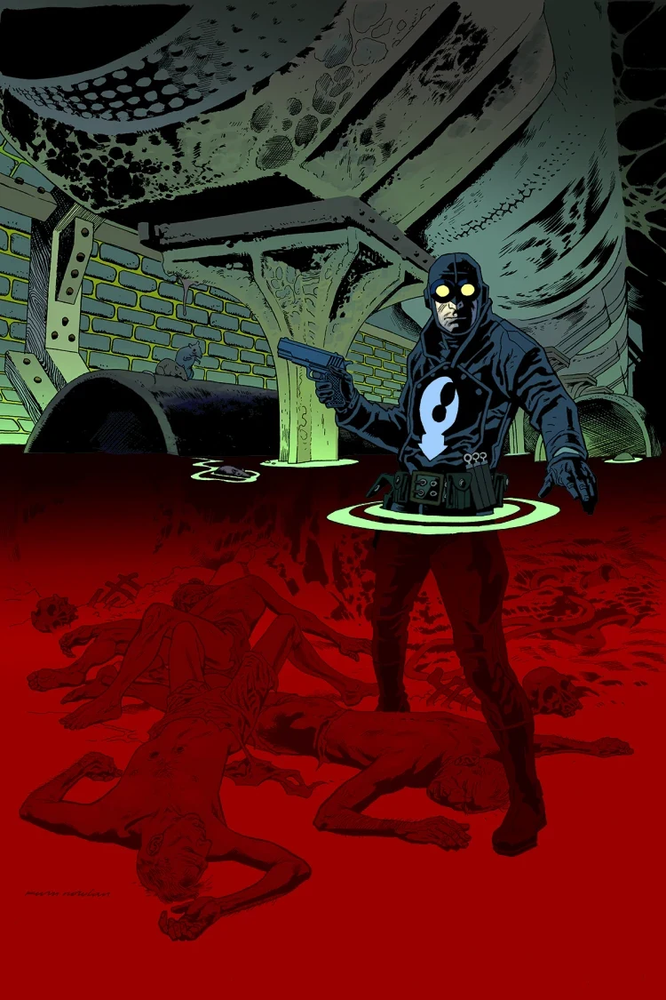

***Satan Smells a Rat*** takes place early in [the Lobster's](/entry/The_Lobster) career as a crime fighter in the 1930s.

## Publication History

This one-shot will be published in 2013, with a cover and art by Kevin Nowlan.

## Synopsis

Someone is killing off skid row bums and dumping their corpses. The only one who can deliver justice is Hellboy’s favorite gun-blazing vigilante.

## Gallery

