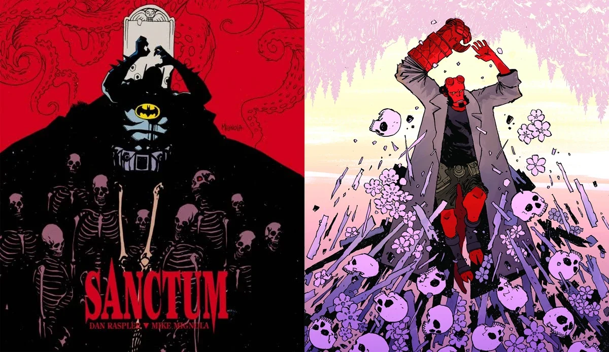

*Saturn Returns* is three-issue *Hellboy and the B.P.R.D.* arc written by [Mike Mignola](/entry/Mike_Mignola) and [Scott Allie](/entry/Scott_Allie), and drawn by [Christopher Mitten](/entry/Christopher_Mitten). This arc is the debut of colorist [Brennan Wagner](/entry/Brennan_Wagner). It is set in October 1975.

## Synopsis

### Part One

A small town in New Hampshire that has been plagued by disappearances is shaken when a local discovers a pile of corpses that date back decades, and Hellboy and B.P.R.D. Agent Kinsley arrive on the scene only to be overwhelmed by supernatural theories for the ritualistic killings.

### Part Two

Hellboy and Agent Kinsley delve deeper into the mystery behind a cache of bodies found in the New Hampshire woods. Possible explanations include werewolves, vampires, and demons… but the truth may be even stranger! Meanwhile, a runaway Liz Sherman finds that life on the street comes at a steep cost!

### Part Three

Theories and threads are coming up cold, but the bodies are still piling up in the terrified New Hampshire town. How many more will die before the creature is contained? Agent Kinsley and the local authorities must race to stop the bloodthirsty body-snatcher without Hellboy, who has been urgently pulled in another direction.

## Gallery

All covers by [Christopher Mitten](/entry/Christopher_Mitten).

Issue \#1

Issue \#2

Issue \#3

## Trivia

- The cover for *Saturn Returns* \#3 is an inverse of Mike Mignola's Batman: Legends of the Dark Knight—Sanctum cover.

Hellboy and the B.P.R.D. Publication Order

&#10;
Preceded by
The Beast of Vargu
Saturn Returns

Followed by
Long Night at Goloski Station
