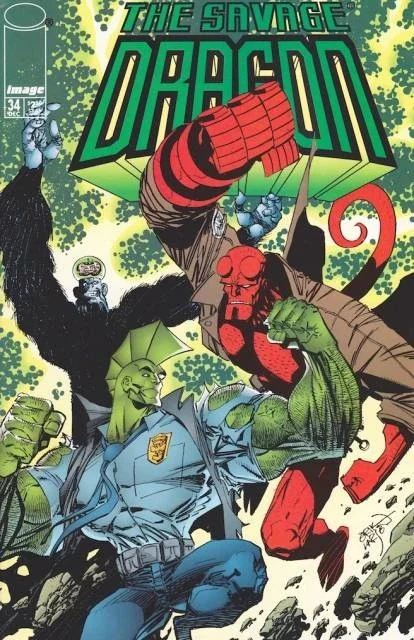

*For the collected trade paperback, see [Savage Dragon Hellboy (TPB)](/entry/Savage_Dragon_Hellboy_(TPB)).*

Savage Dragon/Hellboy is a two-issue crossover comic published by Image Comics in 2002, collecting The Savage Dragon \#34 and \#35 originally published in December 1996. The crossover represents a collaboration between Erik Larsen, creator of Savage Dragon, and Mike Mignola, creator of Hellboy, bringing together Image Comics' green-skinned police officer with Dark Horse Comics' paranormal investigator.

## Synopsis

The story begins when CyberFace, leader of the Vicious Circle criminal organization, starts decomposing following his resurrection through Project: Born Again. To save him, Abner Cadaver casts a spell summoning undead creatures from around the globe to Chicago, which draws the attention of Hellboy, who arrives to investigate the supernatural disturbance. Meanwhile, BrainiApe—revealed to be the preserved brain of Adolf Hitler placed in a gorilla's body—is dispatched by CyberFace to eliminate Dragon.

The crossover features the classic superhero team-up formula where the protagonists initially clash before joining forces against a common enemy. BrainiApe uses his mind control powers to manipulate both heroes, forcing them to fight each other until they overcome his influence and work together to defeat the villain and his army of undead creatures.

### Part 1: *Das Kann Nicht Sein (This Cannot Be)*

The story unfolds across two time periods. In a flashback sequence set on November 3, 1952, the paranormal investigator Hellboy is dispatched to Romania to combat a resurgent Nazi Party. Adolf Hitler, having survived World War II contrary to popular belief, confronts Hellboy directly while wearing a battle-suit, but the armor's chest begins to glow dangerously. Hellboy escapes before a massive explosion occurs, and Hitler's head is recovered by Baron Blitzkrieg, who hopes to preserve at least the dictator's brain.

The contemporary storyline, set on December 21, 1996, reveals that Hitler's brain has been preserved within the body of a gorilla, creating the villain BrainiApe. BrainiApe awakens in the Vicious Circle's new headquarters and is sent on a mission to kill the Dragon by Cyberface. Meanwhile, the decomposing Cyberface enlists Abner Cadaver to summon creatures of the undead, who then attack Hellboy.

### Part 2: *Hellboy! Now I Remeber--*

The story centers on BrainiApe, a villain whose exposed brain sits atop an ape's body, who regains his suppressed memories upon encountering Hellboy and realizes he is actually the preserved brain of Adolf Hitler. The narrative reveals that in 1952, Hellboy had confronted Hitler in Romania, causing an explosion that destroyed the dictator's body while his brain was salvaged by loyal Nazi scientists. Through radiation and chemical treatments, the brain was eventually attached to an ape's body, creating the creature known as BrainiApe.

Using his telepathic abilities, BrainiApe forces Dragon and Hellboy to battle each other, with Dragon proving physically superior to the paranormal investigator. The villain then summons a massive sea monster that devours both heroes. However, Hellboy's government allies intervene by killing the creature, allowing the heroes to escape from within its body. The confrontation concludes when Dragon impales BrainiApe's exposed brain with a knife, ending the villain's mental control over Hellboy.

## Additional Materials

The trade paperback also contains a three page Covers & Pin-up Gallery by [Mike Mignola](/entry/Mike_Mignola) and Jae Lee.

## Gallery

*Savage Dragon Vol 1 \#34:  
Das Kann Nicht Sein (This Cannot Be)*

*Savage Dragon Vol 1 \#35:  
Hellboy! Now I Remeber--*

*Savage Dragon/Hellboy* TPB

|Savage Dragon Vol 1 #34: Das Kann Nicht Sein (This Cannot Be)
