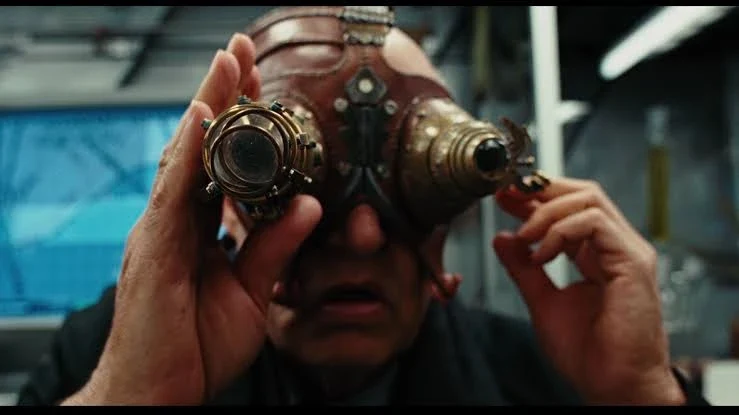

The **Schufftein glasses **were devices invented by Emil Schufftein in 1878. So far three pairs of the glasses were made, finding their way into the Smithsonian in Lot 336.

## Abilities

Schufftein designed and built four crystal diopters that penetrate and allow the wearer to see through a cloaking aura called 'glamour' that fairy folk and trolls emit.
