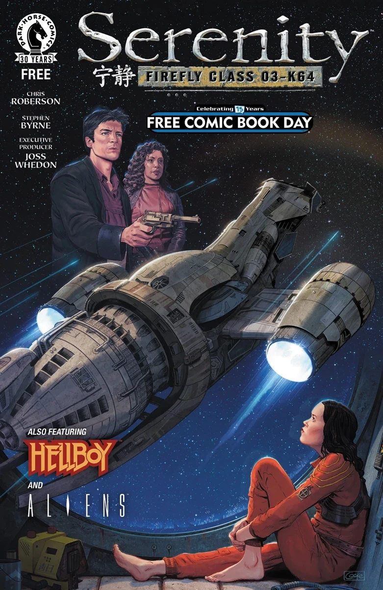

*This article is a stub. You can help Hellboy Wiki by expanding it.*

***Serenity/Hellboy/Aliens: Free Comic Book Day 2016*** is a May 2016 anthology special featuring three stories. It was the first appearance of the Hellboy Universe story *[The Mirror](/entry/The_Mirror)*.

## Solicitation

Need a reason to pick up Dark Horse Comics’ 2016 Free Comic Book Day offering? Here’s three: From Mike Mignola and Richard Corben, a lesson from Hellboy’s past is shared. From Brian Wood, a peek into the *Aliens: Defiance* series with an original tale. And from the world of Joss Whedon, a glimpse at the crew of the Serenity, following the film and the smash-hit series *Leaves on the Wind*.

## Featuring

- *The Warrior and the Wind* written by [Chris Roberson](/entry/Chris_Roberson) with art by Stephen Byrne
- *[The Mirror](/entry/The_Mirror)* written by [Mike Mignola](/entry/Mike_Mignola) with art by [Richard Corben](/entry/Richard_Corben)
- *Extravehicular* written by Brian Wood with art by Tristan Jones
