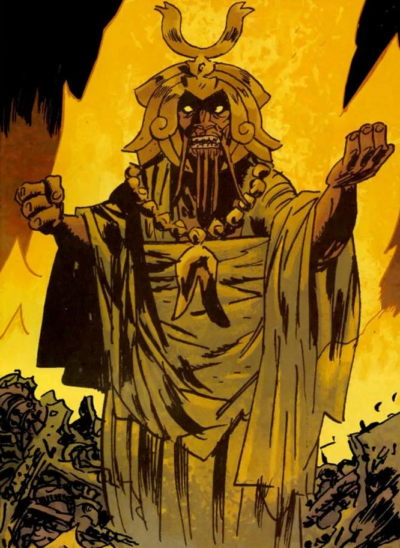

The **Servants of the Left Hand** are a race of humanoid creatures who live underneath the Earth.

## Origins

The Servants of the Left Hand were grown in vats to be a race of slaves to the People of the Left Hand. Their masters were former [Hyperboreans](/entry/Hyperboreans) who had retreated underneath the Earth after the fall of the Hyperborean empire. They called themselves the People of the Left Hand due to their worship of the Black Goddess, [Hecate](/entry/Hecate).

The Servants eventually revolted and killed their masters. They began following the [King of Fear](/entry/King_of_Fear_(character)) as their new leader. He planned on repairing the war machines built by the People of the Left Hand and finding a power source for them. Once this was accomplished the King of Fear wished to conqueror the surface world for his people and destroy humanity.

## [Hollow Earth](/entry/Hollow_Earth)

The [Bureau for Paranormal Research and Defense](/entry/Bureau_for_Paranormal_Research_and_Defense) first encountered these creatures after they abducted the soul of B.P.R.D. agent Liz Sherman. The creatures attacked Liz as she was training in the monastery Agartha, stealing her soul, and leaving her lifeless body behind.  Bureau agents [Abe Sapien](/entry/Abe_Sapien), [Roger](/entry/Roger) the Homunculus, and new member [Johann Kraus](/entry/Johann_Kraus) followed the trail of the creatures underneath the Earth. The Servants using Liz's soul to power their ancient machines and weapons. However, Abe managed to interrupt and shoot the King of Fear distracting the Servants while Roger destroyed the machine and rescuing Liz's soul.  The wounded King of Fear fell deeper into the Earth along with several of his war machines.

## Alliance

The Servants of the Left Hand later entered into an alliance with the [Frog monsters](/entry/Frog_monster) and their leader, [the Black Flame](/entry/The_Black_Flame_(character)). However, the alliance was tenuous, most particularly concerned by the King of Fear, who believed that his power was being subverted by the Black Flame.

## Appearance and Attributes

The Servants of the Left Hand are squat humanoids with a dull red/orange coloring. B.P.R.D. Agent Abe Sapien referred to them as "mole-men" when first encountering the Servants. They are savage and bloodthirsty but also can display some real intelligence and they have knowledge to repair and maintain the ancient Hyperborean war machines.

Once dead the spirits of the Servants also have some notable characteristics.  In the Witchfinder story *[In the Service of Angels](/entry/In_the_Service_of_Angels)*, Witchfinder Sir Edward Grey encountered the ghost of one of the Servants terrorizing Victorian London. The ghost displayed vampiric characteristics, feeding on the blood of its victims to grow in size and power. This ghost could choose to be corporeal or non-corporeal and could alter its appearance to appear either more human or more monstrous. However, once reunited with its bones, the creature returned to life and was able to be shot and killed by Sir Edward.
