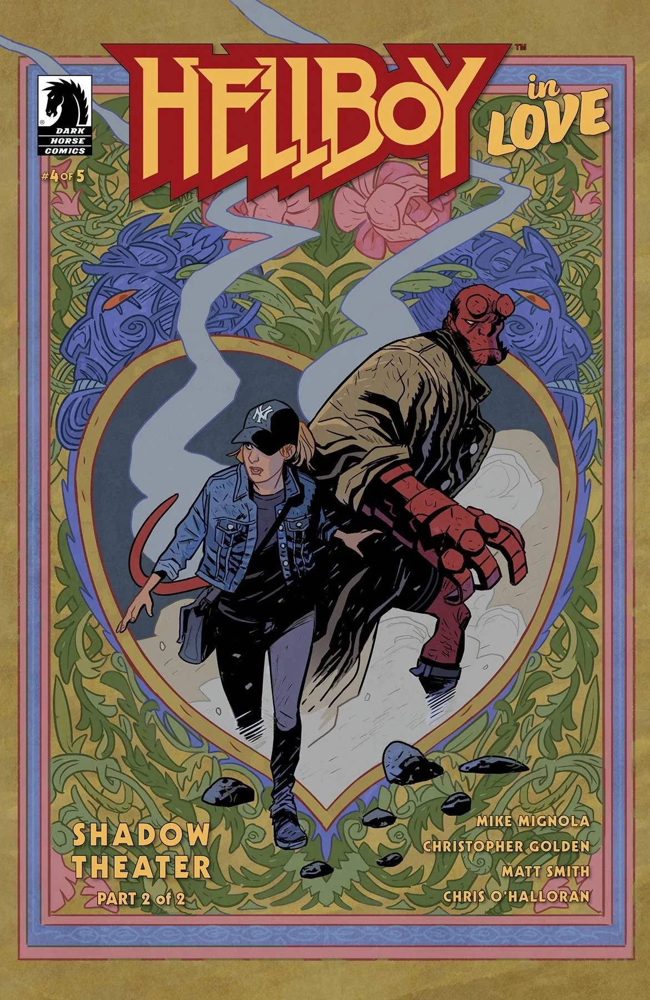

***Shadow Theater*** is a two-issue arc of *Hellboy in Love* written by Mike Mignola and Christopher Golden, and illustrated by Matt Smith.

## Synopsis

### Part One

Sparks fly when Hellboy and Anastasia take a surprise trip to Turkey. Anastasia’s former professor has unearthed the birthplace of Turkish shadow puppetry, but it seems there is more lurking in the shadows than he bargained for. Facing demonic presences is nothing new to Hellboy, but doing it alongside Anastasia is a new challenge!

### Part Two

Hellboy and Anastasia find out more about the history of Turkish shadow puppetry than they intended. After their clash with the malevolent shadows of puppet show characters Karagöz and Hacivat, the pair soon find themselves with more than shadow puppets to reckon with! But any possible way out must first lead deeper into the shadows. . .

## Gallery

All covers by Matt Smith.

*Hellboy in Love* \#3  
*Shadow Theater* (Part 1)

*Hellboy in Love* \#4  
*Shadow Theater* (Part 2)

|Hellboy in Love #4 Shadow Theater (Part 2)
