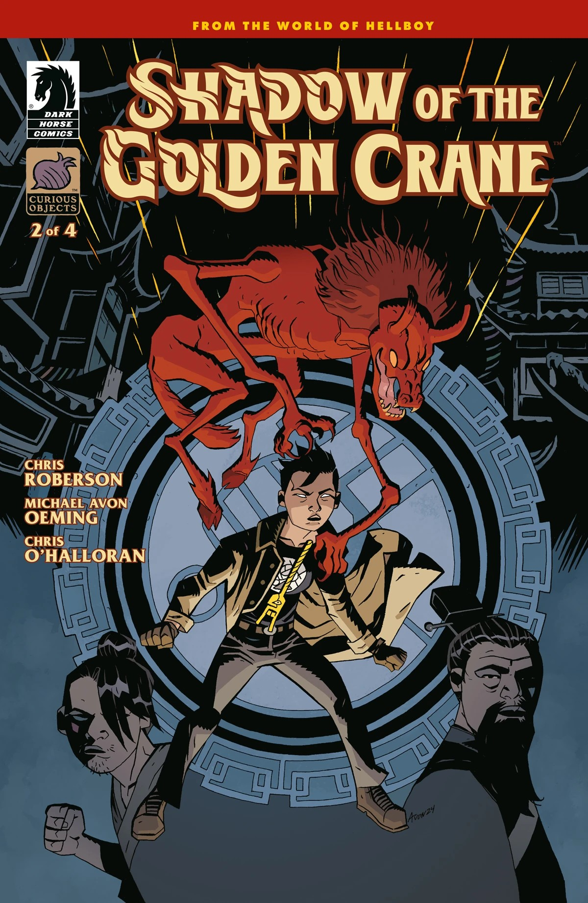
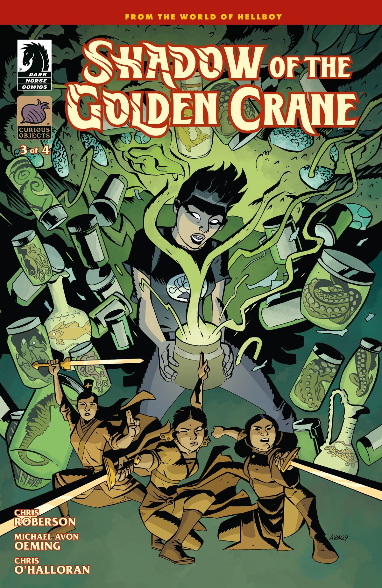
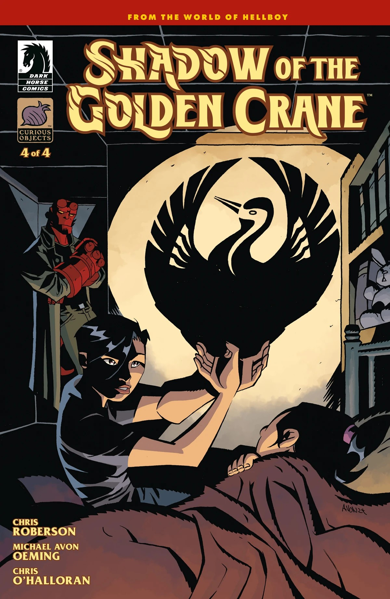

*This article is a stub. You can help Hellboy Wiki by expanding it.*

***Shadow of the Golden Crane*** is a four-issue miniseries written by Chris Roberson and illustrated by Michael Avon Oeming.

## Publication History

The series was written so that each issue functions both as a standalone story and part of a larger whole.

## Synopsis

### Part One

A mysterious B.P.R.D. case in the 1960s forces Agent [Sue Xiang](/entry/Susan_Xiang) to dive into the history of the secretive [Golden Crane Society](/entry/Golden_Crane_Society), and into the questions in her own family past as well.

### Part Two

A link between a possessed woman and a biker gang has roots in a different kind of gang going centuries back in Mongolia.

### Part Three

Agent Xiang investigates a haunting at an herbalist shop that pulls her into a web of ancient witchcraft.

### Part Four

A demon-possessed dagger brings Agent Xiang together with Hellboy and Agent Koestler to stop these ancient, dark forces before they infect much, much more.

## Gallery

Covers by Michael Avon Oeming

Issue \#1

|Issue #2

|Issue #3

|Issue #4
