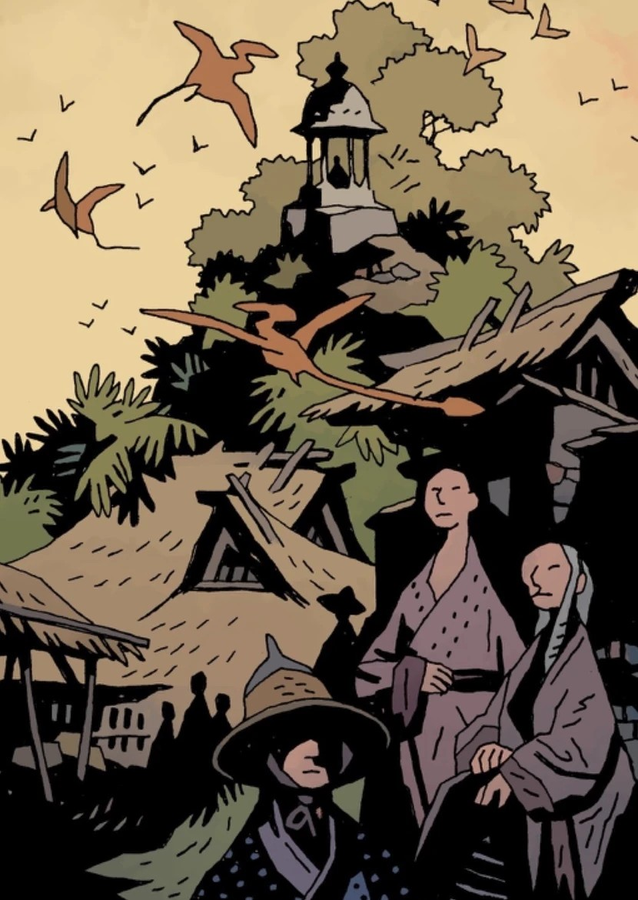

**Shambhala**, also known as **Sancti Hyperberum** and the **Sancti Ab-Jura**, was an underground land. It is inhabited by ancient reptiles, such as pterosaurs.

## History

### Origin

Shambhala was founded by the [Hyperboreans](/entry/Hyperboreans) following the fall of their empire, being described as a new Garden of Eden. They bred a new [slave racee](/entry/Servants_of_the_Left_Hand) which eventually revolted, killing all their masters and following the [King of Fear](/entry/King_of_Fear_(character)).

The paradise was actually founded by Frankenstein's Monster, who defeated [Yotha-Hem](/entry/Yotha-Hem), one of the Ogdry Hem, with the help of a [Vril](/entry/Vril)-maiden. The energy of the Vril would create the a lush rainforest. Frankenstein's Monster would go on to live in this new paradise.

### Ragna Rok

With [Ragna Rok](/entry/Ragna_Rok_(event)) approaching, Sir Edward Grey explained to [Hellboy](/entry/Hellboy_(character)) that mannkind needed to go underground to survive, providing a number of coordinates from where they could descend to do so. Hellboy gave the knowledge to the members of [Bureau for Paranormal Research and Defense](/entry/Bureau_for_Paranormal_Research_and_Defense), who in return gave it to the remaining news stations around the world.

People worldwide started to descend underground, including the remnants of the B.P.R.D., who managed to descend, though losing many members, such as James Henry O'Donnell, [Stazz](/entry/Nastassja_Hansen), and [Ted Howards](/entry/Ted_Howards), to the [Ogdru Hem](/entry/Ogdru_Hem) in the process. The survivors reached the new land, which was a lush rainforest, inhabited by prehistoric wild life.

With the Earth destroyed and being prepared for a new race of man, humanity will carve out a new future underground.

## Gallery

Humanity's future is underground

|Humanity's  future is underground
## Inhabitans

- [Fenix Espejo](/entry/Fenix_Espejo)
- Frankenstein's Monster
- Connor Giarocco
- [Pterosaurs](/entry/Pterosaur)

## Apperance

- [In the Service of Angels](/entry/In_the_Service_of_Angels)
- [Frankenstein Underground](/entry/Frankenstein_Underground)
- [Ragna Rok](/entry/Ragna_Rok_(story_arc))
