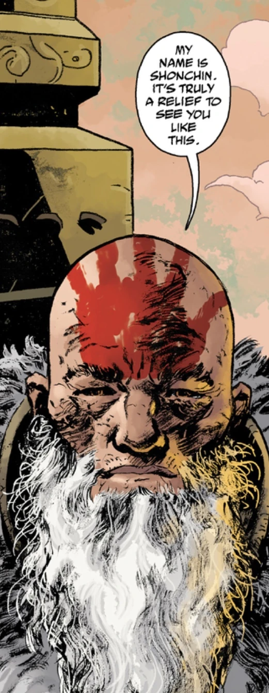

**Shonchin** is an ancient T'shethuan shaman from the [Hyperborean](/entry/Hyperboreans) Age that survived well into the 21st century.

## History

### [*King of Fear*](/entry/King_of_Fear_%28story%29)

A mysterious shaman appeared in [Liz Sherman](/entry/Elizabeth_Sherman)'s vision of the future. He pointed to a vision of [Hellboy](/entry/Hellboy) who encouraged Liz to unleash her power against the [Ogdru Hem](/entry/Ogdru_Hem). Just as Liz was about to decimate [the Black Flame](/entry/The_Black_Flame_%28character%29) and his allies with her powers, the shaman teleported [Abe Sapien](/entry/Abe_Sapien) and the remaining [B.P.R.D.](/entry/Bureau_for_Paranormal_Research_and_Defense) agents to safety.

### *[End of Days](/entry/End_of_Days)*

A mysterious apparition of a shaman had answered [Panya](/entry/Panya_%28character%29)'s prayer after Black Flame taunted her telepathically of the end of the world. He spoke through Panya, who in turn spoke through the comatose [Fenix](/entry/Fenix_Espejo) to recite a prayer that would drain Black Flame's power and give [Johann Kraus](/entry/Johann_Kraus) and Liz a fighting chance.

### *[The Shadow Over Suwanee](/entry/The_Shadow_Over_Suwanee)*

The shaman appeared again before [Gustav Strobl](/entry/Gustav_Strobl), warning him of the consequences should he interfere on discovering the true origins of Abraham Sapien.

### *[Dark and Terrible Deep](/entry/Dark_and_Terrible_Deep)*

The shaman appeared before Abe at the underwater temple where [Langdon Everett Caul](/entry/Langdon_Everett_Caul) found the egg containing the [entity](/entry/Water_Spirit) that transformed him. The man revealed himself to be Shonchin, a shaman and a former disciple of the Hyperboreans, who was left behind when the followers of the Right Hand ascended to the stars. He gave an account to Abe of his past, thousands of years ago. Shonchin and his comrade attempted to reason with a city that fell under the influence of the [Black Goddess](/entry/Hecate). They underestimated the corruption and were captured. The people tortured the men until they renounced their faith and swore loyalty to the Black Goddess. Shonchin was the first to break and became a follower of the Left Hand. He was released and allowed to flee. However his friend refused to submit, and his faith held so strong that gave birth to a miraculous creature that extinguished the very villagers and land around him.

Due to his weakness, Shonchin was left behind to remain on Earth while the rest of his kin ascended to Hyperberum. He was left a broken man, unable to call forth the power of vril. Yet there was still enough vril within him that he was unable to die. He revealed the truth to Abe, that he was not a herald of the Ogdru Jahad, but in fact the light of the Old World who will carry into the Next World. He encouraged Abe to stop running and to finally embrace his destiny.

## Powers and Abilities

Shonchin was a disciple of the Right Hand and capable of using the power of vril. According to Shonchin after he had given into darkness he was unable to call upon its power, but still retains enough Vril to keep him alive for millennia. In the issues shown Shonchin seems to have regained enough of his power to act behind the scenes to stall the Apocalypse.
