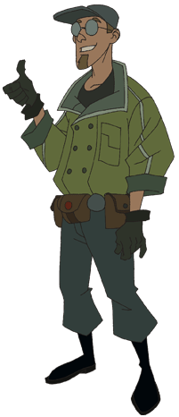

Sidney Leach was a [B.P.R.D.](/entry/Bureau_for_Paranormal_Research_and_Defense) field agent, with the power to detect and manipulate metal.

## History

### [Wake the Devil](/entry/Wake_the_Devil)

Leach's first mission in the B.P.R.D., placed him with fellow agent's [Liz Sherman](/entry/Liz_Sherman) and [Bud Waller](/entry/Bud_Waller), on a search in Romania, for the mysterious castle of [Vladimir Giurescu](/entry/Vladimir_Giurescu). During the mission, Leach discovers Sherman has pyrokenisis, or ability to create fire using her mind. The three end up discovering a dead creature in an alchemist's lab, Waller describes as a [homunculus](/entry/Homunculus), an artificial humanoid made of blood and manure, or "medieval test tube baby". However, the homunculus absorbs Liz's pyrokinetic energy, bringing it to life. Leach's hands are badly burned, and Waller resorts to shooting Sherman in the arm, to discontinue the flow of energy. The creature then snaps Waller's neck, killing him, and escapes.

### [Almost Colossus](/entry/Almost_Colossus)

Eight days later, Leach appears alongside [Tom Manning](/entry/Tom_Manning), [Abe Sapien](/entry/Abraham_Sapien), and Dr. Olasz, at the Wauer Institute, Tirgoviste, where Liz is being treated after the loss of her pyrokinetic abilities. There, Leach informs Olasz about what happened concerning how his hands had been burned, and about the homunculus. A few days later, Sherman dies due to no longer having her power. However, moments later [Hellboy](/entry/Hellboy_%28character%29) and the homunculus, whom Hellboy had dubbed "[Roger](/entry/Roger)" (much to Leach's confusion), enter the hospital. Then, Roger redirects Liz's pyrokenetic power back into her, restoring her back to life, but at the cost of his own. Sometime after this, Sidney possibly retired from the B.P.R.D. His current whereabouts are unknown.

## Abilities and attributes

Sidney is able to detect metal from far distances, and manipulate it.

Sidney is very casual in his work (i.e. Referring to Dr. Olasz as Dr. O, and calling himself the human metal detector).

## Animated

Sidney Leach appears in the Animated [Hellboy: Blood and Iron](/entry/Hellboy__Blood_and_Iron) under the name "Sydney Leach" (rather than Sidney). Leach is voiced by Rob Paulsen.

## See Also

- [Liz Sherman](/entry/Liz_Sherman)
- [Bud Waller](/entry/Bud_Waller)
- [Roger](/entry/Roger)
- [Wake the Devil](/entry/Wake_the_Devil)
- [Almost Colossus](/entry/Almost_Colossus)
- [Abe Sapien](/entry/Abe_Sapien)
- [Tom Manning](/entry/Tom_Manning)
- Dr. Olasz
- [Hellboy](/entry/Hellboy_%28character%29)
