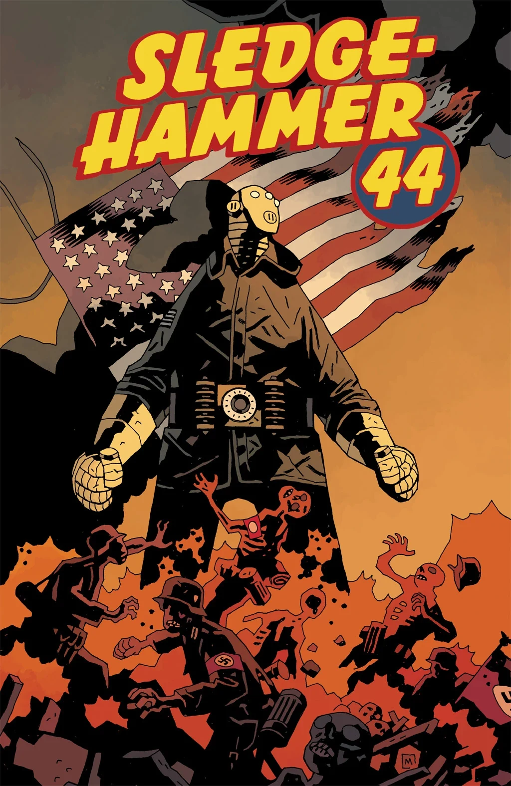
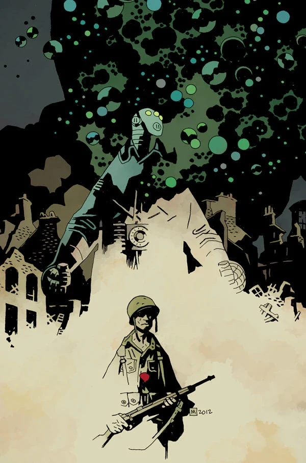

***Sledgehammer 44*** is a two-issue miniseries published in March 2013 with art by Jason Latour. It is set in 1944, and while it is a part of the Hellboy Universe, it is not part of any established series. At the time, [this was the first of its kind](/entry/The_Hellboy_Universe_Comics).

[John Severin](/entry/John_Severin) was the original artist on the book. Following his death [Jason Latour](/entry/Jason_Latour) took over the art duties. Some of Severin's art for the book was presented in [Hellmail](/entry/Hellmail) and in the *Sledghammer 44* trade paperback along with dedication written by [Scott Allie](/entry/Scott_Allie).

450 px|center|A glimpse of John Severin's version of <em>Sledgehammer 44</em> from [Hellmail](/entry/Hellmail).

## Synopsis

### Part One

August, 1944: a man in a [suit of iron armor](/entry/Vril_Energy_Suit) drops from an American warplane onto a French battlefield where he attempts to fight his way through an army of Nazis and the massive war machine they keep protected in an armory.

### Part Two

Outgunned and outnumbered by an army of Nazis, a group of GIs must band together and unleash the Hyperborean power of the mysterious man in the iron suit in order to make it home safely.

## Gallery

