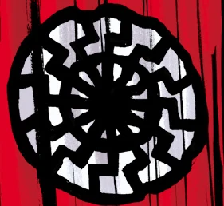

Sonnenrad_Society.png

The **Sonnenrad Society** (or the **Order of the Black Sun**) was one of Nazi Germany's occult bureaus.

## Background

The Sonnenrad Society was founded during the earliest days of the Third Reich. The Society was tasked with investigating anything related to occult power. This include searching the remains of past civilizations buried by the sands of time or hidden deep within the Earth.

Among one such dig, in an Austrian ice cave, the Sonnenrad Society discovered a damaged alien flying saucer. Despite its valued discovery, the higher ups in the Nazi Party doubted its values. During that time, [Adolf Hitler](/entry/Adolf_Hitler) and [Heinrich Himmler](/entry/Heinrich_Himmler) fostered competition between the Sonnenrad Society and other different factions who researched the occult. These include [Herman von Klempt](/entry/Herman_von_Klempt) and [Karl Ruprect Kroenen](/entry/Karl_Ruprect_Kroenen), once members of the Sonnenrad Society, funneled the resources away from the Society and into their personal projects such as [Project Ragna Rok](/entry/Project_Ragna_Rok) and [Project Vampir Sturm](/entry/Project_Vampir_Sturm). Despite this, the Sonnenrad Society managed to reverse-engineered the captured flying saucer.

By the end of World War II, the Sonnenrad Society fled to the Antarctic and hid there in secret and plotted to rule the world as they see themselves worthy heirs of the Nazi ideal. To achieve their goal, the Sonnenrad Society continued the saucer program. While the saucer program was captured by the Soviet Union, the Sonnenrad Society managed to produce a fleet of flying saucers. However, the Society were unable to duplicate the process of the saucers' power source as it was believed the vehicle were powered by [Vril](/entry/Vril). Instead they searched for alternatives; one of which is the counterpoint to Vril is a black flame called "[Shakti](/entry/Shakti) ", which is said to be hidden within all living things. This process was not without its drawbacks as the Society's attempt to extract Shakti was extremely volatile and can mutate living organisms on contact.

## History

In 1952, Herman von Klempt attempted to contact the Sonnenrad Society and requested them to join him in his quest for world domination. But the Society still harbored grudges against von Klempt and refused to heed his call.[1]

By 1954, one of the Sonnenrad Society's saucers crashed in the Arctic Circle and mutated a nearby polar bear, which subsequently brought the attention of the [Bureau for Paranormal Research and Defense](/entry/Bureau_for_Paranormal_Research_and_Defense). [Hellboy](/entry/Hellboy) was sent to the Arctic and eventually discovering the crashed saucer and inadvertently traveled to the Society's secret base. The Society captured Hellboy and planned to extract the Shakti from him to at least powering up some of the saucer fleet. However, their plan for world conquest only came to an end when Hellboy destroyed the machine that was suppose to extract his Shakti and causing a massive explosion that destroyed the entire facility and leaving Hellboy the sole survivor.[2]

## Members

- Gruppenführer Eckart (deceased)
- Professor Börner (deceased)

## References

<references />

[1] *[1952](/entry/1952)*

[2] *[Black Sun](/entry/Black_Sun)*
