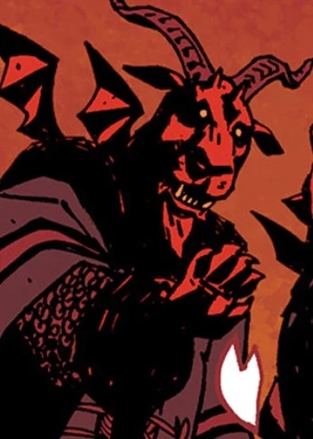

**Sytry** was a high-ranking [demon](/entry/Demon).

## History

Sytry, [Yomyael](/entry/Yomyael) and [Beleth](/entry/Beleth) were a trinity of demons that had aided the Asiatic people in battle "for as long as men had placed faith in the dark behind stars".

Peter the Great summoned Sytry and the two demons, hoping they would help him in the war against the  Swedes in the Great Northern War, but demanded his future sons, his heart and his soul in return.

## Lore

Sytry is a spirit of the Ars Goetia and is described as Great Prince of Hell with sixty legions of demons under his command. He is presumed to be based on the Egyptian deity Set.

## Apperance 

- (/entry/1946)
