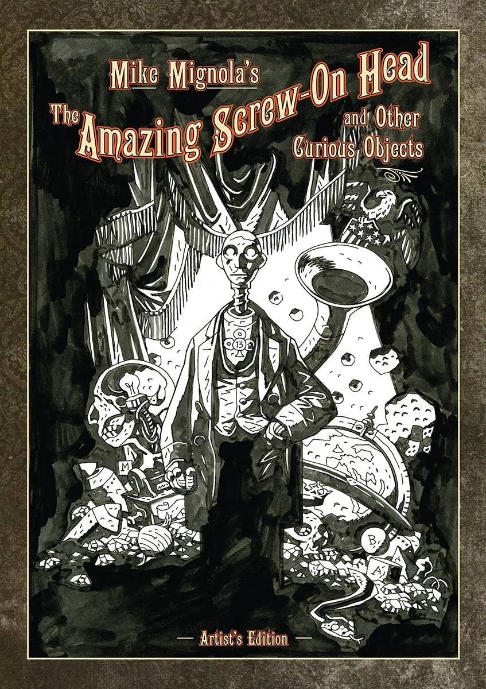
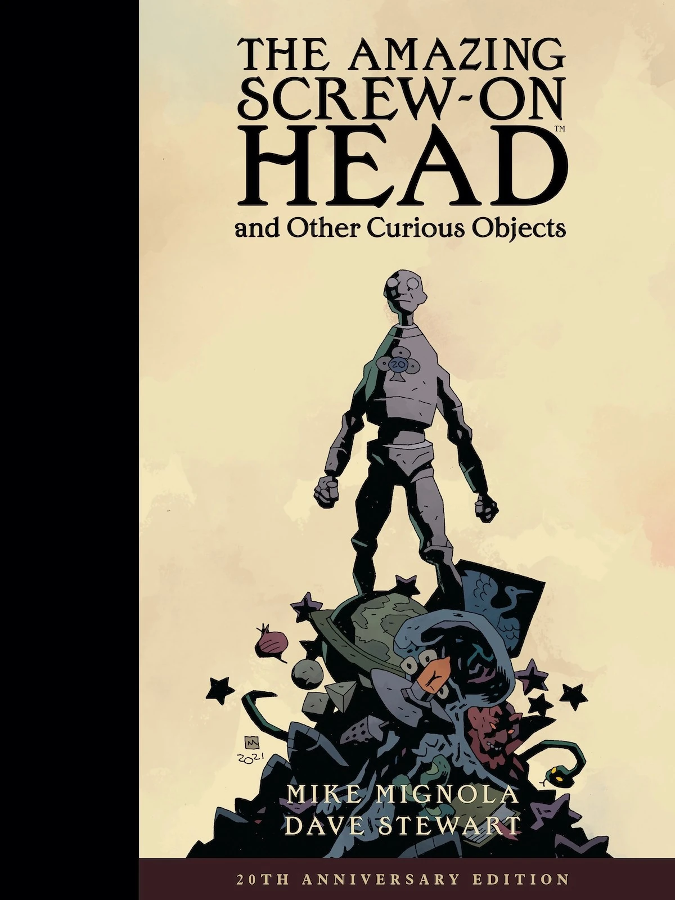

***The Amazing Screw-On Head and Other Curious Objects*** is a collection published by Dark Horse Comics containing two previously published stories tangentially related to the Hellboy Universe, *[The Amazing Screw-On Head](/entry/The_Amazing_Screw-On_Head)* and *[The Magician and the Snake](/entry/The_Magician_and_the_Snake)*, as well as a number of expanded or new stories.

## Publisher's Summary

Victorian flying machines, a mechanical head, tomb robberies, ghosts, witches, puppets, aliens, and giant vegtables-a dizzy parade of curiosities lie between these covers, including the Eisner Award-winning stories "The Amazing Screw-On Head" and "The Magician and the Snake," plus three never-before-published stories and other new work from the creator of *[Hellboy](/entry/Hellboy_(series))*.

## Collected Stories

*The Amazing Screw-On Head and Other Curious Objects* is divided into two parts.

### Part One: *The Amazing Screw-On Head*

Part one collects *[The Amazing Screw-On Head](/entry/The_Amazing_Screw-On_Head)* story. Following the story is a subsection, *Newly Unearthed Curiosities From the Secret Files of the Amazing Screw-On Head*, containing a number of related pin-ups, all drawn by Mignola, that were not included in the original single issue.

### Part Two: *Other Curious Objects*

This section presents five additional stories in the following order:

- *[Abu Gung and the Beanstalk](/entry/Abu_Gung_and_the_Beanstalk)* (originally published in *Scatterbrain* \#1, redrawn for this collection)
- *[The Magician and the Snake](/entry/The_Magician_and_the_Snake)* (originally published in *Happy Endings*)
- *[The Witch and Her Soul](/entry/The_Witch_and_Her_Soul)*
- *[The Prisoner of Mars](/entry/The_Prisoner_of_Mars)*
- *[In the Chapel of Curious Objects](/entry/In_the_Chapel_of_Curious_Objects)*

## Additional Materials

This collection also contains story notes for all six stories as well as an eleven-page sketchbook.

## Story Connections and Their Relation to the Hellboy Universe

All of the stories in this collection are interconnected via shared characters and locations. (For further details, check out each stories' article.) Since both *[The Amazing Screw-On Head](/entry/The_Amazing_Screw-On_Head)* and *[The Magician and the Snake](/entry/The_Magician_and_the_Snake)* are known to exist within the Hellboy Universe as novels and fairy tales, it is conceivable that all the stories in this collection exist as fiction within the Hellboy Universe.

## Artist's Edition

In 2016, IDW published *Mike Mignola's The Amazing Screw on Head and Other Curious Objects: Artist's Edition*. This oversized book features Mignola's inks, uncolored (half the stories are unlettered as well), at the size they were originally drawn.

In addition to all the content from the previous collection, the *Artist's Edition* also includes Mignola's contributions to [*The Goon* \#7](/entry/The_Goon_7) (which featured [Hellboy](/entry/Hellboy_(character))), as well as "Rusty Razorclam: President of Neptune", a story drawn by Mignola from *Dark Horse Presents \#107*.

## 20th Anniversary Edition

On August 10, 2022, Dark Horse Comics published *The Amazing Screw-On Head and Other Curious Objects 20th Anniversary Edition*. While forgoing the additional content added to the artist's edition this anniversary edition contains forty pages not in previous editions. Half of the new content is a previously unpublished story from [Mike Mignola](/entry/Mike_Mignola), *Axorr, Slayer of Demons*. The other half consists of additional color illustrations.

## External Links

- The Amazing Screw-On Head and Other Curious Objects product page on DarkHorse.com
