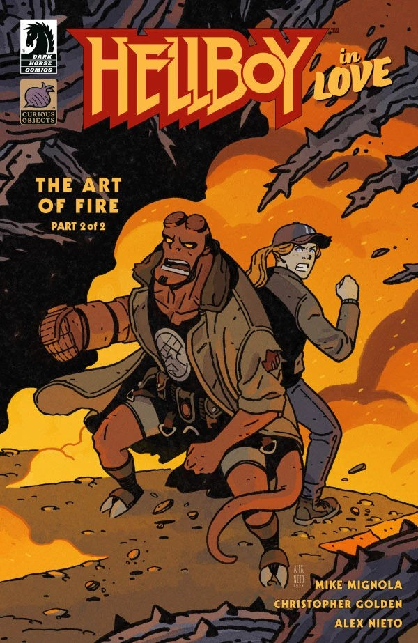

***The Art of Fire*** is a two-issue arc of *[Hellboy in Love](/entry/Hellboy_in_Love)* written by [Mike Mignola](/entry/Mike_Mignola) and [Christopher Golden](/entry/Christopher_Golden). It is the fourth arc in the series and the debut of Alex Nieto in the Hellboy Universe.

## Synopsis

### Part One

Hellboy and archaeologist Anastasia Bransfield trek to Iceland for evidence of a seemingly impossible network of occultists, but a fresh dig site holds answers that come at a steep—and risky—price.

### Part Two

A supernatural entity in an Icelandic cave gives Hellboy and Anastasia the answers they seek, but has other ideas when the two of them try to leave with their newfound knowledge.

## Gallery

All covers by Alex Nieto.

*Hellboy in Love: The Art of Fire* \#1

*Hellboy in Love: The Art of Fire* \#2

|Hellboy in Love: The Art of Fire #2
