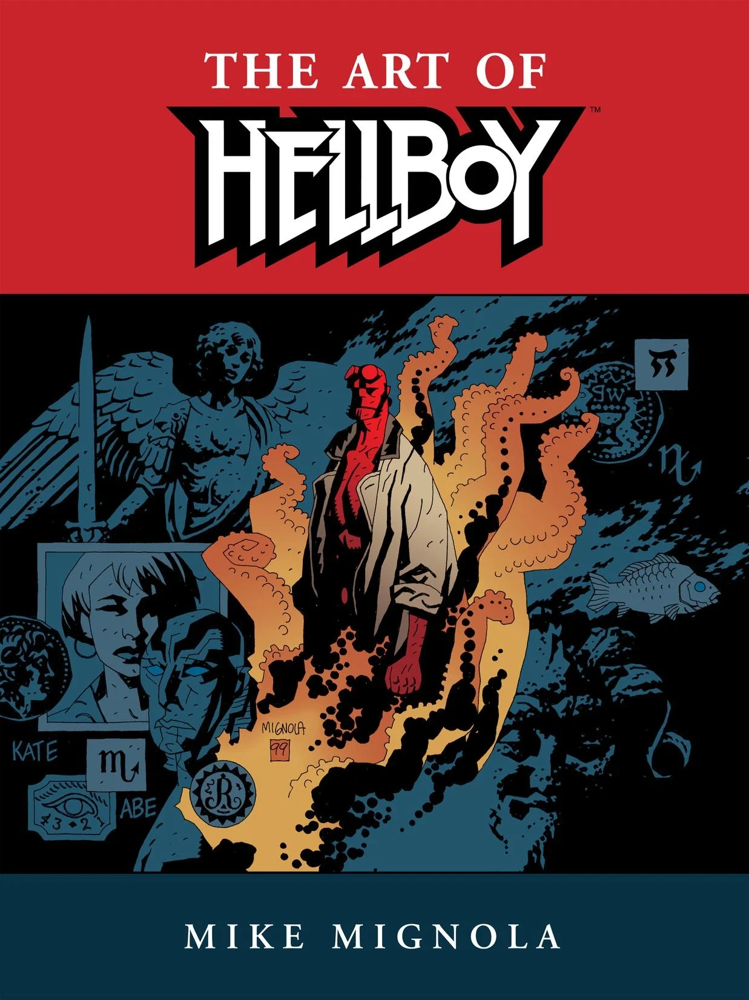

***The Art of Hellboy*** was a book published by [Dark Horse Comics](/entry/Dark_Horse_Comics). It features preliminary sketches, finished pages and notations from the first decade of [Mike Mignola](/entry/Mike_Mignola)'s work on [Hellboy](/entry/Hellboy_(series)).

## Publishers Summary

*This stunning two-hundred-page tome looks at the evolution of Mike Mignola's art over ten years on his award-winning comics series. Featuring previously unpublished art, unused and unfinished covers, and drawing upon ten years of sketchbooks, The Art of Hellboy provides the ultimate inside look at Mignola's design, storytelling, and color work, and rare and never-before-seen art reveals the labor involved in creating one of comics' most acclaimed books.*

## Publication History

*The Art of Hellboy* was originally published as a large, oversized hardback book that served as the basis for the [*Hellboy* Library Editions](/entry/Hellboy_Library_Editions). A year later it was reprinted in a smaller, paperback format.

## Notable Inclusions

*The Art of Hellboy* contains the only reprint of both *Hi, My Name's Hellboy* and the original version of *[The Vârcolac](/entry/The_V%C3%A2rcolac)*.

## Cover Gallery

Hardcover

|Paperback
## External Links

- The Art of Hellboy (Hardcover) product page on DarkHorse.com
- The Art of Hellboy (Paperback) product page on DarkHorse.com
