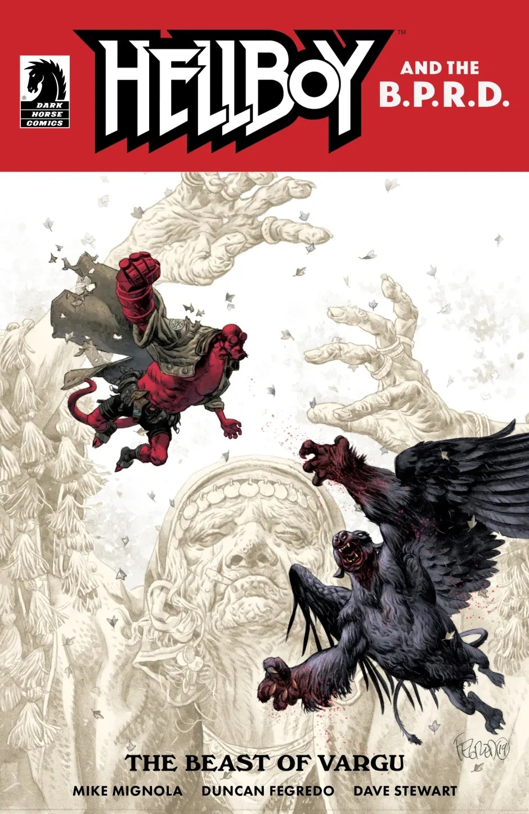

***The Beast of Vargu*** is a one-shot *Hellboy and the B.P.R.D.* issue set in 1962, written by [Mike Mignola](/entry/Mike_Mignola) and drawn by [Duncan Fegredo](/entry/Duncan_Fegredo). This issue marks the first time an issue of *Hellboy and the B.P.R.D.* has jumped ahead in time, rather than continuing year-by-year format of previous issues. The issue also included the short story *[The Secret God of the Roma](/entry/The_Secret_God_of_the_Roma)*.

## Synopsis

This first issue in a new era of *Hellboy and the B.P.R.D.* sees Mignola and Fegredo send Hellboy to Romania for a pair of tales set in a small village with a centuries-old curse and a man-eating monster which culminate in a sinister puppet show and a demigod’s ill-fated dinner.

## Gallery

[Duncan Fegredo](/entry/Duncan_Fegredo) cover

[Mike Mignola](/entry/Mike_Mignola) variant cover

Hellboy and the B.P.R.D. Publication Order

&#10;
Preceded by
1956
The Beast of Vargu

Followed by
The Secret God of the Roma

|Duncan Fegredo cover
