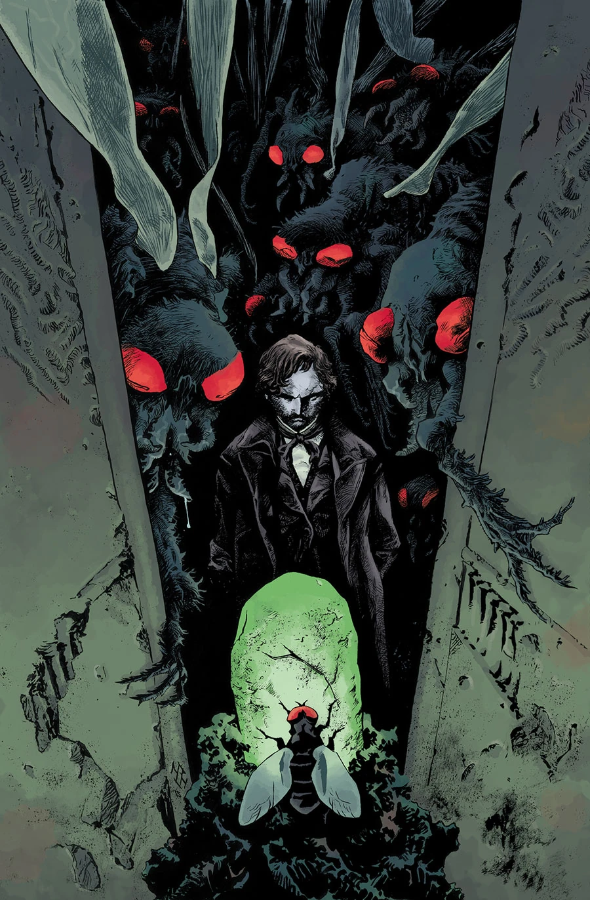
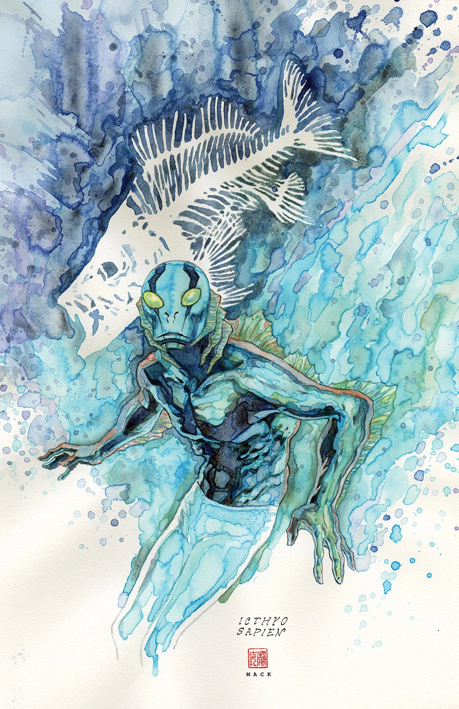

***The Black School*** is a one-shot story with Sebastián Fiumara on art.

## Synopsis

Our villain reaches his goal—the mythic Black School, where his training began over two hundred years ago. Here he’ll find the answers Abe Sapien himself has sought for years. Strobl may also find the shortcut he needs to restore his place at the end of the world: tyrannizing mankind at the right hand of the devil.

## Gallery

[Max Fiumara](/entry/Max_Fiumara)

[David Mack](/entry/David_Mack)
