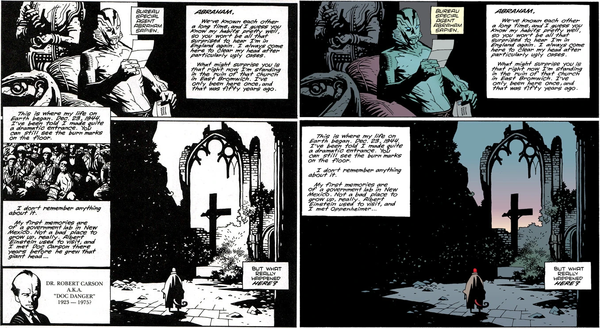

***The Chained Coffin*** is a 1995 short story written and drawn by [Mike Mignola](/entry/Mike_Mignola).

## Publishing History

*The Chained Coffin* was originally published in black and white in *[Dark Horse Presents](/entry/Dark_Horse_Presents)* \#100–2 (Aug 1995). One month earlier, a three-page preview had been published in *Dark Horse Presents* \#100-0, an exclusive included with *Hero Illustrated* \#26. [John Arcudi](/entry/John_Arcudi) wrote a sequel, *[Subconscious](/entry/Subconscious)*, twenty years later.

## Synopsis

The story is framed by [Abe Sapien](/entry/Abe_Sapien) reading a letter from [Hellboy](/entry/Hellboy_%28character%29) about his travels back to the church in East Bromwich, the place of his "birth". Hellboy recounts that the psychic [Cynthia Eden-Jones](/entry/Lady_Cynthia_Eden-Jones) thought Hellboy's appearance was related to two spirits in the church and not a Nazi experiment.

Hellboy falls asleep in the church and dreams of a dying woman. The woman admits to having been a witch, but now she renounces her past and asks for God's forgiveness. The woman asks her children, a priest and a nun, to save her soul. She instructs them to chain up her coffin and guard it from the devil for three nights.

Hellboy awakes to see a vision of the priest and nun standing over a chained coffin. A [demon](/entry/Azzael) enters the Church, and after a brief confrontation, he kills the priest and nun. The demon reveals that the woman's "real child" is still unborn, conceived at Walpurgis-Nacht many years ago. The demon looks towards Hellboy while saying, "My favorite son." The demon takes the woman down to hell forever.

The story ends back with Abe Sapien asleep, dreaming of fish.

## Story Chronology

There is no explicit mention of when the story takes place. It likely is sometime before *[Wake the Devil](/entry/Wake_the_Devil)*.

In the letter to Abe, Hellboy mentions the events at Cavenish Hall (in *[Seed of Destruction](/entry/Seed_of_Destruction)*) so it takes place after that. Near the end of *[Wake the Devil](/entry/Wake_the_Devil)*, three figures (the Faerie King, a witch and a hooded man) are watching the events unfold and mention that Hellboy was "born of a human woman in hell" which alludes to what we see in this story. In *[The Right Hand of Doom](/entry/The_Right_Hand_of_Doom)* the events seem to support the ordering that *The Chained Coffin* occurs before *Wake the Devil*. *Hellboy: The Companion* places the events of the story on May 14, 1994, the day after [Professor Bruttenholm](/entry/Trevor_Bruttenholm)'s funeral.

## Changes from Black and White to Color

''See also: [Dark Horse Comics § Legend](/entry/Dark_Horse_Comics)

The black and white version included a brief mention of Dr. Robert Carson, a character created by [John Byrne](/entry/John_Byrne) from *Danger Unlimited*. Doc Carson's appearance was part of a plan for an Adams-Byrne-Mignola shared universe. However, Doc Carson was removed for the color version when it was collected in *[Hellboy – Volume 3: The Chained Coffin and Others](/entry/Trade_Collections)*, in August 1998; by this point, the shared universe plans had been abandoned.

The_Chained_Coffin_changes.jpg

***Left:** Black and white 1995 version
**Right:** Color 1998 version*

## Content

### Characters

#### General

- [B.P.R.D.](/entry/Bureau_for_Paranormal_Research_and_Defense)
  - [Abraham Sapien](/entry/Abraham_Sapien)
  - [Hellboy](/entry/Hellboy_%28character%29)
  - [Trevor Bruttenholm](/entry/Trevor_Bruttenholm) (Mentioned) (Photograph, Black and White version only)
- [Witches](/entry/Witches)
  - [Sarah Hughes](/entry/Sarah_Hughes) (Flashback/Dream)

[Sarah Hughes](/entry/Sarah_Hughes)'s Children (Flashback/Dream)

- [Demons](/entry/Demon)
  - [Azzael](/entry/Azzael) (Flashback/Dream)
- [Cynthia Eden-Jones](/entry/Cynthia_Eden-Jones) (Mentioned)

#### Black And White Version Only

- U.S. Army Soldiers (Photograph)
- Dr. Robert Carson

### Locations

- England
  - East Bromwich church ruins
- U.S.A.
  - [B.P.R.D.](/entry/Bureau_for_Paranormal_Research_and_Defense) Headquarters (Farfield, CT)

## Notes

<references/>
