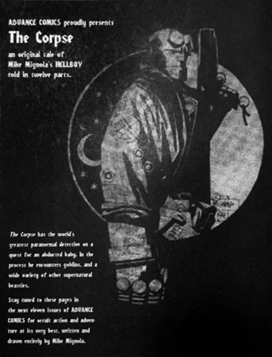

***The Corpse*** is a serialized [*Hellboy*](/entry/Hellboy_%28series%29) story that went on to become a favorite of both Mike Mignola and his fans alike. Although seemingly a standalone story when first published, it has since become a major catalyst for events in *Hellboy* especially in *[Darkness Calls](/entry/Darkness_Calls)*, *[The Wild Hunt](/entry/The_Wild_Hunt)*, and *[The Storm](/entry/The_Storm) and [the Fury](/entry/The_Fury)*.

## Publication History

Most of *The Corpse* was originally serialized as two-page installments in [Capital City Distribution](/entry/wikipedia%3ACapital_City_Distribution)'s *Advance Comics* catalog. *Advance Comics* was not a traditional comic book, rather largely a catalog of comic books, graphic novels, toys, and other merchandise that was sent by the distributor to comic book shops;[1] stories like *The Corpse* were used as a value-add for the publication.

 *The Corpse* ran in *Advance Comics* issues \#75-82, from March through October of 1995. Though an introduction to the story printed in *Advance Comics* \#75 referred to it as a story "told in twelve parts",[2] only eight two-page installments ended up being published within the pages of the catalog. Then in January of 1996, the entire story was collected with a new opening page and an eight-page conclusion (the four missing two-page "parts"), in the one-shot *Hellboy: The Corpse and [the Iron Shoes](/entry/the_Iron_Shoes).*

### Re-releases and adaptations

In August 1998, the story was collected in *[Hellboy – Volume 3: The Chained Coffin and Others](/entry/TPB)*.

Elements of *The Corpse* are adapted in [the 2004 *Hellboy* movie](/entry/Hellboy_%28film%29). As part of the lead up to the film's release, *The Corpse* was reprinted as a standalone 25¢ comic in March of 2004, with three additional pages about the story's adaptation for use in the movie. For its video release, the story was included as an insert within the DVD case of some editions of the movie.

## Synopsis

[Hellboy](/entry/Hellboy_%28character%29) is called to Ireland in 1959, to deal with a child abduction. The child, [Alice Monaghan](/entry/Alice_Monaghan) was replaced by the fairy, [Gruagach](/entry/Gruagach) in disguise. Hellboy burns Gruagach with iron, and forces him to reveal his true form. In order to get back the real child, Hellboy made an agreement with a group of little men Gruagach told him to lay the body of Tam O'Clannie to rest in a proper Christian grave. At the first two churches, the dead call out "No Room," and Hellboy is forced to continue on. [Dagda](/entry/Dagda), King of the Faerie (introduced here for the first time), sees that Hellboy will succeed and orders one of the goblins to return the Monaghan child. Meanwhile, Gruagach seeks vengeance from Hellboy, and releases the boar-headed giant [Grom](/entry/Grom), who immediately eats Gruagach. Hellboy fights Grom, and buries Tam. The deal completed, the fairy return the Baby to Hellboy, and the goblin tells him that they had intended to raise the child as their own because the Fairy can no longer have children, and now without Alice, it is only a matter of time before Dagda calls his kind away from the world forever.

## Story Chronology

The story takes place in 1959. This is the same year as Hellboy's fight with von Klempt, in ["World's Greatest Paranormal Investigator" (CBG)](/entry/World%27s_Greatest_Paranormal_Investigator_%28CBG%29) (1959), one year after *[The Penanggalan](/entry/The_Penanggalan)* and *[The Crooked Man](/entry/The_Crooked_Man_%28comic_story%29)* (1958), and two years before *[The Iron Shoes](/entry/The_Iron_Shoes)* and *[The Hydra and the Lion](/entry/The_Hydra_and_the_Lion)* (1961).

## Content

### Characters

#### General

- [B.P.R.D.](/entry/Bureau_for_Paranormal_Research_and_Defense)
  - [Hellboy](/entry/Hellboy_%28character%29)
- Tam O'Clannie ("The Corpse")
- Monaghan Family
  - [Alice Monaghan](/entry/Alice_Monaghan)
  - Margaret Monaghan
  - Mr. Monaghan
- Several unnamed ghosts

#### [Daoine Sidhe](/entry/Daoine_Sidhe)

- [Gruagach](/entry/Gruagach)
- Crossroads Goblins
- [Grom](/entry/Grom)
- [Dagda](/entry/Dagda)
- Unnamed Goblin with Pipe
- Jenny Greenteeth
- [Queen Mab](/entry/Queen_Mab) (Mentioned, spelled as "Queen Medb")

### Locations

- Ireland
  - Monaghan residence
  - Crossroads
  - Teampoll-Démus
  - Carrick-fhad-vic-Orus
  - Imolgue-Fada
  - Jenny Greenteeth's Pond
  - Kill-Breedya

## Trivia

- The story is based on the Irish folktale "Teig O'Kane and the Corpse" collected by Douglas Hyde and first published in W. B. Yeats' *Fairy and Folk Tales of the Irish Peasantry* (1890),[3] primarily the conceit of being compelled by fay to take a corpse to be buried in a specifically-named courtyard.

## Notes

<references />

[1] ["Advance Comics - The Corpse"](https://community.cbr.com/threads/advance-comics-the-corpse.93307/). *CBR* Community.

[2]

[3] Yeats, William Butler. 1890. "Teig O'Kane (Tadhg O Cathan) and the Corpse" In *Fairy and Folk Tales of the Irish Peasantry*. Pp. 16-31. London: Walter Scott.
