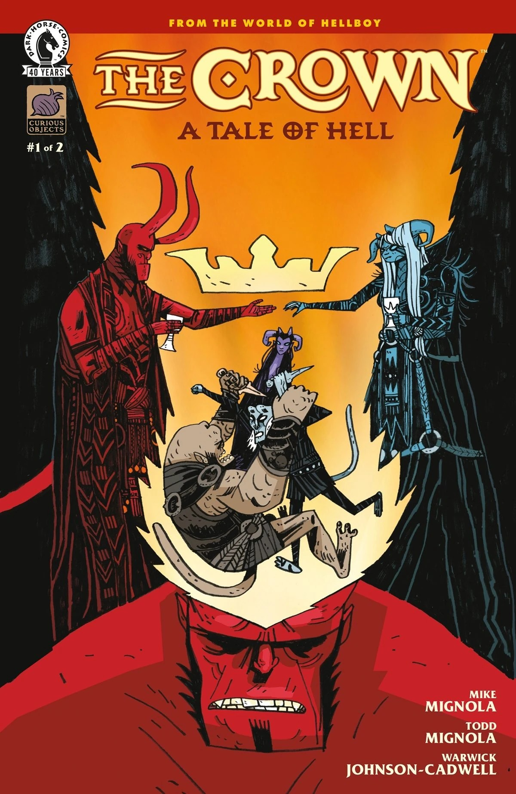
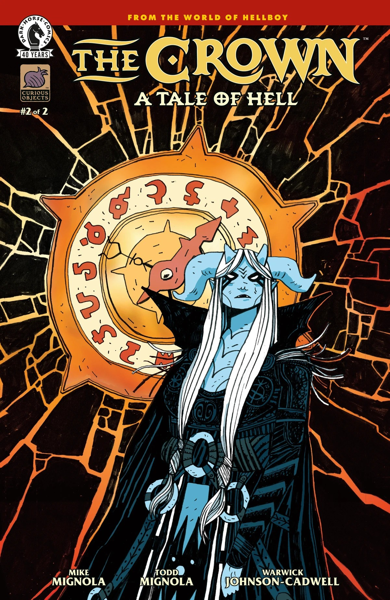
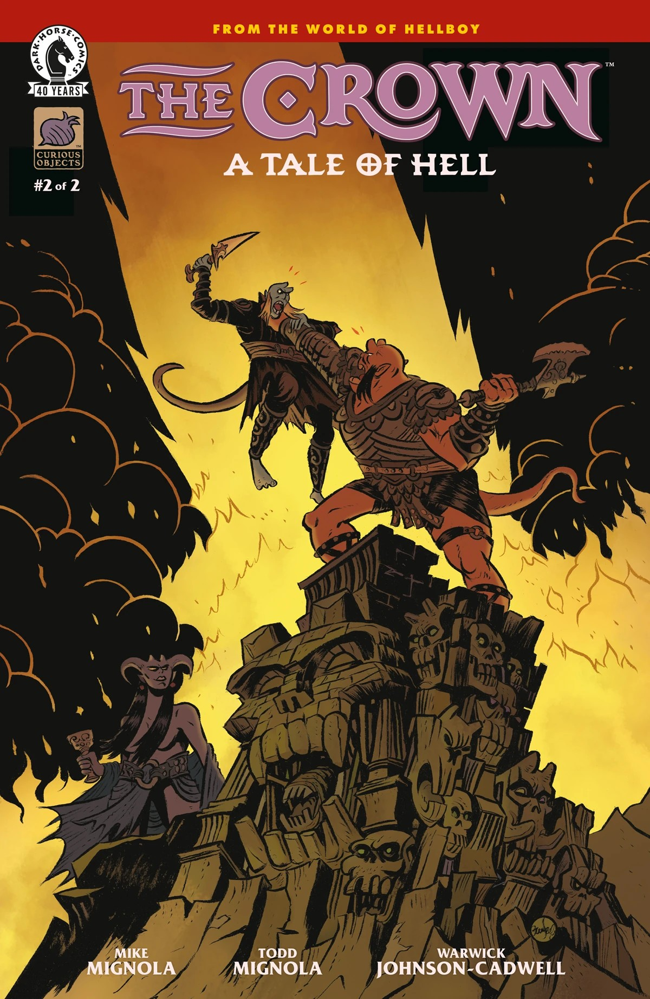

***The Crown: A Tale of Hell*** is a two-issue miniseries written by [Mike Mignola](/entry/Mike_Mignola) and [Todd Mignola](/entry/Todd_Mignola), and illustrated by Warwick Johnson-Cadwell in his Hellboy Universe debut. The story focuses on Hellboy's brothers, [Gamon](/entry/Gamon) and [Lusk](/entry/Lusk), in Hell during the 16th century.

## Synopsis

### Part One

Hellboy’s brothers fight for control of Pandemonium in this demonic family reunion. But it isn’t just the siblings who get involved in the power struggle, as their mother returns from her prison for the first time in a hundred years and has plans of her own.

### Part Two

The demon brothers’ fight for control of Pandemonium gets even messier when their sister joins in with her own ideas for the future of Hell.

## Gallery

*The Crown: A Tale of Hell* \#1  
by Warwick Johnson-Cadwell

*The Crown: A Tale of Hell* \#1  
variant by Mike Mignola with Dave Stewart

*The Crown: A Tale of Hell* \#2  
by Warwick Johnson-Cadwell

*The Crown: A Tale of Hell* \#2  
variant by Bruno Seelig

|The Crown: A Tale of Hell #1 by Warwick Johnson-Cadwell

|The Crown: A Tale of Hell #2 by Warwick Johnson-Cadwell

|The Crown: A Tale of Hell #2 variant by Bruno Seelig
