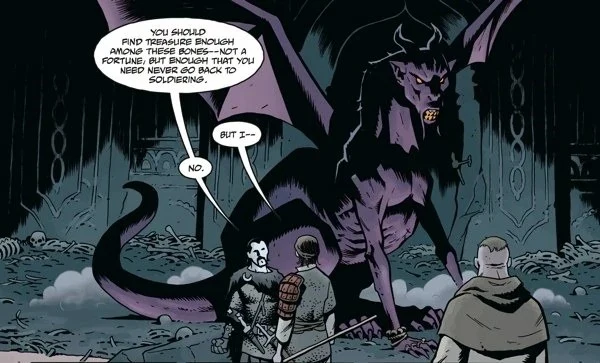

**The Dragon**was a magical ruler during the time of [Koshchei](/entry/Koshchei_%28character%29)'s life.

## History

During Koschei's lifetime, the Dragon was a ruler of a realm in the Slavic region that held courts of all sorts of devils, witches, and ghosts. While out for a walk in the woods one day, he stumbled upon a young Koshchei on the verge of death. The Dragon offered to heal Koshchei with his magic in return that Koshchei acts as his servant for nine years. Koshchei agreed. After the nine years that Koshchei diligently served, the Dragon grew fond of him and offered to take Koshchei on as his own son, teaching him magic and allowing him to stay in his domain forever, Koshchei refused stating that he would rather live like a man. Understanding Koshchei, the Dragon gave him a parting gift; a magical mail shirt that as Koshchei wore is, no weapons would harm him.

When Koshchei was betrayed, killed, and had his body chopped up and left in the woods, the Dragon smelled the familiar blood and found the remains of Koshchei. The Dragon took the remains of his friend back to his castle and reanimated him. To ensure that Koshchei would never suffer death again, the Dragon took Koshchei's soul from his body and hid it inside an egg, inside a duck, inside a rabbit, inside a goat, inside of a tree, on an island just beyond the edge of the world. After that, Koshchei set out once again, but this time was for revenge.

The two would meet again under dire circumstances. Koshchei tricked by the [Baba Yaga](/entry/Baba_Yaga_%28character%29), she fooled him in killing the Dragon's mate and his children. Though angry and mournfully at this, the Dragon did not blame his foster son. Now the last of his kind, the Dragon died of sadness.

## Gallery

|The Dragon in his true form.
