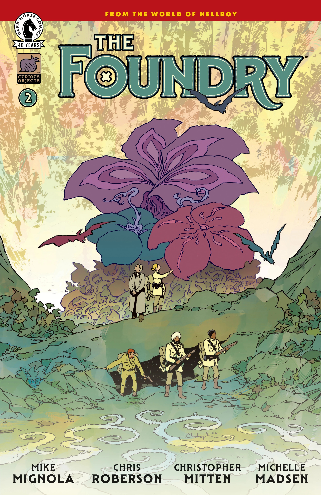

*This article is a stub. You can help Hellboy Wiki by expanding it.*

***The Foundry*** is a comic book series written by Mike Mignola and Chris Roberson, and illustrated by Christopher Mitten. It focuses on [the Foundry](/entry/Foundry_(organization)), particularly the character Major Karam Singh.

## Publication history

When the series was initially announced, Dark Horse's marketing referred to it as a four-issue miniseries called *The Foundry: In Peril on the Seas*. For unknown reasons, it is now simply titled *The Foundry*. Editor Katii O'Brien hinted in the announcement that there would be developments that would have implications for the Hellboy Universe as a whole.

## Synopsis

### Part One

Meet the Queen’s own secret agency that investigates the paranormal and the mysterious! Characters from Witchfinder and The British Paranormal Society join together in this adventure series where they travel the world over seeking out supernatural-powered technologies and the stories of the civilizations that harnessed them—for good and for evil.

### Part Two

The Queen’s paranormal investigators’ mission is off to a sinking start when their airship gets attacked by an unseen foe!

## Gallery

All covers by Christopher Mitten.

*The Foundry* \#1

*The Foundry* \#2

|The Foundry #2
