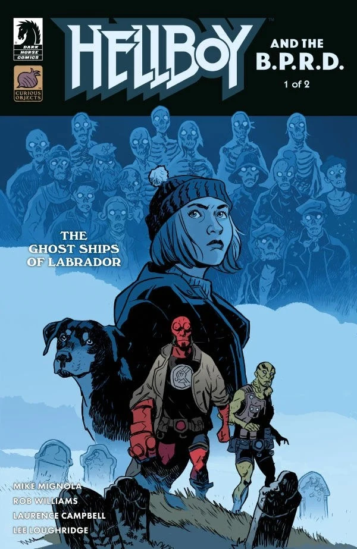
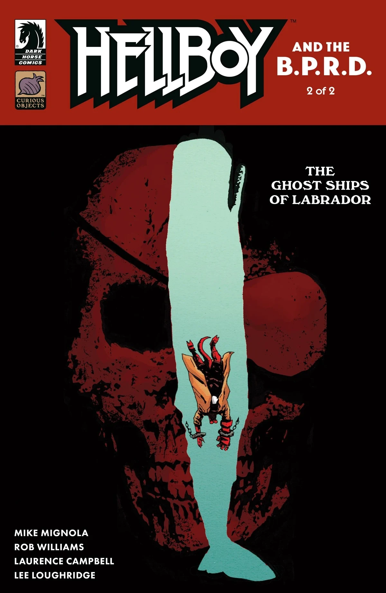
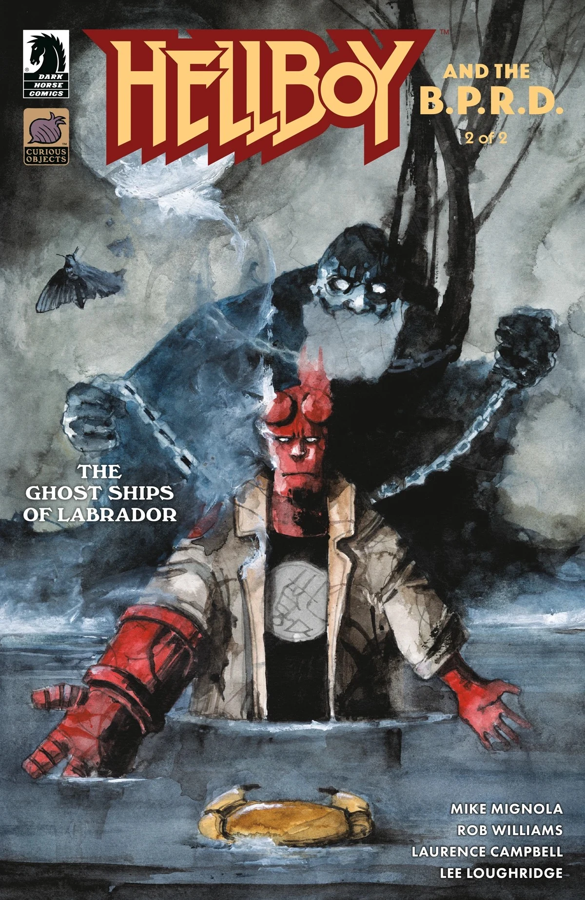

***The Ghost Ships of Labrador*** is a two-issue arc of *[Hellboy and the B.P.R.D.](/entry/Hellboy_and_the_B.P.R.D.)* written by [Mike Mignola](/entry/Mike_Mignola) and [Rob Williams](/entry/Rob_Williams) and illustrated by [Laurence Campbell](/entry/Laurence_Campbell).

## Synopsis

### Part One

A town overrun by ghosts would be enough of a problem, but Hellboy has an even bigger problem on his hands when a fellow B.P.R.D. agent disappears amongst the paranormal chaos.

### Part Two

Hellboy will go to any lengths to save a missing agent—even if it means diving in to the belly of the spectral beast.

## Gallery

*Hellboy and the B.P.R.D.: The Ghost Ships of Labrador* \#1  
cover by [Laurence Campbell](/entry/Laurence_Campbell)

*Hellboy and the B.P.R.D.: The Ghost Ships of Labrador* \#1  
variant cover by [Matt Smith](/entry/Matt_Smith)

*Hellboy and the B.P.R.D.: The Ghost Ships of Labrador* \#2  
cover by [Laurence Campbell](/entry/Laurence_Campbell)

*Hellboy and the B.P.R.D.: The Ghost Ships of Labrador* \#2  
variant cover by [Daniele Serra](/entry/Daniele_Serra)

|Hellboy and the B.P.R.D.: The Ghost Ships of Labrador #1 variant cover by Matt Smith

|Hellboy and the B.P.R.D.: The Ghost Ships of Labrador #2  cover by Laurence Campbell

|Hellboy and the B.P.R.D.: The Ghost Ships of Labrador #2 variant cover by Daniele Serra
