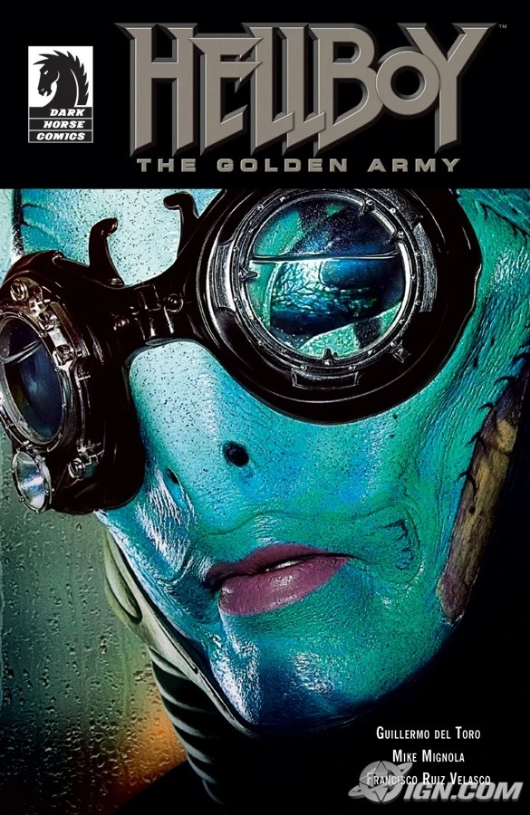

12-page full-color promotional tie-in comic serves as a narrative bridge between the Hellboy comic universe and the 2008 film *[Hellboy II: The Golden Army](/entry/Hellboy_II__The_Golden_Army)*.

## Synopsis

The comic book tells the bedtime story that young Hellboy's adoptive father, Trevor Bruttenholm, shared with him during Christmas 1955.

## Gallery

cover A

|cover B

|cover C
