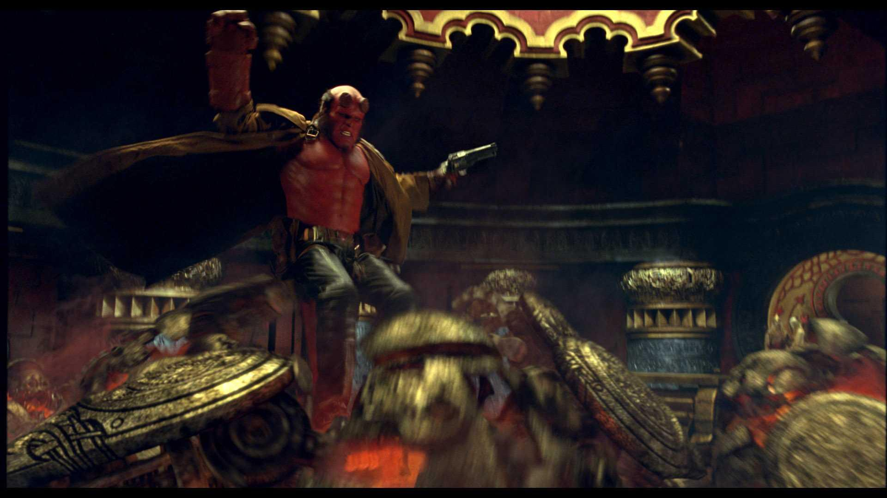
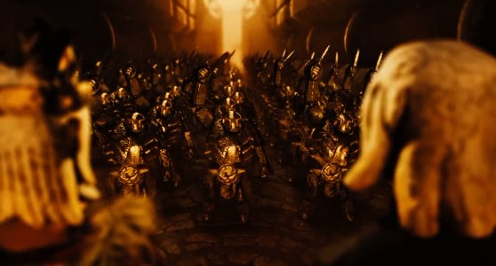
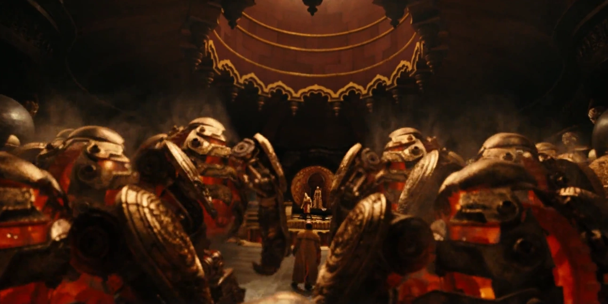
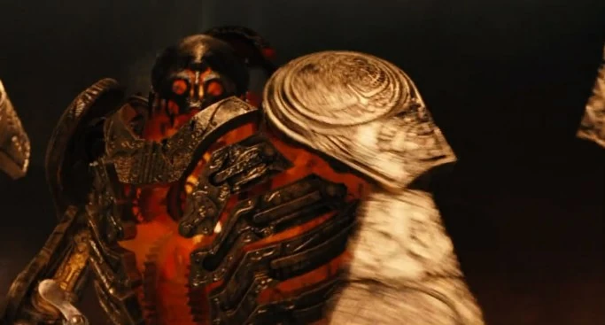

*For the army as a general concept and the 2008 film, see [Golden Army](/entry/Golden_Army) and [Hellboy II: The Golden Army](/entry/Hellboy_II__The_Golden_Army).*

The **Golden Army**, or the "unstoppable force", was a clockwork army composed of 70x70 (4,900) mechanical warriors, each far larger and stronger than any human. They could repair themselves from all damage and were effectively indestructible due to this.

It was commissioned by King [Balor](/entry/Balor) during the first wars against mankind and later locked away by him to prevent its power from falling into unworthy hands. The Golden Army can only be controlled by an individual of royal blood who wears [the Golden crown](/entry/Crown_of_Bethmora), though command of the Army can be won over in honorable combat.

## History

 The Golden Army came into being countless ages ago, when a Master [Goblin blacksmith](/entry/Goblin_%28Bethmoran%29) suggested to [King Balor](/entry/King_Balor) of the [Elves](/entry/Elves) that to defeat mankind, they would need an army capable of destroying them utterly, if not to do so, then as a threat. With his son [Nuada](/entry/Nuada) convincing him to allow it, Balor commissioned the Golden Army's creation along with the only means to activate and control them: the mythical [Crown of Bethmora](/entry/Crown_of_Bethmora). However, as Balor learned too late from watching the complete destruction of the opposing humans, the Golden Army were incapable of both mercy and remorse, and as such held nothing back in combat. The Golden army did not distinguish between friend or foe—they had no pity for the weak, the feeble, the young or the elderly. They simply destroyed wherever they roamed, leaving countless corpses in their wake.

The sight of this carnage convinced Balor to forge a truce with the thoroughly cowed humans, and as part of that truce, he ordered the crown broken into three pieces: two for the Elves to hold and one for Mankind to protect, while the Golden Army itself was deactivated and sealed away in [Bethmora](/entry/Bethmora), located in Northern Ireland, before the city was ravaged by disease.

Centuries later, returning from his self-imposed exile, Nuada began to reassemble the Crown of Bethmora to bring the Golden Army back to life for the complete genocide of the human race. Though the [B.P.R.D.](/entry/B.P.R.D.) agents attempted to stop Nuada, they found themselves outnumbered and overwhelmed by the Golden Army. Luckily, being the son of the [Fallen One](/entry/Azzael), [Hellboy](/entry/Hellboy_%28character%29) was able to challenge Nuada as the Golden Army observed the fight, ready to obey the orders of the victor. Once [Liz Sherman](/entry/Liz_Sherman) melted down the crown, the Golden Army was finally shut down for eternity, never to awaken again.

## Appearance and Abilities

The Golden Army is, as the name implies, a legion of huge clockwork soldiers made entirely of gold and animated via a special type of magic which links the army to the [Crown](/entry/Crown_of_Bethmora) of [Bethmora](/entry/Bethmora), a mystical crown that gives those who wear it the ability to command these terrifying constructs. They took spherical form when inactive, and once awakened, the head and limbs popped out with what appeared to be some sort of magical clockwork reactor that gives off a golden-orange glow.

Each of these clockwork soldiers possesses heated retractable blades on their large arms as primary weapons. They displayed superhuman strength and resilience, as they could tear enemies apart with their bare hands and were able to fight even at the very point of being completely incapacitated. Even so, being made of gold, the Army was still susceptible to damage with their own weapons and firearms or with firepower that at least equals Hellboy’s Samaritan.

Their true power, however, lies in both their numbers and their ability to repair themselves from any form of damage. The testament of their indestructability is shown when these constructs are severely damaged, their scattered components will return to the rest of their bodies as they reform. Nothing can stop them from repairing themselves from damage, even severe mutilation. The only way to stop them is by shutting them down via Crown of Bethmora's destruction.

## Personality

In spite of their obedience towards the bearer of the [Crown](/entry/Crown_of_Bethmora), the Army proved too savage and ruthless in their approach in eradicating their enemies, for they lacked the ability to differentiate good and evil, soldiers and peasants, and even innocent or otherwise. A testament of their savagery further explained in the novelization of the movie: The army not only marched for the battlefield but also attacked settlements of innocent humans who happened to be neutral or entirely had nothing to do with war between mankind and magical creatures itself.

Whilst merely a group of soulless constructs, The Army themselves can display limited emotion: The one briefly possessed by Krauss displayed confusion and fear when the agent exited his suit and possessed it. Some of these constructs are even shown roaring and screaming when taunting the heroes or being heavily damaged to the point of becoming temporarily incapacitated. Even so, the Army displayed a lack of hesitation in attacking one of their own since they can repair themselves, as shown when one of the clockwork soldiers was willing to bisect its fellow soldier possessed by Krauss just to free it from his control and influence.

## Role

The Army was proposed by a [goblin](/entry/goblin) [blacksmith](/entry/Goblin_Master_Blacksmith_%28Bethmoran%29) who sought the respect of King Balor, and when the King was despairing over the human onslaught, he agreed to have the blacksmith build him a gigantic Army.

The next time the humans marched, the earth trembled, and the skies darkened from the looming Golden Army. The onslaught was unstoppable, and the sadistic Golden Army slaughtered injured humans and innocent bystanders alike. Nobody survived when the Golden Army marched.

One might argue the humans got their just desserts for starting a war, but does violence truly solve violence?

After the army savagely slaughtered innocent humans, King Balor despaired further over the evil the Army had wrought, so he ordered it deactivated. The goblin blacksmith responsible for their making agreed with Balor, and confessed that sometimes he wished he had never made the Army.

When the goblin took [Hellboy](/entry/Hellboy_%28character%29) to the Prince, Abraham Sapien gave Nuada the third piece of the [Crown of Bethmora](/entry/Crown_of_Bethmora), which could control the Army, for whoever wore the Crown would be the rightful leader and King of the Army. One of royal blood simply had to wear the Crown, announce "I am King (insert name here) ruler of the Golden Army. Is there any who would dispute my right?" If the Golden Army recognized the royal blood, they would salute the ruler. If the ruler was challenged by another being, then they would have to accept the challenge. Years later, when Prince Nuada put the Crown on and declared himself King, to which the unstoppable Army awoke. Hellboy attempted to fight the Golden Army all by himself. Eventually, Johann Krauss, the ghost secret agent, entered the fight by possessing one of the Golden Army. The two were able to hold their own, however one of them managed to stab Krauss causing him to reenter his original body.

The Golden Army eventually repaired itself, and surrounded Hellboy, Liz, Abe, and Johann. Out of ideas, Hellboy, remembering the story Professor Broom had told him, challenged Prince Nuada for the right to command the Golden Army. Prince Nuada proclaimed that Hellboy wasn't royalty so he can't challenge for the right to command the army. However, Princess Nuala told her brother that Hellboy is royalty, as she called him "the son of [Fallen One](/entry/Azzael)". After learning this, Prince Nuada accepted his challenge and the two fought, with Hellboy emerging victorious. However, Nuada, refusing to let anyone else to claim the power of the Golden Army, attempting to kill Hellboy. Fortunately, Nuala saved Hellboy by killing herself, as if she gets injured, her brother will get the same injury. When Prince Nuada died, Hellboy was tempted to claim the powers of the Golden Army, but Liz Sherman steps in and melts the Crown with her arsonic power, which resulted in the Golden Army permanently shutting down.

## Gallery

