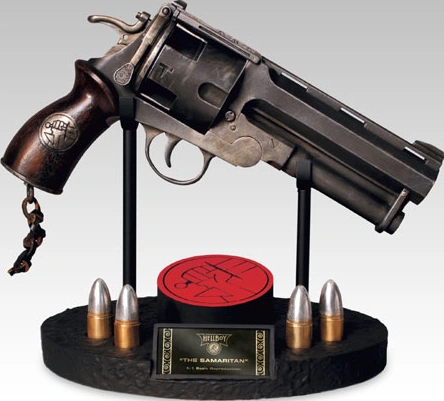

 **The Samaritan** is a weapon from the 2004 film *[Hellboy](/entry/Hellboy_%282004_film%29)* and its 2008 sequel *[The Golden Army](/entry/Hellboy_II__The_Golden_Army)*. The preferred sidearm of [Hellboy](/entry/Hellboy_%282004%E2%80%932008_film_character%29), the Samaritan is a massive revolver created by the [Bureau for Paranormal Research and Defense](/entry/Bureau_for_Paranormal_Research_and_Defense) that is capable of firing a variety of specialized bullets to fight monsters.

## Weapon Specifications

The Samaritan is an oversized top-break-action revolver, resembling a beefed-up Webley revolver. Its size and heft – nearly 10 pounds – make it viable as a bludgeoning weapon in addition to its normal operation.[1][2]

The cylinder has four chambers, accepting 22mm (0.866 caliber) rounds. It fires with a muzzle velocity of 1775 feet per second.[3] Slots on the chamber serve as indicators that allow an operator to quickly see if the gun is loaded.

As it is difficult for [Hellboy](/entry/Hellboy_%282004%E2%80%932008_film_character%29) to perform fine tasks with the large fingers of the [Right Hand of Doom](/entry/Right_Hand_of_Doom), he usually uses his left hand to both load and fire the sidearm; Hellboy makes use of speed-loaders to more easily arm the weapon. He does demonstrate an ability to fire it with his right hand in *The Golden Army*, during a fight in the Troll Market.

### Construction

The Samaritan was hand-forged in 1956, in Braintree, Massachusetts.[4] Its metal components were forged from a special alloy created from the iron of Irish church bells,[5] holy silver, fragments of blades used in the Crusades, cannonballs, and various sacred amulets; the gunsmiths invoked ancient and holy incantations during the smelting. The metal was cooled in sage water and finished by hand.[6]

A silver[7] B.P.R.D. medallion, given as an 18th-birthday gift to Hellboy by [Professor Broom](/entry/Trevor_Bruttenholm), is embedded into the wooden grips.[8] Some say that the wood was carved from a fragment of the true cross.[9]

A short, knotted leather lanyard is braided to the butt of the gun; the end dangles loose rather than being tied to anything. Hellboy carries the gun in a leather belt holster that is emblazoned with a large "US" leather stamp; this holster is custom-made and reinforced for the weapon's great strength and size.[10]

### Special Rounds

Hellboy makes custom bullets himself as a hobby; there are twelve different varieties in total, including silver, gold, and hollow-point as well as the "whoppers" and tracking rounds.[11]

#### Whoppers

These rounds, Hellboy's favorites, are tipped with explosive shells that contain white oak chips, holy water, clover leaves, and silver shavings. These ingredients, each bearing a folkloric power to impede evil and/or specific monsters, have the potential to injure the supernatural foes Hellboy may face.

#### Tracking Rounds

These contain a phosphorescent green liquid that will drip from the wound they open on a target, allowing the target's path to be easily followed in low-light situations. In the film, Hellboy deploys one such round when fighting [Sammael](/entry/Sammael).

## Gallery

## Design

The Samaritan does not take its name or design from any particular [gun used by Hellboy](/entry/Hellboy%27s_gun) in [the comics](/entry/Hellboy_%28series%29), though its holster and general size is somewhat comparable to handguns used by the comic character.

[Guillermo del Toro](/entry/Guillermo_del_Toro)'s script initially described the gun in a different manner than its ultimate appearance:

> Hellboy unlocks a steel box (stenciled on its lid: "The Good Samaritan") and extracts the meanest-looking, custom-built, double-barrel, blue-finished handgun ever made. A veritable cannon.[15]

[TyRuben Ellingson](/entry/TyRuben_Ellingson), visual designer for *Hellboy*, developed the look of the Samaritan. Though his initial sketches followed the side-by-side double-barrel structure specified in the script, Ellingson eventually reworked the design to a four-chamber single-barrel revolver. During the design process, the adjective "Good" was also dropped from the name – its final name in the movie is simply "The Samaritan".[16][17][18][19][20]

The Samaritan (and its holster) was ultimately built by Weta Workshop artists Jason Docherty, Dominic Taylor, John Harvey and Mike Grealish.[21]

## Trivia

- The weapon's name is an allusion to the Biblical parable of the Good Samaritan; Hellboy named it "The Samaritan" because it puts monsters out of their misery,[22] in a tongue-in-cheek nod to the mercy of the Biblical figure.
  - In the film, [Trevor Bruttenholm](/entry/Trevor_Bruttenholm) describes himself as Catholic ("among other things"), so he and his adopted son Hellboy would be familiar with the story.
- Although the gun only has four chambers, Hellboy is seen firing it at least six times before reloading in certain action scenes.
- The promotional website for the first film refers to the Samaritan simply as "Hellboy's Big Gun" and describes it in a slightly different manner:
  - *"Hellboy's Big Gun is a not-so-miniature hand cannon that most people would use to blow huge holes in buildings. The .60 mm mega-pistol blows holes the size of Buicks through opponents wearing armor-plated gear. With an oversized chamber holding 4 of these bad-boy bullets, this weapon is the ultimate tool for bumping back against what bumps in the night."*[23]
    - A ".60 mm" pistol is nonsensical, as that would indicate an internal barrel diameter of less than a millimeter. ".60 *caliber*", by comparison, is slightly smaller than the 22mm bullet size that the final prop uses.
- At the end of *Hellboy II: The Golden Army*, Hellboy quits the B.P.R.D. and surrenders his equipment to [Director Manning](/entry/Thomas_Manning). However, he swiftly returns to claim the Samaritan, cheekily remarking "On second thought, I think I'll keep this."
- The Samaritan was created for the 2004 *Hellboy* movie and is distinct to the film and its sequel. In the comics (and other adaptations thereof) [Hellboy](/entry/Hellboy_%28character%29) uses [different guns](/entry/Hellboy%27s_gun);[24] the appellation "Samaritan" is often applied to these by fans, but is not given in the work themselves.
  - Hellboy uses several guns in the comics, most prominently a single-shot handcannon given to him by [the Torch of Liberty](/entry/the_Torch_of_Liberty) and an M1911 pistol given to him by [Harry Middleton](/entry/Harry_Middleton).
  - [Hellboy](/entry/Hellboy_%28Injustice%29) wields a revolver in *[Injustice 2](/entry/Injustice_2)*. Moves using the weapon are referred to as "Devil's Revolver", but the handgun itself is referred to generically as "his trusty revolver".
  - Hellboy uses a different [unnamed revolver](/entry/Hellboy%27s_revolver_%282019_film%29), dubbed the "devil revolver" by production staff, in [the 2019 film](/entry/%E5%9C%B0%E7%8B%B1%E7%94%B7%E7%88%B5%EF%BC%9A%E8%A1%80%E7%9A%87%E5%90%8E%E5%B4%9B%E8%B5%B7)).
  - Another unique revolver is wielded by Hellboy in *[The Crooked Man](/entry/Hellboy__The_Crooked_Man_%28film%29)*; again, it is not referred to by a special name.

## References

<references responsive="0" />

## See Also

- [Big Baby](/entry/Big_Baby)

[1]

[2]

[3]

[4] DVD Comics: "The Samaritan". *Hellboy: Director's Cut* (3 Disc Special Edition) DVD, 2004.

[5] DVD Comics: "The Samaritan". *Hellboy*, "2-Disc Special Edition" DVD, 2004.

[6]

[7]

[8]

[9]

[10]

[11]

[12]

[13]

[14]

[15]

[16]

[17] Del Toro, Guillermo (director) (April 2, 2004). *Hellboy* (motion picture). Event occurs at 25:51.

[18] Del Toro, Guillermo (director) (April 2, 2004). *Hellboy* (motion picture). Event occurs at 29:30. "I'm not a very good shot but The Samaritan here uses really big bullets."

[19] ["Hellboy Revolver 'The Samaritan'"](https://web.archive.org/web/20040414111416/http://www.sideshowtoy.com:80/cgi-bin/category.cgi?category=hellboy_props&item=8911). *Sideshow Collectibles***.** (2004)

[20] ["'The Samaritan' - Hellboy II Revolver"](https://web.archive.org/web/20080328174715/http://www.sideshowtoy.com/?page_id=4489&sku=8931). *Sideshow Collectibles, Inc.* (2008)

[21] ["Weta Workshop // Projects - Hellboy"](https://web.archive.org/web/20071103065401/http://www.wetaworkshop.co.nz/projects/filmography/film/hell_boy) 2003

[22]

[23] "Hellboy //Weapons". [*HELLBOY* website](https://web.archive.org/web/20041011154131/http://www.sonypictures.com/movies/hellboy/site/hellboy_main.html).

[24] ["HELLBOY 3 News"](https://collider.com/hellboy-3-news-guillermo-del-toro/). *Collider*, 8 Jul 2013. (DEL TORO: "Mike \[Mignola\] said very clearly, “*Hellboy* the movies is yours, *Hellboy* the comics is mine; I don’t wanna confuse them.”  He has been very clear about not bringing any mythology we did in the movies into the comics, like \[...\] The Samaritan, which is not called “The Samaritan” in the comics,")
