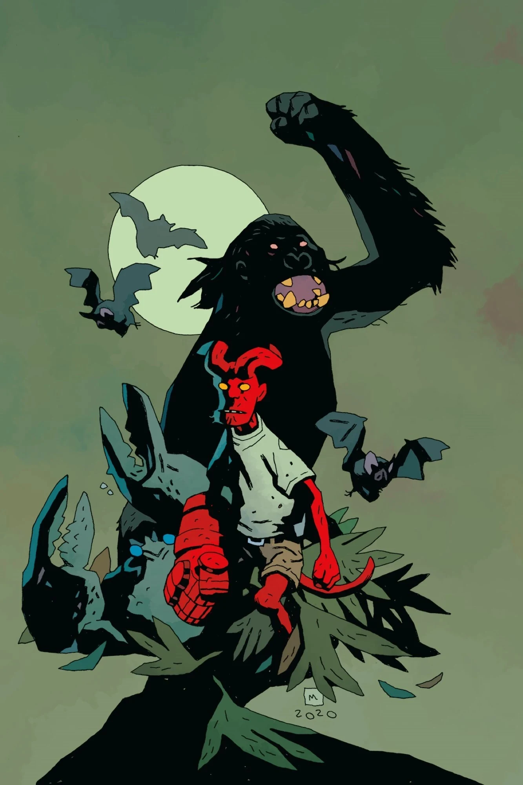
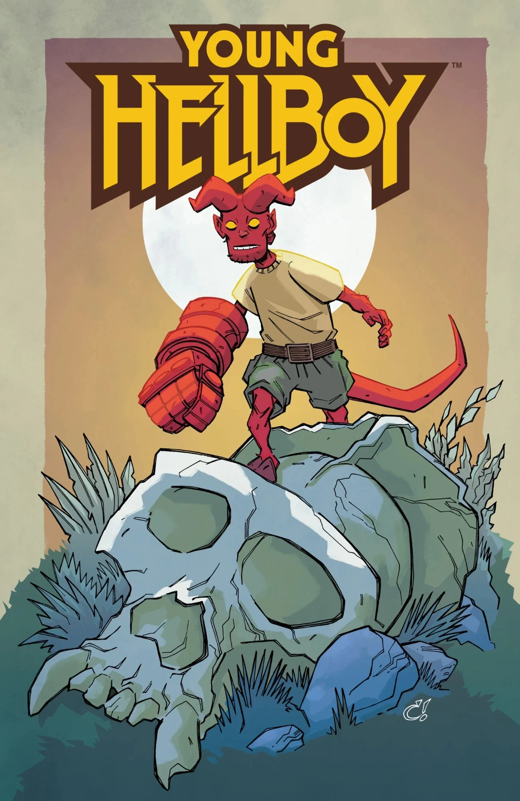
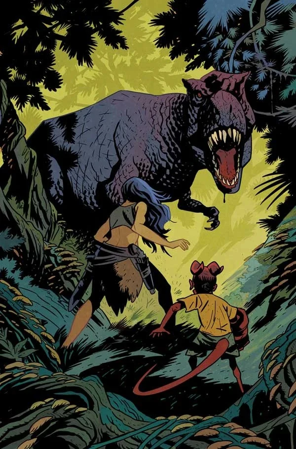
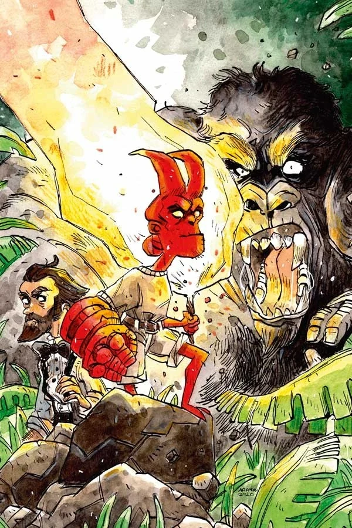
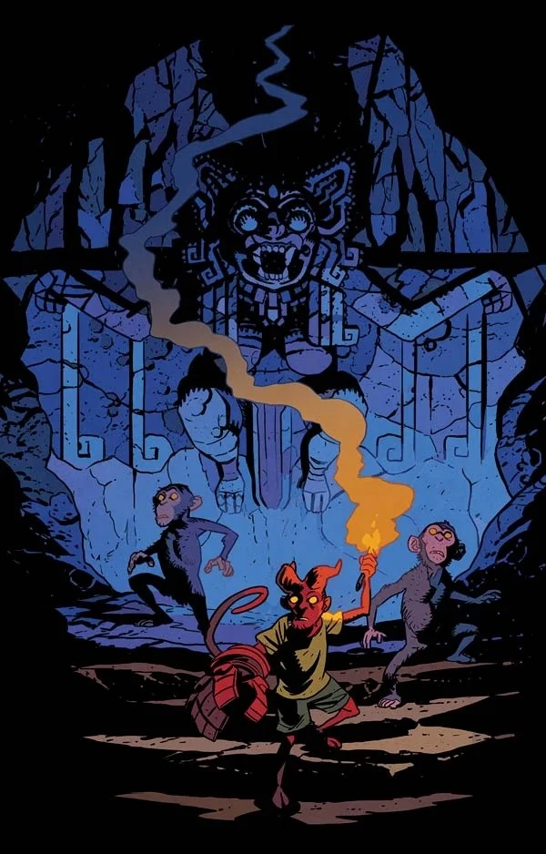
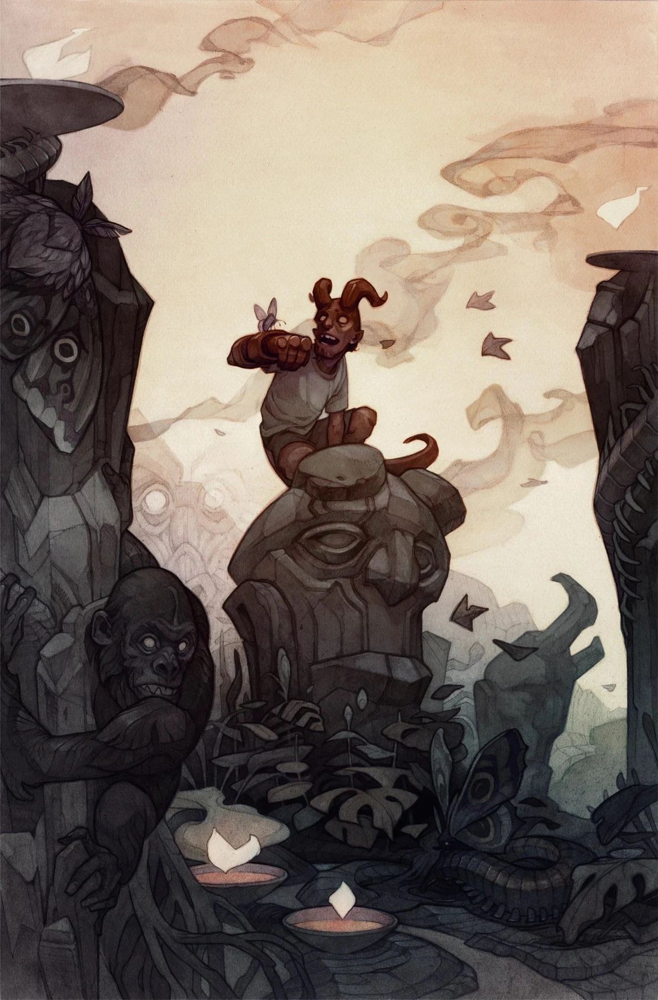
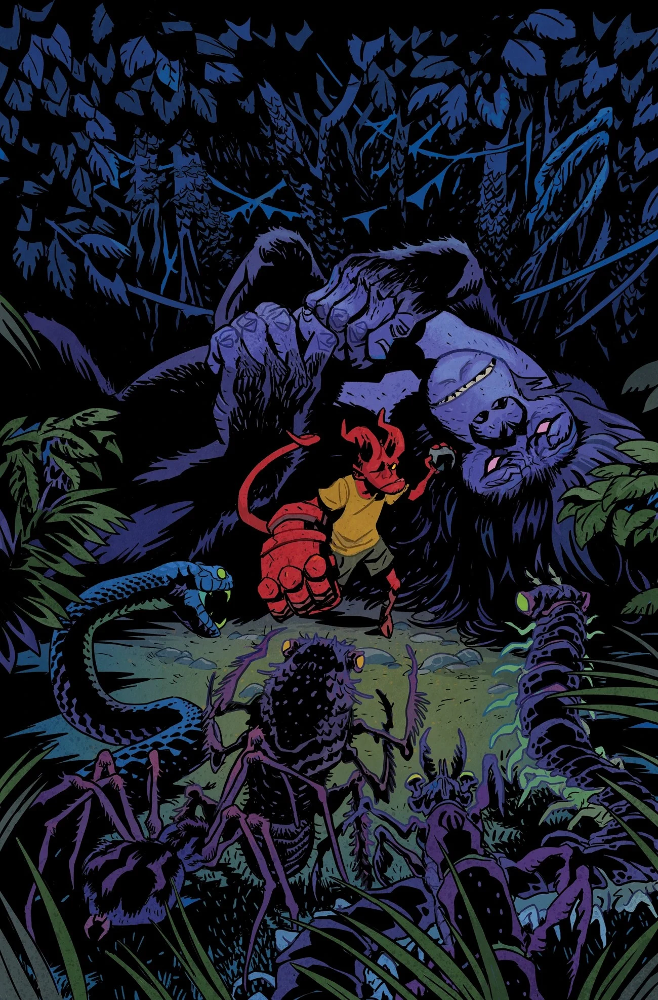
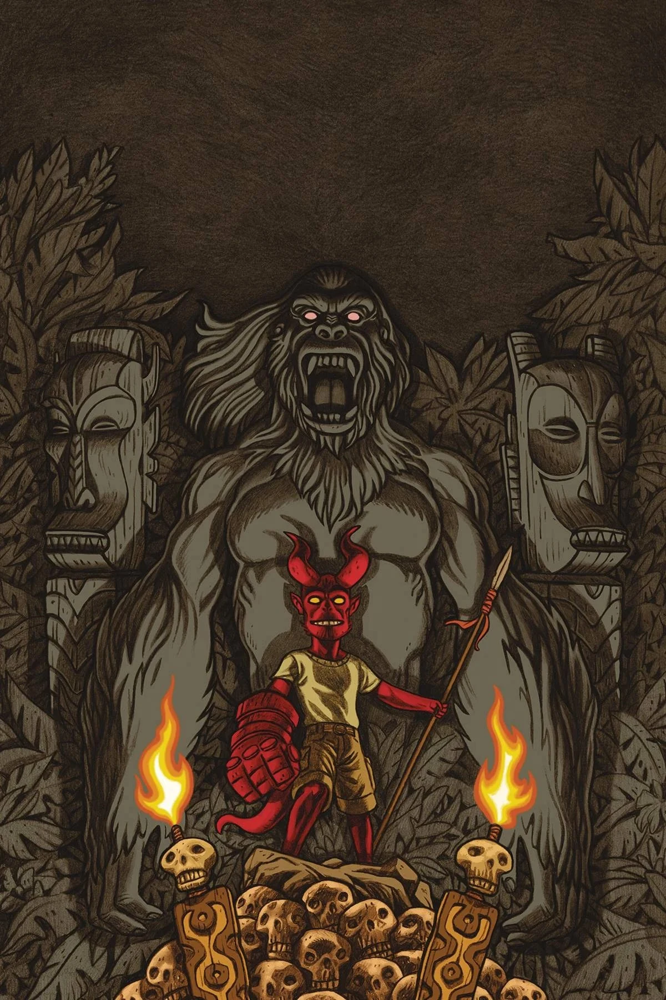

***The Hidden Land*** is a four-issue miniseries that came out February 2021 written by [Mike Mignola](/entry/Mike_Mignola) and Tom Sniegoski with art by [Craig Rousseau](/entry/Craig_Rousseau). It is the first story in the *[Young Hellboy](/entry/Young_Hellboy)* series. *The Hidden Land* features the first appearance of a new character, [Scarlett Santiago, the Sky Devil](/entry/Scarlett_Santiago).

## Publication History

Some copies of issue \#4 were misprinted; a lower resolution version of the cover image was used thus resulting in the art having an almost "pixilated" look.

## Synopsis

### Part One

Stranded on a strange island after a mishap on their way to a South American dig site, [Hellboy](/entry/Hellboy_(character)) and [Professor Bruttenholm](/entry/Trevor_Bruttenholm) are confronted by all manner of monsters! But even when the stranger who rescues them turns out to be one of Hellboy's heroes, they aren't as safe as they think they are!

### Part Two

After meeting a missing adventurer and being taken in by the island’s [Ohnar](/entry/Ohnar) people, Hellboy and Professor Bruttenholm delve deeper into the strange island’s mysteries. Exploring a previous civilization’s ruins reveals more about local history... and grabs the attention of some gruesome foes!

### Part Three

Hellboy, the Professor, [Scarlett](/entry/Scarlett_Santiago), and the Ohnar are all in danger when an ancient evil awakens. The [vampire](/entry/Vampire_(creature)) Vesperra and her undead legions are too powerful for Hellboy and his companions to face alone, but Scarlett has an ace up her sleeve that will give them a fighting chance.

### Part Four

The vampire queen Vesperra has awakened! The ancient ape god of the island has emerged from his avatar to fight her, but it may not be enough. Can Hellboy, Professor Bruttenholm, and their hosts survive long enough for the two adventurers to escape from the mysterious island they crashed on?

## Gallery

Issue \#1  
Cover by [Matt Smith](/entry/Matt_Smith)

Issue \#1  
Variant cover by [Mike Mignola](/entry/Mike_Mignola)  
with [Dave Stewart](/entry/Dave_Stewart)

Issue \#1  
Variant cover by [Craig Rousseau](/entry/Craig_Rousseau)  
(Forbidden Planet and Jetpack Comics exclusive)

Issue \#2  
Cover by [Matt Smith](/entry/Matt_Smith)

Issue \#2  
Variant cover by Rachele Aragno

Issue \#3  
Cover by [Matt Smith](/entry/Matt_Smith)

Issue \#3  
Variant cover by Wylie Beckert

Issue \#4  
Cover by [Matt Smith](/entry/Matt_Smith)

Issue \#4  
Variant cover by Anthony Carpenter

|Issue #1 Variant cover by Mike Mignola with Dave Stewart

|Issue #1 Variant cover by Craig Rousseau (Forbidden Planet and Jetpack Comics exclusive)

|Issue #2 Cover by Matt Smith

|Issue #2 Variant cover by Rachele Aragno

|Issue #3 Cover by Matt Smith

|Issue #3 Variant cover by Wylie Beckert

|Issue #4 Cover by Matt Smith

|Issue #4 Variant cover by Anthony Carpenter
