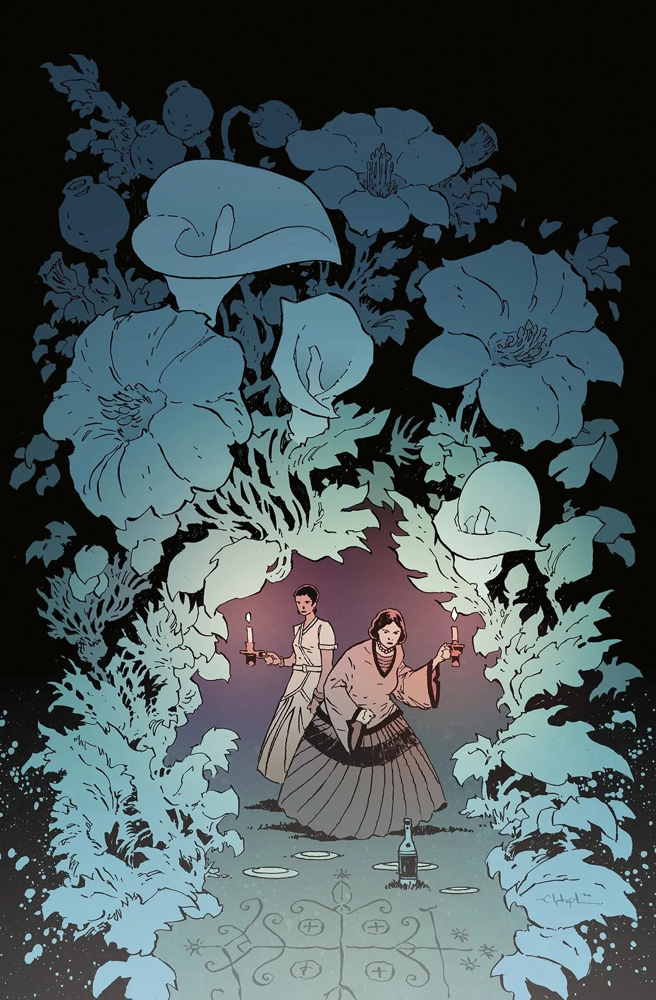
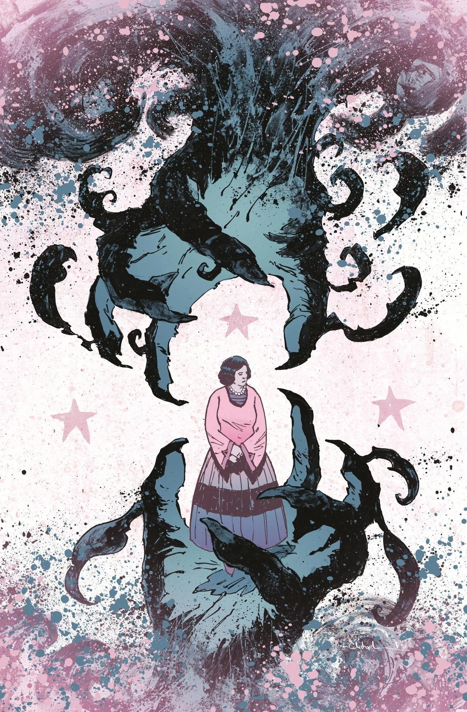
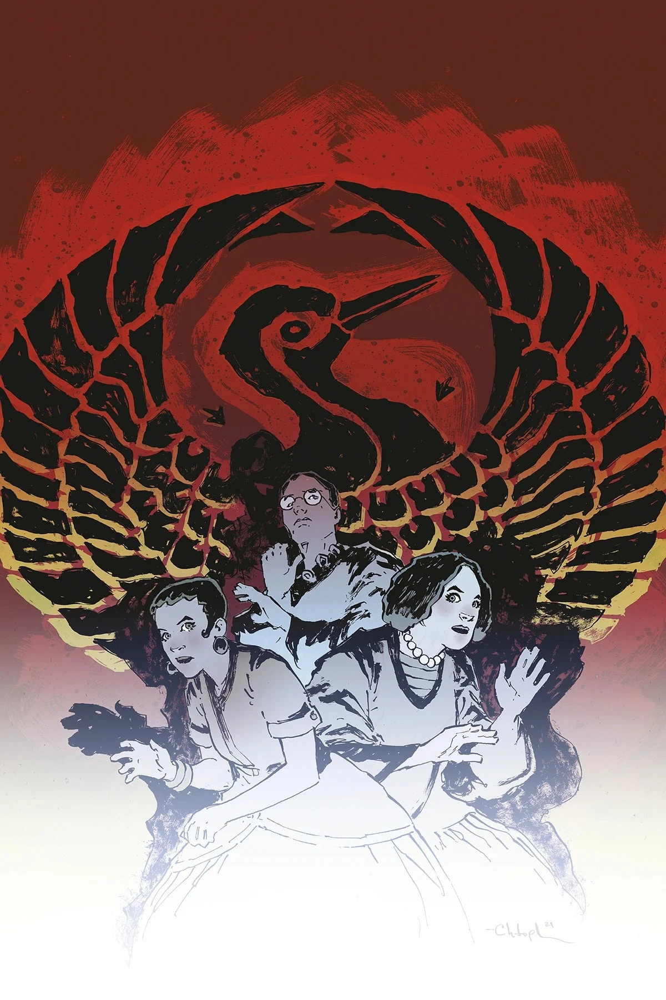
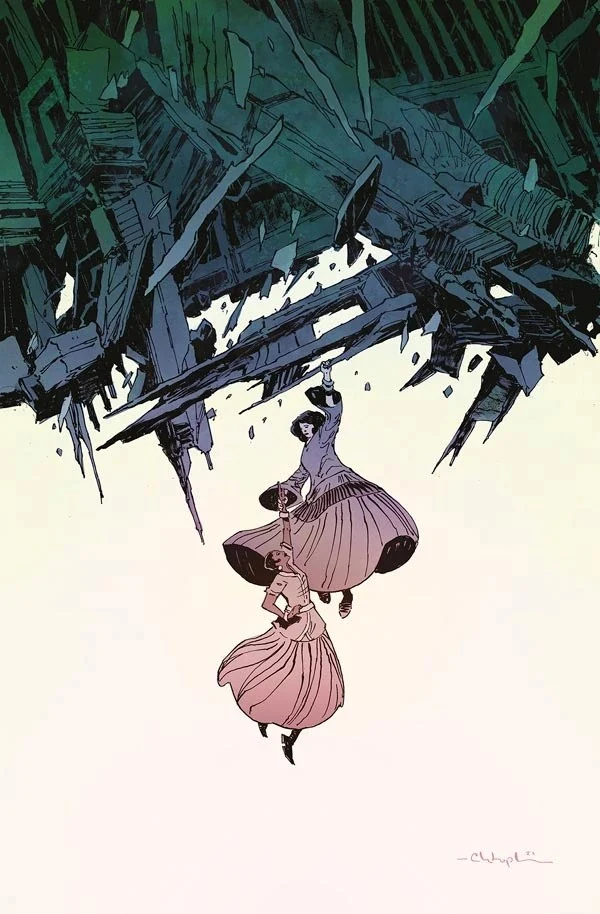

***The House of Lost Horizons*** is the first arc of *[The Sarah Jewell Mysteries](/entry/The_Sarah_Jewell_Mysteries)* series. It is a locked-room murder mystery with paranormal detective [Sarah Jewell](/entry/Sarah_Jewell) and her associate [Marie-Thérèse LaFleur](/entry/Marie-Th%C3%A9r%C3%A8se_LaFleur) on the case set on a private island off the coast of Washington where an occult auction is being held.

## Synopsis

### Part One

A locked-room murder mystery puzzles paranormal detective Sarah Jewell and her associate Marie-Thérèse when a weekend trip on a private island off the coast of Washington goes astray. Trapped by a storm and surrounded by myriad suspects who have gathered for an auction of occult items, the intrepid duo must unravel the supernatural mysteries surrounding the guests in hopes of uncovering the murderer! But all the while, bodies keep piling up, and at any moment Sarah or Marie Therese could be next!

### Part Two

The murder mystery continues after another body is discovered! The remaining guests on the storm-ravaged island wake from the same eerie nightmare to find that one of them has been the next victim of a brutal killing! But Sarah and Marie-Thérèse are starting to suspect that there may be more than one murderer afoot. Who is the killer, and if they're not discovered, who might they target next?

### Part Three

Two bodies down... how many more to go? A raging storm keeps the group of occult collectors trapped on the island, but some of them appear to be more restless than others. Sarah and Marie-Therése divide and conquer, following the two prime suspects down two different, but equally perilous, paths to danger!

### Part Four

Sarah Jewell catches one murder suspect red-handed in a bid to steal an occult artifact, while Marie-Therése continues to pursue her own suspicions. But the culprit they finally discover is the one person neither one of them suspected!

### Part Five

Sarah and Marie-Thérèse LaFleur have identified the murderer, but that turns out to be the least of their concerns! As supernatural forces stretch their influence over the island where Sarah and the others are trapped, one person’s selfishness and folly could be everyone’s undoing.

## Gallery

Covers by [Christopher Mitten](/entry/Christopher_Mitten)

Issue \#1

|Issue #2

|Issue #3

|Issue #4

|Issue #5
