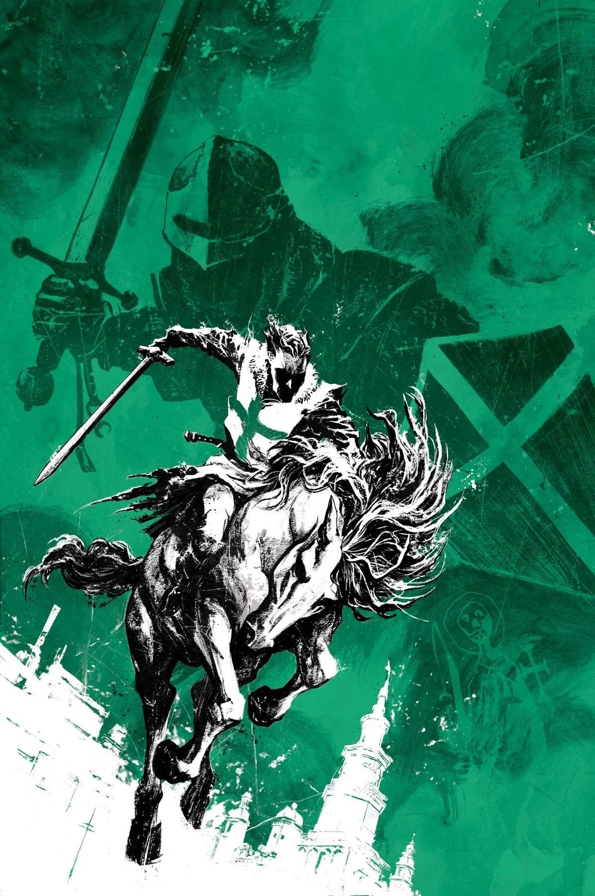
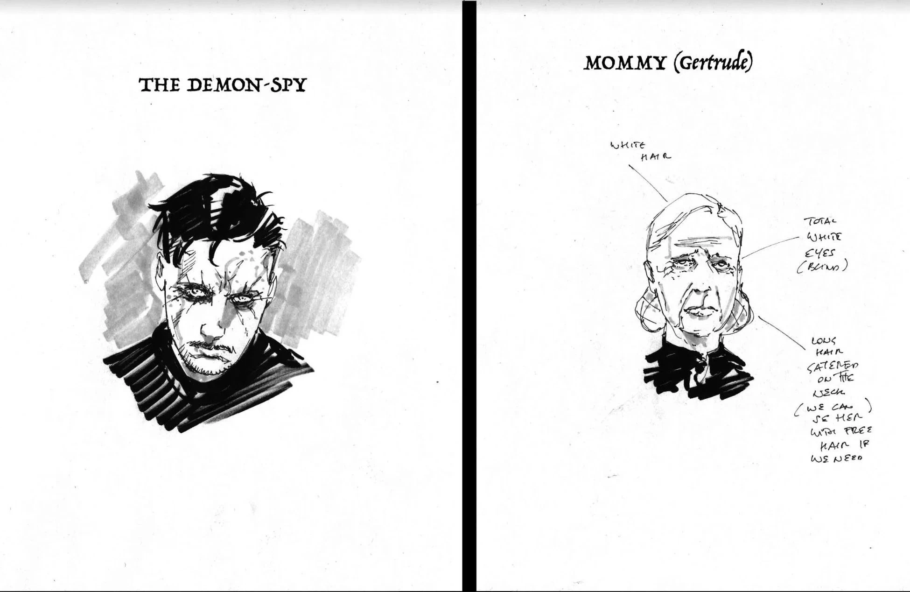
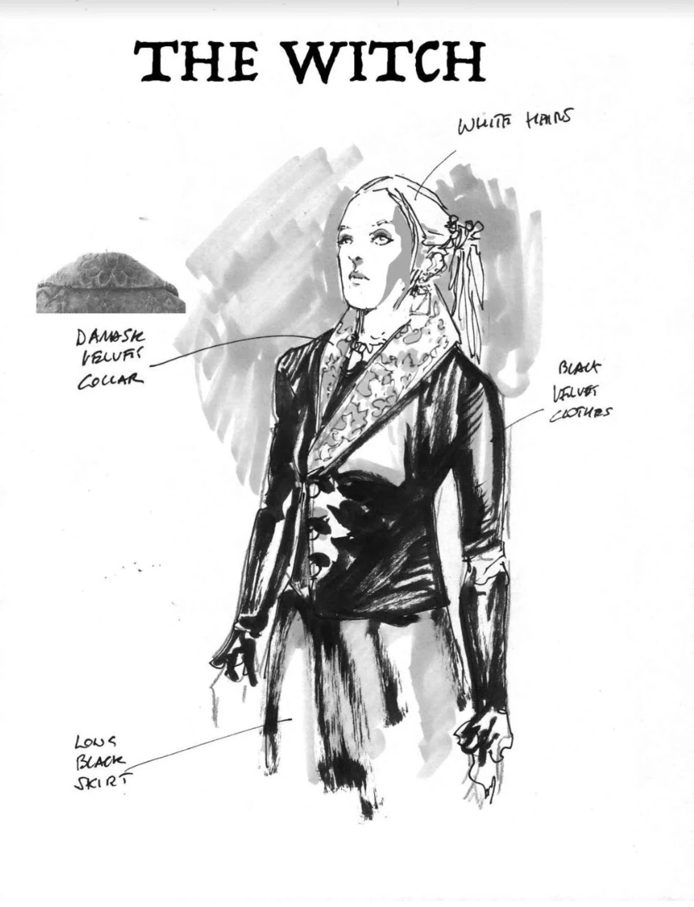
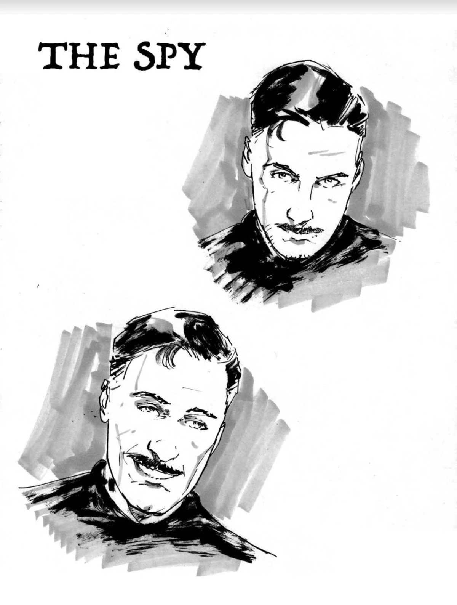
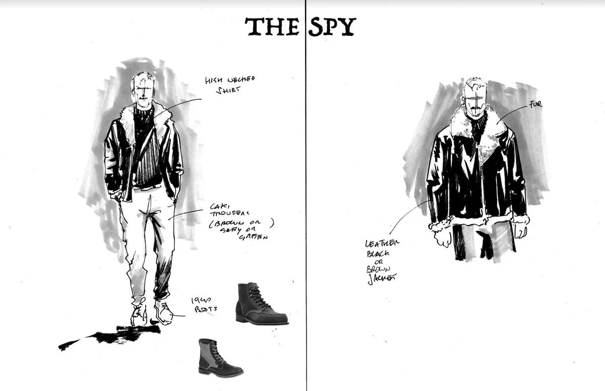

***The Last Knight of St. Hagan*** is a canceled four-issue miniseries that was planned to be written by Mike Mignola and Scott Allie with art by Andrea Mutti. It was announced January 11, 2020 just prior to the release of the *[Hellboy Winter Special (2019)](/entry/Hellboy_Winter_Special_(2019))*, which features a [short story](/entry/The_Beast_of_Ingelheim) teasing the miniseries.

## Publishing history

The first issue was originally set to debut in April 2020, but was delayed due to the COVID-19 outbreak. The miniseries was later canceled after news broke of co-writer [Scott Allie](/entry/Scott_Allie)'s predatory behavior.

## Publisher Summaries

### Part One

*A wily Polish spy, pursued by a group of Nazi enforcers, flees through the small town of Torun. The year is 1939, the beginning of the German occupation, and he carries important information for the resistance. But a bullet, a tomb, and a ghost—perhaps even God—have their own plans for the spy, and they will involve the mystical crusader knight St. Hagan.*

### Part Two

*The haunted are given life, but tasked with atonement.*

*Possessed by the will of St. Hagan, a Polish spy struggles to find his way in the growing WWII conflict. Returning to the scene of his apparent death, the spy learns of the mystical crusader knight St. Hagan—and the plans he seems to have for the spy.*

### Part Three

*A dire chase plays out against the backdrop of occupied Europe!*

*Goaded on by the spirit of St. Hagan, a Polish spy pursues the Nazi soldiers who stole valuable rebel intel and left him for dead. What the envelope contains is the key to stopping an occult doomsday plan. But occult forces at work in the Third Reich have sensed his presence, and move to intercept. Will one man, even infused with such a spirit, be enough to overcome that which stands against him?*

### Part Four

*The Last Knight of St. Hagain* was canceled before issue \#4 was solicited. No summary exists.

## Gallery

Covers by [Sebastián Fiumara](/entry/Sebasti%C3%A1n_Fiumara).

Issue \#1

Issue \#2

|Issue #3

|Concept art by Andrea Mutti

|Concept art by Andrea Mutti

|Concept art by Andrea Mutti

|Concept art by Andrea Mutti
