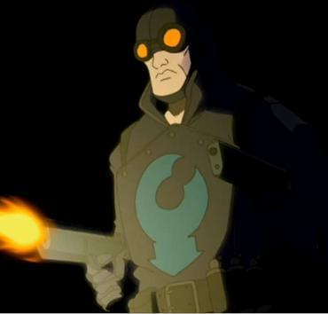

**The Lobster** was a vigilante who worked in secret in New York City during the 1930s. He had a reputation for violence, such as killing mobsters and burning his trademark lobster claw symbol into their foreheads.

In modern times, the general public believes the Lobster is only a fictional character created by a retired detective turned pulp author. These pulp stories gave him the (fictional) alter-ego of wheelchair bound millionaire Walter Johnson, inspiring his popular nickname "Lobster Johnson".

A few conspiracy theorists correctly believe the Lobster was real, though he was never referred to as "Lobster Johnson" in his own time.

He first appeared in the backup story *[Lobster Johnson: The Killer in My Skull](/entry/The_Killer_in_My_Skull)* that accompanied *[Hellboy: Box Full of Evil](/entry/Box_Full_of_Evil)* \#1.

## History

### Vigilantism

The origins of the Lobster and his identity has since remained unknown and never been determined. His first appearance in the public was pinpointed to the death of gangster Donny "Mints" Parker with a claw shape seared into his forehead in February 1934. For the next four years, the Lobster and his allies had waged a one-man war on gangs, with over a hundred (by some accounts, as many as two-hundred and fifty) gang-related victims confirmed between 1932 and 1938, including such organized crime figures as Zuco Banana, Skinny Joe Lincoln, and Victor "Vicky the Fish" Cipriani. Late in the 1930s, the Lobster focus from his war on crime to international affairs, such as foiling the attempts of foreign agents, which mainly consists of Axis spies and saboteurs, operating in America, and paranormal threats.

In 1932, the Lobster became involved with mobster [Arnie Wald](/entry/Arnie_Wald), who has been dipping into mystically enhanced crimes. The conflict with Wald drove the mobster into hiring [The Black Flame](/entry/The_Black_Flame_%28character%29).

In 1937, the Lobster came into conflict with the mysterious [Memnan Saa](/entry/Memnan_Saa) in a plot to create an army of dragons and resurrecting the Hyperborean empire from using the secrets of Professor [Kyriakos Gallaragas](/entry/Kyriakos_Gallaragas)'s work, "[Anum's Fork](/entry/Anum%27s_Fork)". The Lobster saved Gallaragas' daughter [Helena](/entry/Helena_Gallaragas) and Saa's plan was destroyed by Gallaragas' associate [Jim Sacks](/entry/Jim_Sacks). However, Memnan Saa escaped and becoming a dangerous enemy of the Lobster.[1]

The Lobster sworn in pursuing Memnan Saa, but the leads came into dead ends and tragedy as the Lobster's allies suffered tragic deaths in finding Saa, which left only his ally [Harry McTell](/entry/Harry_McTell). The losses forced the Lobster into abandoning his pursuit and subsequently began working as an independent agent for the United States government.[2]

### Working for the U.S. Government

In 1938, the Lobster was investigating a series of abnormal scientist murders in Upper New York City. A photo discovered in Dr. Skinner's apartment led the Lobster to the last remaining scientist of the original five employed by [Zinco-Davis](/entry/Zinco_Corporation); [Stanley Corn](/entry/Stanley_Corn). It is revealed that Stanley was the head of a top-secret research project at Zinco-Davis, but was fired as a result of his dangerous experiments on brains, including his own. Stanley then attempts to kill the Lobster, his assistant [Bob](/entry/Bob), and the police through brain energy waves, but are successfully blocked by a jamming device. Subsequently, the Lobster shot Corn but only for Corn's brain to emerge and attempt to strangle the Lobster with its spinal cord. Fortunately, the Lobster manages to break free and smash the jamming device against it, causing an explosion and the "death" of the brain.

In February 1939, in one of his few unsuccessful missions, the Lobster failed in capturing a Nazi criminal, who killed his assistant and destroyed a train full of scientists bound for the Manhattan Project.

The Lobster's final mission was an unsuccessful attempt to prevent the Nazis from launching a space capsule at [Hunte Castle](/entry/Hunte_Castle) in Austria on March 20, 1939. Although he managed to force the roof of Hunte Castle to close before the launch, the capsule managed to burst through. The subsequent explosion and fire within the castle killed everyone except Nazi scientist [Herman von Klempt](/entry/Herman_von_Klempt).

### Legacy

Ever since his demise, the Lobster inspired the public's imagination throughout the Second World War. The Lobster became a fictional character created in the pulp magazines published by [Norvell Cooper](/entry/Norvell_Cooper) (who claimed to have met and work alongside the Lobster) and made briefly popular in a couple of movies such as *The Phantom Jungle* (Republic Pictures, 1945) in which he was portrayed by Vic Williams, and a string of low-budget horror movies produced by Mexican director Eduardo Fernandez. In recent years, it is suggested that the fictionalization of the Lobster was an effort by the U.S. government to cover up the vigilante's existence, in which [Hellboy](/entry/Hellboy) (a lifelong Lobster fan) believed it to be so.

In February 2001, the Lobster's spirit was encountered by [B.P.R.D.](/entry/B.P.R.D.) agents Hellboy and [Roger](/entry/Roger) in the haunted ruins of Hunte Castle. The Lobster was instrumental in stopping Herman von Klempt and [Rasputin](/entry/Rasputin)'s plot to bring the [Conqueror Worm](/entry/Conqueror_Worm) to Earth, completing in death the mission he had failed to do in life. In the aftermath, the Lobster's bullet ridden, desiccated corpse was subsequently discovered by Hellboy and Roger, whom they give a burial for the restless vigilante.

However, the Lobster never did come to rest. In July 2003, the Lobster again helped Roger and [Liz Sherman](/entry/Liz_Sherman) in resolving his failed 1939 mission and capturing the now aged saboteur. When Memnan Saa began to make his presence felt to the B.P.R.D. during the war against Sadu Hem's [frog monsters](/entry/frog_monster), the Lobster briefly took possession of [Johann Kraus](/entry/Johann_Kraus)'s ectoplasm in the wake of [Ben Daimio](/entry/Ben_Daimio)'s disastrous end of relations with the team to break the hold Saa had gained over Liz. With something of his past association with Saa thus revealed, the team held a séance not long afterwards in which his spirit gave them their first clues in the search for Saa, using the information he had uncovered decades before in his investigations. When the B.P.R.D. finally traced Saa to his base somewhere on the Stanovoy Ridge, the Lobster again took possession of Johann's form in the closing moments of the denouement in an attempt to defeat his old nemesis. After Saa was killed and the Lobster's purpose has been fulfilled, [Kate Corrigan](/entry/Kate_Corrigan) took him back to Hunte Castle in Austria, where he relinquished his hold on Johann's ectoplasm and rejoined the ghostly throng inhabiting the castle - having found his own sort of peace in an afterlife where he could continue his battle against Nazis and the forces of evil forever after.

### The Lobster in *Weird Detective*

In 1939, New York City police detective [Norvell Cooper](/entry/Norvell_Cooper) left the police department to pursue a writing career. In September, 1940, *Weird Detective* magazine published the first Lobster story, *The Long Arm of Death*, which Cooper claimed was based on real events. Considering Cooper's tendency to destroy famous landmarks in his stories, however, this cast doubt on his claims—throughout the course of his Lobster stories, he managed to blow up the Empire State Building twice. The stories were enthusiastically, but poorly written.

While Cooper insisted he had known the real Lobster, other portions of the story were fictionalized, such as Walter Johnson, the Lobster's wheelchair-bound millionaire alter-ego.

Cooper wrote a total of eight Lobster stories, with the last, *Death Means Justice*, appearing in February 1942.

### *Lobster Comics*

In the early 1940s, Cooper's Lobster was adapted to comics. The comics moved the location from New York to Europe in World War II, but otherwise the details of the character were much the same. The Lobster repeated fought and killed Hilter, but each time the Nazi villain returned as an increasingly grotesque Frankenstein-like creature.

Most of the Lobster comics were written by Adam Horowitz and drawn by Isaac "Janky" Rosen. Like Cooper, they are remembered more for their enthusiasm than their skill. *Lobster Comics* ended its thirty-eight issue run in 1946 after the Lobster shifted from being a wartime hero to a spaceman fighting aliens.

### The Republic Pictures film serials

Republic Pictures made two twelve-part film serials. The first, *The Phantom Jungle*, was set in Africa and involved a convoluted plot involving Atlanteans, mutants, and dinosaurs. Audiences remember it as "amazingly terrible". Comic writer Adam Horowitz described watching the film as "one of the saddest experiences of \[his\] life".

The second film was loosely based on Norvell Cooper's *Empire of Death* and returned the action to New York City. Both films came out in 1945 and starred former singing cowboy Vic Williams in the role of the Lobster, even though he was clearly too old and heavy for the role.

### The *Lobster Johnson* lucha libre films

From 1951 to 1959, Mexican director Eduardo Fernandez made at least nine films based on the Lobster, though his version of the character significantly diverges from its source material. Fernandez's Lobster was an old man or corpse that magically transformed into the masked hero "Lobster Johnson" (the name apparently coming from a combination of "the Lobster" and "Walter Johnson"). The films starred [Adolfo Flores](/entry/Adolfo_Flores) as the titular Lobster Johnson.

In the 1960s, the films were heavily edited and poorly dubbed into English for American television. Unfortunately, no good prints of the original films survive.

## Powers and Abilities

The Lobster possesses a professional degree of physical combat and specialized in firearms, such as his trademark pistols. After killing his enemies, the Lobster would leave a "claw" brand which is attached to his glove, though it is unclear how exactly he heats it; it is most likely done through supernatural means.

Upon his death, the Lobster existed as a ghost and was able to turn fully tangible at any moment he chose. He has shown many times to appear in places that would normally be extremely difficult or impossible to reach, indicating that he can either teleport or become intangible/invisible. As in life, the Lobster continues to carry his trademark handguns in death, and they have lost none of their effectiveness. The Lobster also retains his "claw" brand.

As a ghost, the Lobster often demonstrates an aloofness or a sense of greater understanding. When Roger asks for his assistance in fighting the Conqueror Worm, the Lobster declines, telling Roger that it is a task that he (Roger) must do without him. It is likely that being a ghost has revealed several aspects of the universe to the Lobster that are unknowable to the living.

After the Lobster recharged Roger via a lightning bolt, he is reduced to a skeletal corpse clad in a battered version of his uniform/costume, hinting that the Lobster might still maintain his dead corporeal body even as a ghost.

## In Other Media

The Lobster appearing in a teaser for the unproduced <em>The Phantom Claw</em>.

- Lobster Johnson has a brief cameo in the second [animated Hellboy](/entry/Hellboy_Animated) film, *[Blood and Iron](/entry/Blood_and_Iron)*, appearing during a flashback scene showing Hellboy's birth and [Malcolm Frost](/entry/Malcolm_Frost)'s reaction to the creature.
  - A post-credits scene featured a teaser for a third film, *The Phantom Claw*, where the Lobster would assisted Hellboy and [Kate Corrigan](/entry/Kate_Corrigan) in battling the ghost of [Rasputin](/entry/Grigori_Rasputin). This film was ultimately cancelled.
- The Lobster is vaguely alluded to in *[Hellboy: The Science of Evil](/entry/Hellboy%3A_The_Science_of_Evil)*.
  - Achievements connected to cancelled DLC refer to the Lobster (one is called "Taste the Lobster's Claw", and another refers to playing "as Lobster"). The game's credits list Bruce Campbell as voicing a "CLASSIFIED" role, implying he was to provide the Lobster's voice in this DLC.
- In the video game *[Injustice 2](/entry/Injustice_2)*, pre-match dialogue against [The Flash](/entry/w%3Ac%3Ainjustice%3AThe_Flash_%28Jay_Garrick%29) (Jay Garrick) may include [Hellboy](/entry/Hellboy_%28Injustice%29) asking Garrick if he ever met the Lobster. The Flash appreciatively replies "Ah, finally someone who knows his history," indicating his awareness of his fellow 1940s crimefighter.
- The Lobster appears briefly in the 2019 film *[Hellboy](/entry/%E5%9C%B0%E7%8B%B1%E7%94%B7%E7%88%B5%EF%BC%9A%E8%A1%80%E7%9A%87%E5%90%8E%E5%B4%9B%E8%B5%B7))*, portrayed by [Thomas Haden Church](/entry/Thomas_Haden_Church).

## References

<references />

[1] *[The Iron Prometheus](/entry/The_Iron_Prometheus)*

[2] *[The Black Goddess](/entry/The_Black_Goddess_%28story%29)*
