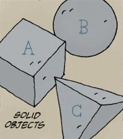

***The Magician and the Snake*** is an Eisner award winning collaboration between *Hellboy* creator, [Mike Mignola](/entry/Mike_Mignola), and his, at the time, seven-year-old daughter, [Katie Mignola](/entry/Katie_Mignola).

## Publication History

This short story was originally published in the pages of *Dark Horse Maverick: Happy Endings* in September 2002. The comic was later collected in *The Amazing Screw-On Head and Other Curious Objects* published by Dark Horse in September 2010. It was again collected in the [*Hellboy in Hell*](/entry/Hellboy_Library_Editions) library edition, and the [*Hellboy – Volume 4: Hellboy in Hell*](/entry/Omnibus_Editions) omnibus edition.

## Synopsis

The Magician reveals to his best friend, [the Snake](/entry/The_Snake), that he overextended himself by making three geometric shapes, the Solid Objects, disappear in order to be named "The Greatest Magician in the World" by a monkey king. However, he has not made the Solid Objects disappear permanently, and when they return the Magician will die. The Magician and the Snake spend their last years together enjoying themselves. Ultimately, the Solid Objects return and the Magician passes. He is mourned by his friend, the Snake.

## Story within a Story

Per [Mike Mignola](/entry/Mike_Mignola), *The Magician and the Snake* exists as a fairy tale within the Hellboy Universe.[1]

## Meaning of the Solid Objects

The_Solid_Objects.jpg

The meaning of the Solid Objects is deliberately left ambiguous and open to interpretation. However, in an interview with Le Commis des Comics, [Mignola](/entry/Mike_Mignola) did elaborate on what the Solid Objects mean to him:

*The Magician had made these shapes disappear and everyone said,*‘You’re a great magician.’*It’s like people saying to me,*‘You’re a great artist.’*Well, I don’t feel that I am a great artist. I feel like I get credit for being better than I am. So that’s the feeling that went into that. And the shapes coming back, it was sort of like somebody saying,*‘Y’know, you’re really not that good.’*Again, it’s a very complicated emotional thing, which is why those shapes are very important, because to me they’re something very personal about my own creative… thing.*[2]

## Connections to the Hellboy Universe

### Solid Objects

The Solid Objects that the Magician makes disappear show up in both *[Hellboy in Hell](/entry/Hellboy_in_Hell)* and *[B.P.R.D.: The Devil You Know](/entry/The_Devil_You_Know_%28story_cycle%29)*.

### Statue

A statue of the Magician, the Snake, and the Solid Objects is the final image of *The Magician and the Snake*. The same statue is seen in *[Hellboy in Hell](/entry/Hellboy_in_Hell)*.

### The Snake

The Snake shows up in *Hellboy in Hell* \#5 and [*B.P.R.D.The Devil You Know: Pandemonium* \#1](/entry/Pandemonium_%28story_arc%29).

## Connections to Other Mignola Works

In addition to connecting to books within the Hellboy Universe, *The Magician and the Snake* also connects to two other stories collected in *[The Amazing Screw-On Head and Other Curious Objects](/entry/The_Amazing_Screw-On_Head_and_Other_Curious_Objects)*.

### *The Prisoner of Mars*

[*How Doctor Snap Murdered Professor Cyclops and What Came of It* or *The Prisoner of Mars*](/entry/The_Prisoner_of_Mars) features an inn named "The Magician and the Snake" whose sign incorporates images of the Magican, the Snake, and the Solid Objects. The final image of the comic also features the Snake.

### *In the Chapel of Curious Objects*

*[In the Chapel of Curious Objects](/entry/In_the_Chapel_of_Curious_Objects)* features a miniature version of the statue seen at the end of *The Magician and the Snake*. The miniature statue is revealed to contain the Solid Objects.

## Awards

- 2003 "Best Short Story" Eisner Award

## References

<references />

## External Links

- [*Dark Horse Mavericks: Happy Endings* product page on DarkHorse.com](https://www.darkhorse.com/Books/11-975/Dark-Horse-Maverick-Happy-Endings%7C)
- [*The Amazing Screw-On Head and Other Curious Objects* product page on DarkHorse.com](https://www.darkhorse.com/Books/16-870/The-Amazing-Screw-On-Head-and-Other-Curious-Objects-hardcover-collection%7C)
- [Read *The Magician and the Snake* on io9.com](https://io9.gizmodo.com/5604593/this-comic-by-mike-mignola-and-his-daughter-is-the-most-heartwarming-thing-youll-read-all-day/%7C)

[1] <https://twitter.com/artofmmignola/status/1006527381354369024>

[2] <https://www.youtube.com/watch?v=jzgwcJ9fr3c>
