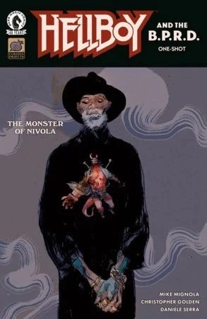

***The Monster of Nivola*** is a one-shot arc of *[Hellboy and the B.P.R.D.](/entry/Hellboy_and_the_B.P.R.D.)* written by Mike Mignola and Christopher Golden and illustrated by [Daniele Serra](/entry/Daniele_Serra) in his Hellboy Universe debut.

## Synopsis

Rumors of a monster bring Hellboy to a nearly abandoned town in Sardinia, where the search for the creature leads to a local abbey with a shocking secret of its own.

## Gallery

*Hellboy and the B.P.R.D.:  
The Monster of Nivola*  
by Daniele Serra

*Hellboy and the B.P.R.D.: The Monster of Nivola variant by Nicolas Nemiri*

|Hellboy and the B.P.R.D.: The Monster of Nivola variant by Nicolas Nemiri
