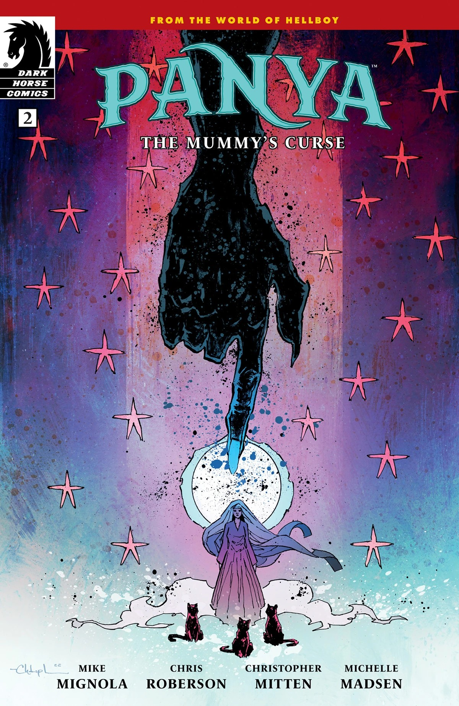
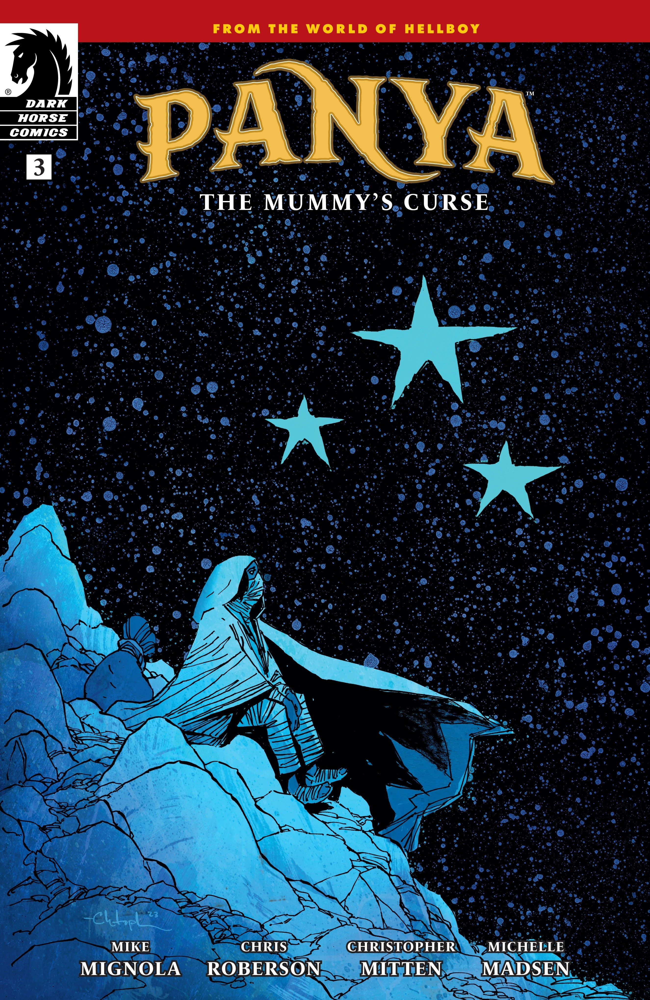
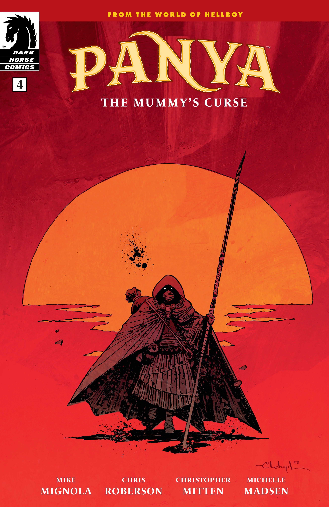

*This article is a stub. You can help Hellboy Wiki by expanding it.*

***The Mummy's Curse*** is an arc of *[Panya](/entry/Panya_(series))* written by Mike Mignola and Chris Roberson, and illustrated by Christopher Mitten.

## Synopsis

### Part One

Thousands of years before Hellboy, the B.P.R.D., and Ragna Rok, there was Panya. As a girl in ancient Egypt, she witnessed the fall of a dynasty and was gifted—or cursed—with visions of the beginning, the end, and the coming of the dragon...

### Part Two

Years after surviving a catastrophe that destroyed her home, Panya has settled into her life as a temple servant, but remains plagued by nightmares. . . or visions. Meanwhile, groups of traveling petitioners come to the temple bearing warnings of a of looming darkness that bears a worrying resemblance to Panya’s own dreams.

### Part Three

Panya scours the world in search of the truth behind her visions of an ancient city, the secret of her mysterious powers, and the voice that whispers for her to seek the light. But to find answers, she may first have to venture into the darkness...

### Part Four

Shrouded by shadow and touched by fire, Panya must come face-to-face with the dark in order to reveal the light.

## Gallery

All covers by Christopher Mitten.

*Panya:  
The Mummy's Curse* \#1

*Panya:  
The Mummy's Curse* \#2

*Panya:  
The Mummy's Curse* \#3

*Panya:  
The Mummy's Curse* \#4

|Panya: The Mummy's Curse #2

|Panya: The Mummy's Curse #3

|Panya: The Mummy's Curse #4
