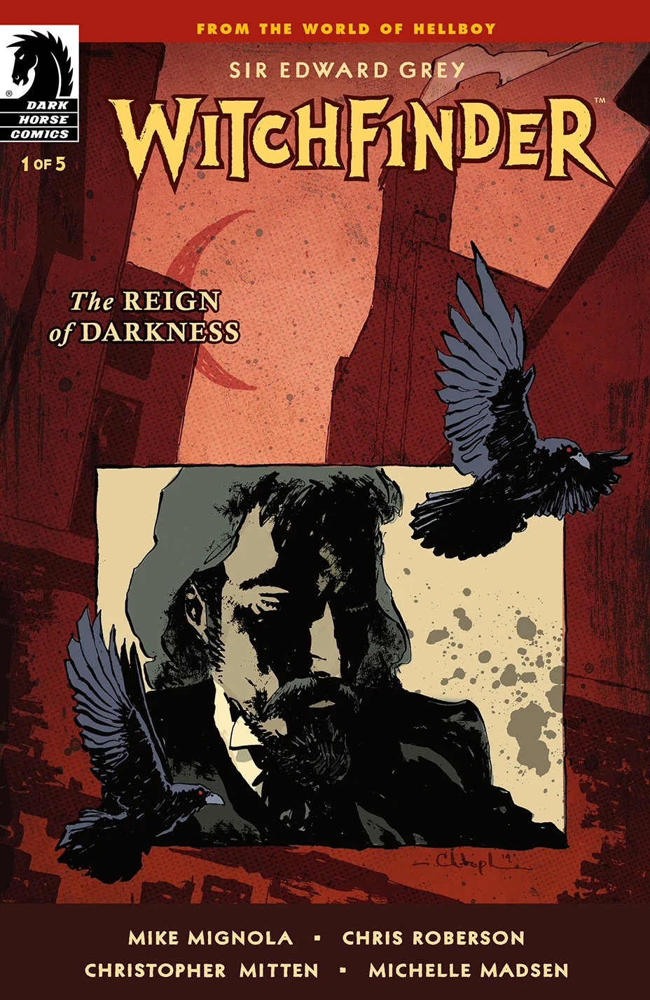
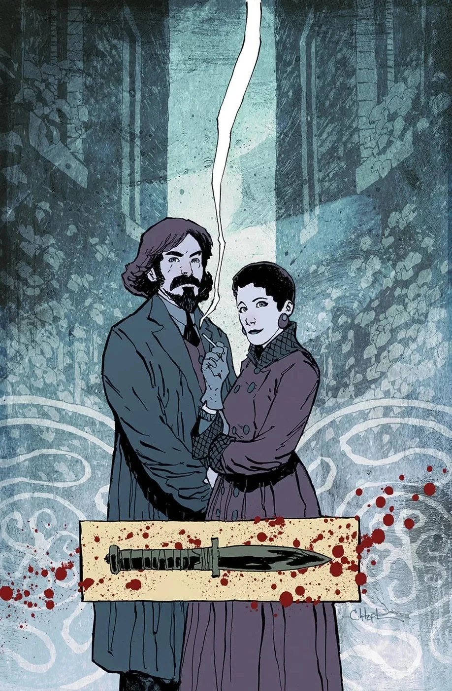
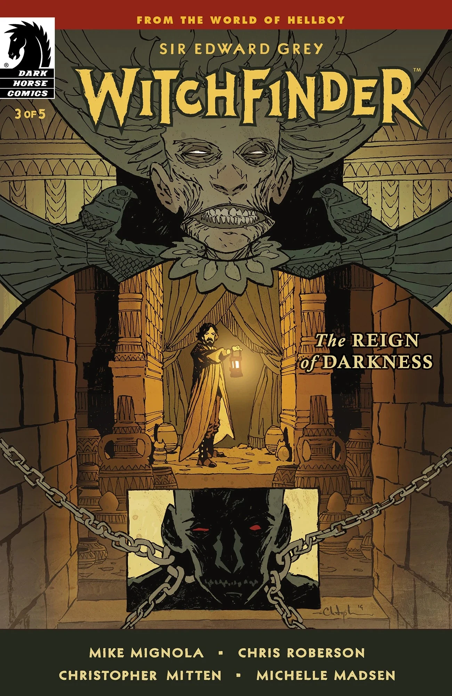
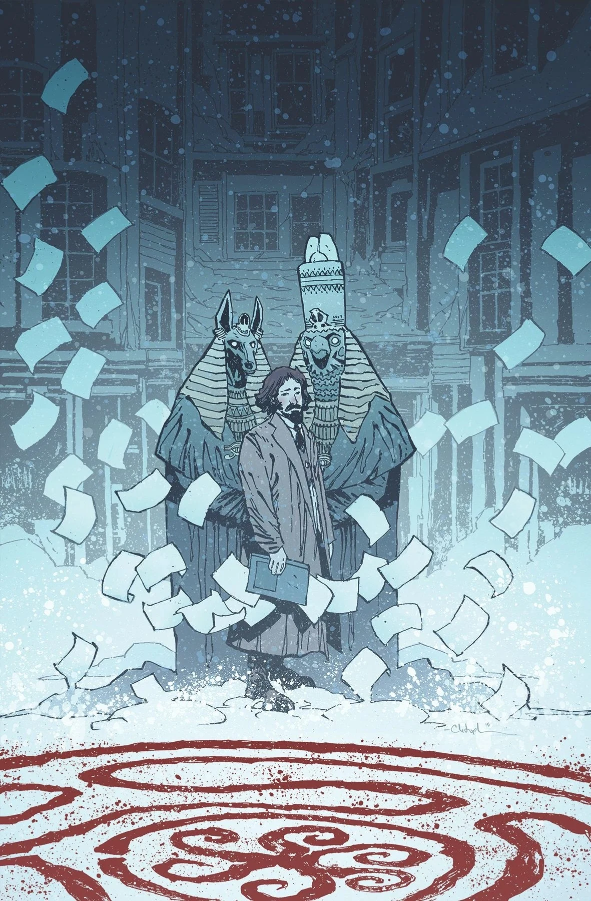
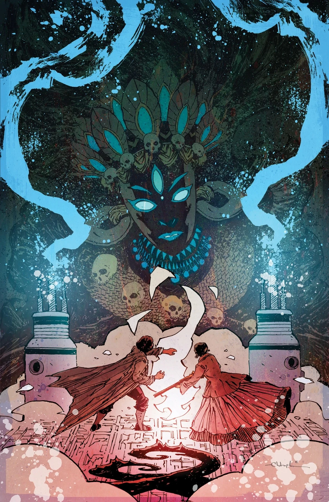

***The Reign of Darkness*** is a five-issue miniseries written by [Mike Mignola](/entry/Mike_Mignola) and [Chris Roberson](/entry/Chris_Roberson) with [Christopher Mitten](/entry/Christopher_Mitten) on art duties. It is set in 1888, and deals with the murders of [Jack the Ripper](/entry/Jack_the_Ripper).

## Synopsis

### Part One

Sir Edward Grey takes on London’s most famous serial killer! But he’s the only one who thinks Jack the Ripper’s murders have an occult purpose. When Scotland Yard turns its back on him, Grey finds an ally in American occult adventurer Sarah Jewell. But the forces allied against their investigation are more powerful than either one of them imagines!

### Part Two

A new suspect arises as the Witchfinder continues his investigation into the Ripper murders! But with his investigative integrity in question, that may be the last thing he needs. Meanwhile, Sarah Jewell’s attempts to infiltrate the mysterious Proserpine Home could reveal the true culprit—or put both her and Edward Grey in even more danger!

### Part Three

After consulting Panya about the Ripper case and Asquith’s suspicious connections with the Heliopic Brotherhood of Ra, the Witchfinder sneaks into the Brotherhood’s temple. But he’s completely unprepared for the informant he finds there! Meanwhile, a turn in Sarah Jewell’s undercover operation in Proserpine Home suddenly makes her search for the truth much more urgent.

### Part Four

With one of his closest confidants dead at the hands of the Heliopic Brotherhood, his home in a shambles, and his allies dwindling, the stakes are higher than ever for the Witchfinder. Pursuing the suspected sorcerer Gordon Asquith with a newfound desperation, Sir Edward Grey sinks further into danger even as Sarah Jewell creeps closer to answers in her undercover operation inside Proserpine Home.

### Part Five

Sir Edward Grey and Sarah Jewell prepare to face one of the darkest entities that either of them has ever encountered! Believing the killer has finally overplayed their hand, Grey may still be in for a surprise when he tries to take them down.

## Gallery

Covers by [Christopher Mitten](/entry/Christopher_Mitten).

|Issue #1

|Issue #2

|Issue #3

|Issue #4

|Issue #5
